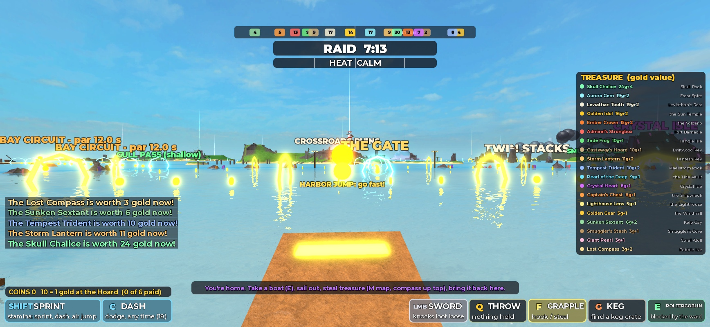
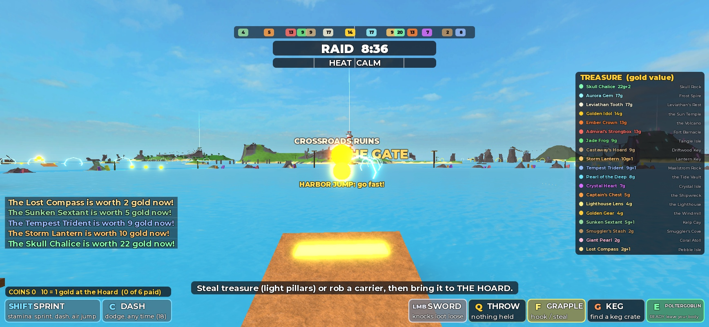
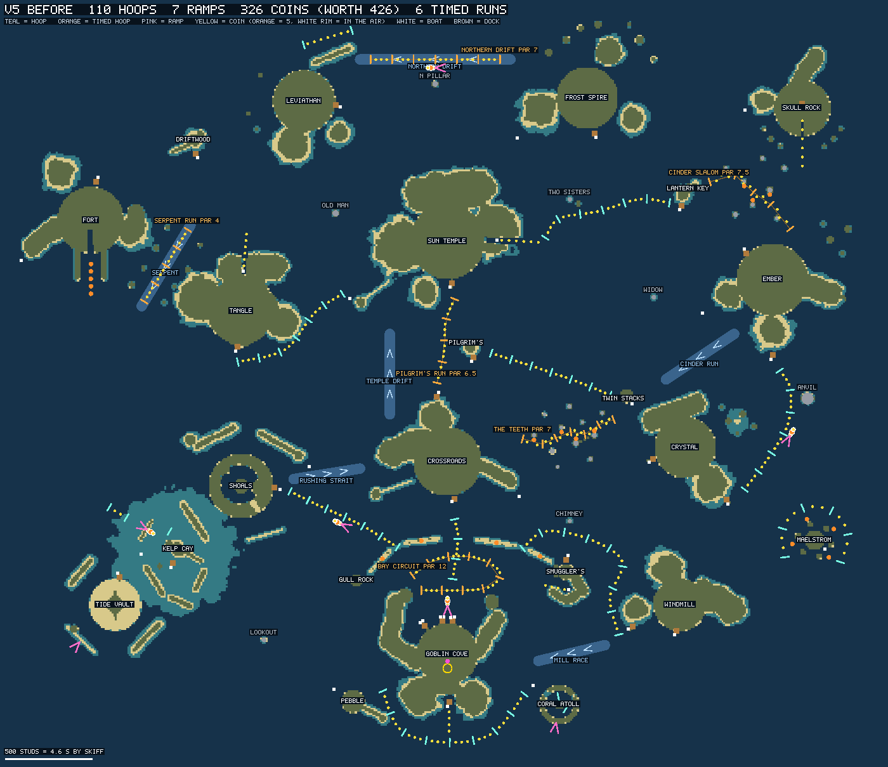
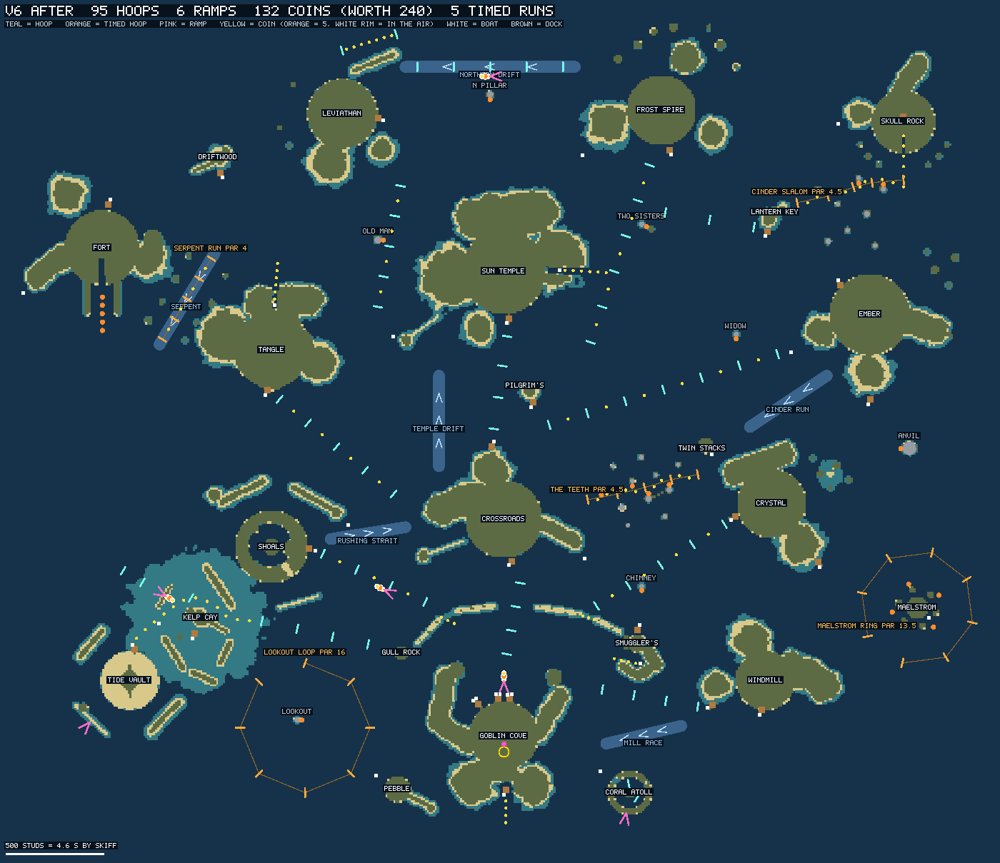
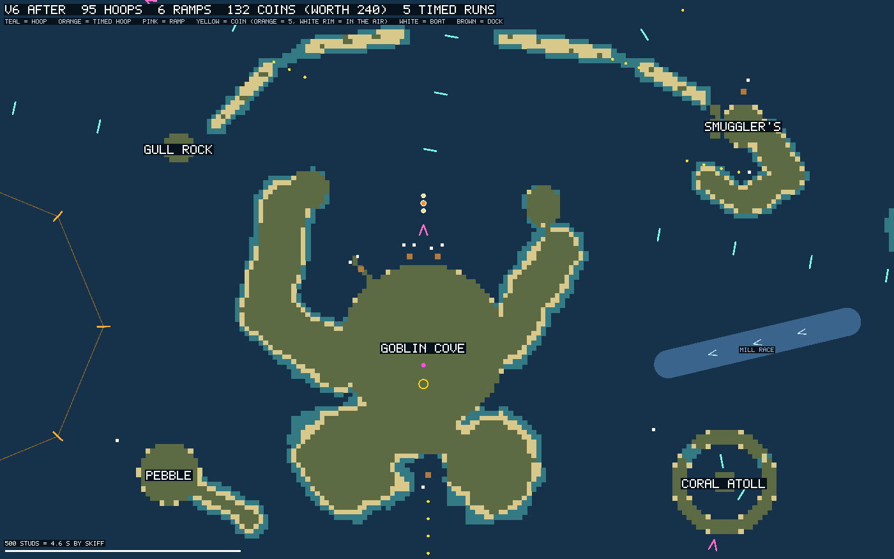
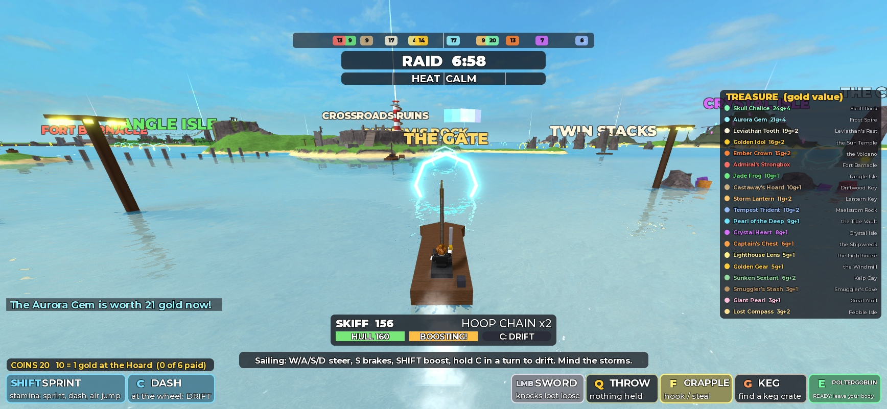

# Report: V6, ocean flow and sensory polish

| | |
| --- | --- |
| Date | 2026-10-12 |
| Request | Ninety's "V6 One-Shot: Ocean Flow & Sensory Polish" prompt |
| Agent | Claude Code (Opus 5.5), local session on Ninety's machine with Roblox Studio MCP |
| Branch | `feature/v6-ocean-flow-audio`, **stacked on** PR #13's branch `feature/v5-living-threats-playful-seas` (then #12, #11, #10, #9) |
| Pull request | [#14](https://github.com/EnrikR2002/Loot-Goblins/pull/14), base branch is `feature/v5-living-threats-playful-seas` |
| Merge status | **Not merged.** Nothing was merged, including PRs #9 to #13. Needs a human playtest and explicit approval. |

## 1. Summary

The V5 playtest said the map, the boats and the creatures are right, the things to do at sea are fun but badly placed, and there have been explosions in the distance since V2. V6 adds no system. It lays the sea out again and fixes the sound.

- **The sea was laid out again by a few rules** (section 3). 95 hoops (V5: 110), 132 coins (V5: 326), 6 ramps (7), 5 timed courses (6).
- **Home Bay is calm.** Within 300 studs of the harbor mouth there were 12 hoops and 34 coins. There are 3 and 3. One line of hoops runs from the harbor through the Gate to the Crossroads.
- **Lanes are straight and point at docks.** Thirteen of them. The ones that hooked round islands are gone. The western sea, which had 5 hoops, has 14.
- **Every lane and course was driven** by an autopilot using the game's own boat physics, at full hoop-chain speed, and changed until it could be followed. That found real faults: V5's two slaloms could not be threaded at speed, and a lap has to be much wider than V5's.
- **Par times are measured**, not guessed.
- **The distant explosions were thunder.** Every lightning bolt of every storm played a boom to every player, in their ears, never quieter than 15% volume. Standing at home with three storms 1,600 to 2,900 studs away: **31 booms in 38 seconds**. In V6, same place, storms that far away: **none**. A storm that actually comes near is still heard, and loudly at the strike.
- **Signs only show when they are really in range**, which takes about ten far-off island names off the horizon at home.

Tested in Studio by one AI on one client. **Nobody has played V6**, and I cannot hear: the sound was checked from logs of what was played, where, and how loud by the falloff formula. Section 12 says exactly what was and was not verified.

## 2. What was wrong with V5's arrangement

Looked at in Studio and on an overhead map drawn from the running game (every hoop, coin and boat, over a 10-stud survey of the coastline).

1. **A quarter of everything was in Home Bay.** 27 of 110 hoops and 80 of 326 coins, in the smallest region. The Bay Circuit's ten orange hoops sat across the harbor mouth, the Gate Run ran through the middle of them, four big coins glowed on the reef, and the signs for all of it overlapped. From the harbor ramp it was a wall.
2. **Lanes hooked round islands.** The Back Door Arc looped round the south of home. The Mill Run went north round Smuggler's Cove and then S-bent down a strait. The Ember Reach curled right round Crystal Isle. The Lantern Line and Tangle Lane had doglegs. A hoop every 120 studs made each bend a string of small course corrections.
3. **The western sea had almost nothing:** 5 hoops and 9 coins.
4. **The slaloms had never been driven, and could not be.** Driven at speed in V6's first test, a boat on the Teeth (seven gates 80 to 120 studs apart, sidestepping 25 to 55 studs between them) missed the third and fourth gates by 49 and 32 studs and hit a stack. The Cinder Slalom had a sea stack on the straight line between its second and third hoops, and ended at an empty shore.
5. **Nothing told one thing from another.** Lane hoops, course hoops and coins were everywhere at the same density.
6. **Salvage crates were dropped on top of random coins**, which put them inside slaloms, in the fort's harbor and in the bay.
7. **Thunder** (section 9).
8. **Signs showed from much farther than intended** (section 8).

## 3. The layout strategy

Four rules, written at the top of `src/server/Searuns.lua` so the next person keeps them.

- **A teal hoop is a lane.** It points at a dock across open water. It is straight unless there is a reason to bend. Hoops stand about 190 studs apart (V5: 120): far enough apart to see past, close enough to chain (a chain lasts 4 seconds; at 150 studs a second that is 600 studs). A small sign at each end says where it goes, readable only from close by.
- **An orange hoop is a timed course**: a run threaded through sea stacks, a sprint down a current, or a lap round a landmark. These are places to go and play, set apart from the lanes.
- **A coin marks a line worth taking**: a weave through a course, a stack to hug, the air over a ramp, the way into somewhere hidden. A few long lanes carry one coin between hoops. Coins never just fill water.
- **Some water is left alone.** Home Bay has one line out. The fort's water, the skull's, the east beyond Crystal Isle and the south of home have no lanes, so that they stay quiet.

One more rule came out of the driving tests and matters for anyone adding a hoop:

- **A hoop chain holds a skiff at 150 to 175 studs a second, and at that speed it barely steers.** It needs about 180 studs of radius to turn, and its course lags its bow by a moment. Measured: a boat stayed on a course whose line bent 8 degrees at a gate and left one that bent 24. So a line of hoops must hardly bend (10 degrees a gate at most, at 150 studs apart), a lap needs a radius of about 300, and **where the way really twists, do not use hoops at all**: use coins, which show the way and leave the speed to the pilot.

## 4. Hoops and coins, before and after

| | V5 | V6 |
| --- | --- | --- |
| Hoops | 110 | 95 |
| Ramps | 7 | 6 |
| Coins | 326 (worth 426) | 132 (worth 240) |
| Timed courses | 6 | 5 |
| Hoops within 300 studs of the harbor mouth | 12 | 3 |
| Coins within 300 studs of the harbor mouth | 34 | 3 |
| Hoops within 500 studs | 17 | 4 |
| Coins within 500 studs | 45 | 8 |
| Hoops within 700 studs | 20 | 10 |
| Coins within 700 studs | 61 | 15 |

By region (counted from the running game; the regions are rough boxes):

| Region | Hoops V5 | Hoops V6 | Coins V5 | Coins V6 |
| --- | --- | --- | --- | --- |
| Home Bay, with the water east to Smuggler's Cove and south to Pebble and Coral | 27 | 11 | 80 | 17 |
| The Crossing | 14 | 13 | 44 | 21 |
| Western Shallows and the water south of them | 5 | 14 | 9 | 17 |
| Eastern Reach | 17 | 12 | 43 | 6 |
| Navy Waters | 12 | 12 | 41 | 22 |
| The Long Reach and the temple's water | 11 | 11 | 35 | 12 |
| East of the Long Reach and the Cinders | 13 | 7 | 36 | 7 |
| The far north | 11 | 15 | 38 | 30 |

(Of Home Bay's 11: three are inside Coral Atoll's lagoon as before, three are the Gate Run inside the reef, four are the Mill Run east of the harbor's arm, and one is the first hoop of the Tide Run beyond Gull Rock.)

The count went down by 15 hoops. That was not a target: wider spacing needs fewer hoops for the same distance, and the lanes are longer than V5's.

Where the 132 coins are:

| | Coins |
| --- | --- |
| In the air over four ramps (the middle one of each is worth 5) | 12 |
| One between hoops on six long lanes | 26 |
| Weaving through the Teeth and the Cinder Slalom, and big ones hugging their stacks | 23 |
| On the Serpent Run | 4 |
| Big coins inside the Maelstrom Ring, where the water pulls | 4 |
| Trails into places: the Back Door, Smuggler's lagoon, the two shallow passes through the reef, the temple's river, Tangle's hidden river, the skull's mouth, under Leviathan's ribs, the fort's harbor, the channel across the shelf to the Tide Vault | 56 |
| One big coin at each lone rock (and between the Two Sisters) | 7 |

## 5. The lanes

Each was driven both ways by the autopilot (section 12) at full chain. "Time" is from first hoop to last.

| Lane | From, to | Hoops | Studs | Coins | Time | What changed from V5 |
| --- | --- | --- | --- | --- | --- | --- |
| **Gate Run** | The harbor, through the Gate, to the Crossroads' south dock | 4 | 368 | 0 | 2.4 s | Dead straight through the middle of the Gate. No longer runs through a circuit. No coins: the bay is calm. |
| **West Run** | Outside Gull Pass to Shipwreck Shoals' dock | 4 | 575 | 3 | 3.8 s | Straight. Starts outside the reef. The West Jump is still beside it. |
| **Mill Run** | East out of the bay, south of Smuggler's Cove, to Windmill Hills' west dock | 4 | 493 | 0 | 3.2 s | V5 went north round Smuggler's Cove and S-bent down the strait. Now a straight line. The Mill Race current, just south, is the way back. |
| **Chimney Run** | Smuggler's Gap, past the Chimney, to Crystal Isle's west dock | 5 | 771 | 4 | 5.2 s | New. |
| **Temple Run** | The Crossroads' north dock, past Pilgrim's Rock, to the temple's dock | 4 | 475 | 0 | 3.2 s | Was the timed "Pilgrim's Run". It is the main way north, so it is a lane now. |
| **Ember Road** | North of the Crossroads across the open reach to Ember Isle's west beach | 7 | 1215 | 6 | 7.8 s | New. The long one: nothing in the way, a chain of 6, top speed 175. Replaces the Reach Run and the Ember Reach. |
| **Frost Road** | The temple's east coast, past the Two Sisters, to Frost Spire | 6 | 949 | 5 | 6.1 s | New. One straight line laid 60 studs west of the Sisters. |
| **Lantern Line** | North of the Two Sisters to Lantern Key | 3 | 456 | 0 | 3.0 s | Was a dogleg from the temple's river. Now branches off the Frost Road. |
| **Tangle Lane** | West of the Crossroads to Tangle Isle's dock | 5 | 753 | 4 | 4.9 s | Was a hook round Tangle's south-east. Straight. |
| **Leviathan Road** | Between Tangle Isle and the temple, past the Old Man, toward Leviathan's Rest | 5 | 626 | 4 | 4.1 s | New. Stops 300 studs short of the dock on purpose (see below). |
| **Northern Drift** | Frost Spire to Leviathan's Rest along the top of the map | 5 | 740 | 0 | 4.5 s with the current, 5.2 against | Was timed. It is the way across the top, so it is a lane. The Drift Jump is still beside it. |
| **Tide Run** | West of Gull Rock to the edge of the Western Shelf | 4 | 553 | 0 | 3.6 s | New. Then 12 coins show the channel across the shelf to the Tide Vault's pier. |
| **Shelf Hop** | Two hoops, the Sandbar Jump, one hoop | 3 | | 3 in the air | not flown | As V5. |

Removed: the **Back Door Arc** (a loop round an island is not a way to anywhere; its four coins up the Back Door cove stay), the **Reach Run**, the **Ember Reach** and its Anvil Jump.

Three decisions worth knowing about:

- **The Leviathan Road stops short.** Its first draft ended 50 studs from the Sleeper, which wakes to fast boats. A lane must not carry a boat at 170 studs a second onto an island's threat, so it ends outside the Sleeper's hearing and the last 300 studs are the pilot's to judge.
- **The Tide Run's hoops stop at the shelf.** The way on winds between sandbars with turns of 30 to 50 degrees. Hoops there would throw boats at the bars. Coins mark the channel instead.
- **No lane goes to Fort Barnacle, Skull Rock, Driftwood Key or Maelstrom Rock.** The fort has the Serpent Run past it, the skull has the Cinder Slalom to its mouth, the Maelstrom has its ring. Their water is otherwise empty.

## 6. The timed courses

| Course | Kind | Hoops | Studs | Measured | Par | From V5 |
| --- | --- | --- | --- | --- | --- | --- |
| **The Teeth** | A run threaded through the stacks east of the Crossroads | 5 | 575 | 3.7 s, both ways | 4.5 s | Redesigned. Seven gates became five on a line that hardly bends, with a stack close on alternate sides. |
| **Cinder Slalom** | From Lantern Key through the basalt stacks to the mouth of Skull Rock | 5 | 555 | 3.6 to 3.8 s | 4.5 s | Redesigned and re-aimed: it now arrives at the coin trail into the skull's mouth. |
| **Serpent Run** | A sprint down the channel between Tangle Isle and the fort | 5 | 480 | 2.9 s with the current, 3.3 against | 4.0 s | Kept as it was. |
| **Lookout Loop** | A lap round Lookout Stack, in open water west of home | 8 | 2058 | 13.3 to 13.8 s a lap | 16 s | New. Replaces the Bay Circuit, out of the harbor's view. Radius 330: the widest turn in the sea. |
| **Maelstrom Ring** | A lap round the outside of the whirlpool | 8 | 1808 | 11.5 to 11.7 s a flying lap | 13.5 s | V5's untimed "Maelstrom Sling" at radius 195 became a timed lap at radius 290. Four big coins are inside it. |

Removed as timed courses: the **Bay Circuit** (replaced), **Pilgrim's Run** and the **Northern Drift** (both lanes now).

**How par was set.** The autopilot drove each course at full chain. Par is its clean time plus 15 to 20 percent, rounded to half a second. A boat that arrives slowly, or misses hoops, will not beat it; one that holds the chain will.

**Laps are new.** A lap starts and ends at its first hoop (the one with the sign), goes either way round, and wants the other seven hoops in order. The clock keeps running, so every lap after the first is a flying lap. Crossing the line again with hoops missed voids that lap and starts a new one. `Coins.lua` holds the logic.

**Rewards are unchanged:** 6 coins for finishing a course once a raid, 10 more the first time under par, the best time and name on the sign.

## 7. Collectibles and reward balance

- **Rates are unchanged.** Ten coins are 1 gold at the Hoard, at most 6 gold a raid. A coin takes half a second off the boost cooldown and patches 1.5 hull. A taken coin comes back after 80 seconds.
- **There is much less to farm.** All the coins in the sea are worth 240, four times one goblin's cap (V5: seven times). Everything within reach of home without leaving the bay is worth 21: the harbor jump, the two passes, the Back Door and Smuggler's lagoon.
- **Coins are now mostly earned.** 27 of the 132 are the big ones, and every big one asks for something: a stack to scrape past, the middle of a jump, the inside of the whirlpool, the fort's harbor.
- **Salvage** is the same crate (8 coins, a keg, 60 hull, a boost refill; four adrift a raid). It is now set adrift 45 to 70 studs to one side of a lane, in deep water: in sight of a boat on the lane, never on its line, and never beside the Gate Run or the Shelf Hop.

I did not change the cap, the rates or any treasure value. With a third of the coins, the cap is harder to reach than it was. Whether coins still feel worth taking is a question for the playtest.

## 8. The view from spawn, and signs

- From the harbor ramp a goblin now sees the water, the reef, the Gate's two posts with one line of hoops through them, the harbor jump's three coins, and the Crossroads beyond. The pictures in section 1 are the same camera in both versions.
- **Signs.** A floating sign has a maximum distance. Roblox measures it along the camera's line of sight, not to the sign, so anything far off to one side still showed. From the harbor a dozen island names stood on the horizon, most of them islands 1,800 studs away or more. The client now hides any sign that is really out of range (`Main.client.lua`; the server tags the signs). At the Hoard that leaves the four near islands, the Crossroads and Windmill Hills.
- "THE GATE" sits lower, between its posts, so it no longer covers the Crossroads' name. The Gate Run has no lane signs, because those two names already stand on its line.
- **Not changed:** treasure tags still show across the map, by design.

## 9. The distant explosions

### The source

`Effects.bolt` in the client, unchanged since V2. For every lightning strike it played the boom sound:

- **as an interface sound**, with no position, so it could not fade with distance or come from a direction;
- **at a volume that never went below 0.15**, however far away the strike was;
- **on every client**, because the server sent every strike to everyone.

With three storms out (the usual number since V4) that is a boom every 1.2 seconds, for everyone, all raid. On V2 and V3's smaller maps the storms were closer, and the same formula gives 0.3 to 0.9 within 1,000 studs.

Two smaller faults in the same code:

- **World sounds never faded out.** They used Roblox's default rolloff, which gets quieter with distance but never reaches silence and then cuts off dead at the maximum distance.
- **Each strike made three sounds** (the marker's blip, an explosion boom, and the thunder), and every client built all of it, with the bolt and the marker's parts, for strikes thousands of studs away.

### What changed

| | V5 | V6 |
| --- | --- | --- |
| Thunder | Interface sound. Volume `clamp(1 - distance / 1500, 0.15, 0.9)`. | A world sound at the strike. Full volume within 150 studs, silent at 900, not played at all beyond. Muffled with distance (an equalizer takes up to 30 dB off the treble). Still arrives late, by distance. |
| Every world sound | Default rolloff (`Inverse`), full volume within 15 studs, cut off at its range | `InverseTapered`: the same loudness close by, fading to silence at its range. Not played at all beyond it, or when it would be inaudible. |
| A blast (keg, shell, cannonball) | Full within 15, cut off at 350 | Full within 20, silent at 600 |
| Lightning's explosion boom | Played as well as the thunder | Not played: the thunder is its sound |
| Many blasts at once | All played | At most 3 of one sound within 0.3 s, unless a new one is louder than those. A compressor on the world's sound group (threshold -14 dB, ratio 6) holds down what does overlap. |
| Who is sent a strike | Everyone | Goblins within 1,200 studs (2,000 for the bolt itself). `Net.broadcastNear`, used by `Blast.lua`. |
| What a client draws | Everything | A danger marker or a blast within 900 studs, a bolt within 1,800 |
| The sky's flash | Full, for every strike anywhere | Full within 300 studs, fading to nothing at 1,400 |

Numbers are in `Config.AUDIO`. Nothing about storms, lightning, the Navy or any damage changed.

**Also fixed:** the sky's flash restored whatever colour it found, so two bolts within a tenth of a second could leave the world brightly lit for good.

How loud, by the falloff formula (1 is full volume):

| Distance from the strike | Thunder, V5 | Thunder, V6 |
| --- | --- | --- |
| 150 studs | 0.90, in your ears | 1.00, from the strike |
| 250 | 0.83 | 0.45 |
| 350 | 0.77 | 0.23 |
| 500 | 0.67 | 0.09 |
| 650 | 0.57 | 0.03 |
| 800 | 0.47 | not played |
| 1,300 and beyond | 0.15, for ever | not played |

### What I measured

I cannot hear. A logger on the client recorded every sound the game created: which file, interface or world, its settings, and how far it was from the camera.

**Before (V5 build).** Standing at the Hoard, three storms 1,600 to 2,900 studs away, 38 seconds:

- 31 thunder sounds, every one an interface sound at volume 0.15.
- 31 marker blips and 31 explosion booms were also created, 1,600 to 2,900 studs away. They were beyond their ranges and inaudible, but every client built them.

**After (V6 build).** Same place, 38 seconds, with three storms set 2,400 to 3,000 studs away and one that drifted past 230 to 750 studs from the Hoard on its own:

- No interface sounds.
- 11 thunder sounds, all from the storm that was near, each at its strike, with loudness by the formula from 0.01 (745 studs) to 0.51 (233 studs) and the treble cut by 7 to 30 dB.
- Nothing from the three far storms. The client was not sent their strikes: it received 11 bolts in that time, the near storm's.

**Inside a storm.** A strike on the goblin: the marker's blip, then thunder at full volume 1.3 seconds later, and no second boom. A strike 234 studs away: 0.5.

**A pile-up.** Six blasts at once, 51 studs away: three booms were played.

**Blasts by distance** (logged with the first setting, full within 15 and silent at 350): played at 36, 71, 131 and 211 studs (0.29, 0.12, 0.04, 0.01), not played at 311 or 411, and one 1,500 studs away was never sent. I then let blasts carry to 600 studs so that one 300 studs off is still faintly heard, and **did not log that final setting.**

### What I cannot say

Whether it sounds right. The loudness figures are the formula, not a measurement of what comes out of the speakers. A person needs to stand in a storm, near one, and at home, and listen.

## 10. Performance

Same machine as the earlier reports. V6 adds no simulation: a lap check in the run timer, a distance check when a blast is sent, and a sign check on the client every 0.4 seconds.

| | V5 | V6 |
| --- | --- | --- |
| Start-up to world ready | 5.7 to 6.8 s | 5.6 to 6.6 s |
| Generated parts | 5,677 | 5,382 |
| Instances | 52,397 | 52,138 |
| Server, a goblin sailing | 60.0 fps, 0.8 to 0.85 ms of script a frame | 60.0 fps, 0.64 to 0.98 ms, no frame over 20 ms in 6 s |

**Client frame rate, measured for the first time since V2.** Studio's window was in front this time, so the client was not capped.

- At the Crossroads' south dock: **60.0 fps, worst frame 18 ms, no frame over 20 ms in 5 seconds**, with 6,756 instances of the world streamed in (V5's reading there was about 7,500).
- At the Lookout Loop: 60.0 fps, worst frame 18 ms, 6,686 instances.

That is one client on a desktop with nothing happening near it. It says nothing about a phone, a busy scene or four players.

**Not measured in V6:** the demanding scene from the V5 report (FRENZY, two patrol ships, a storm, every creature awake), and memory.

## 11. How it was designed and tested

Worth recording, because it is why this layout is not just another formula.

1. **A survey.** A test command raycast the whole sea on a 10-stud grid (223,000 rays, 1.9 seconds) and classed each cell: land, too shallow for a skiff, skiff and cutter only, deep.
2. **A map.** A small script drew that survey with every hoop, coin, boat, dock, rock and current over it. The before and after pictures in this report are its output, drawn from the running game.
3. **A drawing board.** The same curve maths as `Searuns.lua`, in a script, so a layout could be drawn and checked against the survey (every hoop, every coin, and the water between each pair of hoops) in a second, without starting the game.
4. **The game.** Each layout was built in Studio and the two were compared: all 101 gates and 132 coins within 2.8 studs of the drawing.
5. **An autopilot.** A test command seats the goblin in a skiff and has the server drive it through a lane's hoops with the game's own boat physics: full throttle, steering at a point a little ahead along the course, boosting on the straights, drifting when a turn is sharp. It reports the time, the top speed, the chain, hull lost, and how far it passed from each hoop.
6. **Change, and drive again.** Four layouts were built. Section 13 lists what the driving found.

None of those tools is in the repository (they need a temporary test script and a loopback helper, as in earlier versions). `docs/AI_CONTEXT.md` describes the method.

## 12. Tests performed, and their limits

### Limits that apply to everything below

- **Nobody has played V6.** I can say a boat can follow these lanes. I cannot say they are fun.
- **An autopilot is not a person.** It holds the throttle down and never gets bored, lost or surprised. It is a fair test of "can this be followed at speed" and no test at all of "is this clear" or "is this enjoyable".
- **One AI, one client.** Nothing between two players was exercised.
- **I cannot hear.** Section 9.
- No mobile, gamepad, touch or real-latency test.

### Verified working

- **The world** built with an empty console on each of about ten runs. The machine checks passed on the final build: every treasure spot on its island, all 43 boats over at least 3.2 studs of water, all 11 ziplines clear, no coin on land, no hoop over water too shallow for a skiff.
- **Every lane, both ways** (the table in section 5): every hoop passed within 11 studs, no hull lost, chains of 2 to 6.
- **Every timed course** (the table in section 6): finished, recorded by the game, best time and name written on the sign, coins paid (28 for a first run of the Teeth under par, with the coins along it).
- **Laps:** both rings completed clean laps in both directions and the game recorded them (Maelstrom 11.5 s, Lookout 13.4 s). A chain of 20 hoops was held round the Maelstrom Ring.
- **A goblin's own hands on the wheel:** with the driver's own client simulating the boat and the W key held, the skiff took the Gate Run at 156 studs a second and the HUD showed "HOOP CHAIN x2" (picture below). Nothing was steered.
- **Coins and the purse:** coins collected at 170 studs a second on every lane that has them; 10 coins became 1 gold at the Hoard.
- **A theft and an escape:** took the Lighthouse Lens (Heat +16; the four Watchers left their plinths), raised Heat to HUNTED, and drove the Ember Road as a carrier: 8.1 seconds against 7.9 empty, a chain of 6, with a patrol ship called out and 746 studs behind at the end. Then banked it: 7 gold with interest.
- **A raid ending and starting again:** every coin back, the purse empty, four crates adrift beside lanes, Heat and storms cleared, creatures home.
- **Creatures:** all 21 registered, and one awake with a goblin at home, as in V5.
- **Sound:** section 9.
- **Signs:** read once, just before the goblin spawned (the camera was still 500 studs below the island): 5 island names shown, 17 hidden, and every far sea sign hidden. From the Hoard itself Windmill Hills is in range too, by its distance. The harbor picture in section 1 shows the result: three signs where there were nine.

### Not verified

- **Whether any of it is clearer or more fun to a person.**
- **Anything with two players.**
- **Any ramp.** The harbor jump, the West Jump, the Drift Jump and the Sandbar Jump were not flown in V6. Three of them did not move; the Sandbar Jump's approach is as V5 tested it.
- **The coin trail across the shelf** to the Tide Vault's pier. It was checked against the survey, not driven.
- **Laps by hand.** The autopilot's laps were not all clean: on the Lookout Loop about two in five were, the rest missed a hoop by 20 to 40 studs at full chain. A lap is meant to take some care, but whether 330 studs of radius is forgiving enough for "the one to learn on" is a guess.
- **The escape** used a test command to raise Heat, and I teleported to the Hoard to bank. The patrol ship never caught up, so nothing about being shot at on a lane was seen.
- **The final blast range** by log, and **every sound by ear.**
- **The demanding scene** for performance.
- **The creatures**, beyond the Watchers waking. V6 did not touch them.
- V5's unverified list still stands.

## 13. Bugs found and fixed

In V5's code:

1. **Thunder played to everyone, everywhere, in their ears.** Section 9.
2. **World sounds cut off instead of fading out.**
3. **Two bolts close together could leave the sky lit.**
4. **The Teeth could not be threaded at speed**, and **the Cinder Slalom had a stack on its line.** Section 6.
5. **Salvage crates were dropped onto coins.**
6. **Signs showed from far beyond their range.** Section 8.

In my own V6 drafts, found by driving them:

7. **Laps at radius 190 could not be held.** The autopilot missed half the hoops. 290 can be held; the learner's lap is 330.
8. **The first Tide Run** put hoops through the bends between sandbars.
9. **The first Leviathan Road** ended on top of the Sleeper.
10. **The first Lantern Line** started directly behind the Two Sisters as seen from the Frost Road. A boat turning onto it drove into the rock.
11. **The Frost Road, the first Leviathan Road and the Gate Run had kinks** of 17 to 19 degrees that threw a boat 20 to 120 studs wide of the next hoop. All three are straight lines now.
12. **A wrong property name** in the new sound code stopped the client loading on the first run.
13. **A missed hoop made a lap last two laps** (the clock ran until the hoop was finally taken). Crossing the line now starts a new lap.

## 14. Remaining limitations

- **Everything in "Not verified".**
- **One coin between hoops on six lanes** may read as too few to mean anything. It is there to top up the boost on a long haul.
- **The lane signs** ("TO EMBER ISLE") are new and unjudged.
- **A sign at the very edge of its range** can blink as the check runs every 0.4 seconds.
- **The two rings are large** (580 and 660 studs across) and sit in open water. They are the biggest single things on the map.
- **The harbor jump's three coins** are the brightest thing in the harbor view. That is deliberate (jump, hoop, Gate) but it is bright.
- **The creatures, treasure values, Heat and the Navy are as V5 left them**, with V5's known issues.
- **The map's regions and the "THE LONG REACH" label** are unchanged.

## 15. Human playtest instructions

Run **Test > Server & Clients > 4 players > Play** if you can. Press `H` first.

**The first minute:**

1. **Stand on the harbor ramp and look out.** Can you tell where to go? Is anything still in the way?
2. **Take the harbor jump and the Gate Run.** Does the line read: jump, hoop, Gate, Crossroads?

**Lanes:**

3. **From the Crossroads' north dock, take the Ember Road.** It is the long one. Can you hold the chain to the end? Is it too easy, too empty, about right?
4. **Go west:** the West Run to the Shoals, or the Tide Run and then follow the coins across the shelf. Could you follow the coins without hitting a sandbar?
5. **Go east:** the Mill Run or the Chimney Run. Did either point somewhere you did not expect?
6. **Anywhere:** did a lane ever throw you at something? Did you ever want a lane and not find one?

**Courses:**

7. **The Lookout Loop** (west of home, orange). Do a few laps. Can you hold it? What time against par 16?
8. **The Teeth** (east of the Crossroads). Is going through the stacks that fast exciting, or just a straight line?
9. **Race someone** round the Maelstrom Ring.

**Coins:**

10. **Did you bother with coins?** Which ones? Did you find a trail that led somewhere?

**Sound. This is the part I could not check:**

11. **Stand at home while a storm is far away.** Any booms?
12. **Sail toward a storm.** Do you hear it before you reach it? Does it get louder? Can you tell which way it is?
13. **Sit inside one.** Is the thunder as dramatic as before?
14. **Throw a keg, fire a cannon, watch a patrol ship shell someone from 200 studs off.** Do those still sound right? Too quiet at a distance?

**With others:**

15. **Did you meet each other on the lanes?**
16. **Carry treasure home down a lane with a patrol ship after you.**

**What I most want to know:** whether the harbor view is now clear or now empty; whether straight lanes are better or duller; and whether the explosions are gone.

## 16. Recommended next priorities

1. **Play it**, with the sound up.
2. **Tune by ear**: thunder's range, how far a blast carries.
3. **The laps**: radius, and whether they are worth their size.
4. **Creature polish**, which V6 left alone as asked.
5. **A demanding-scene performance check** now that the client's frame rate can be read.
6. Still open from before: touch controls; two-player behaviour of the Watchers and the Echo.

## 17. Branch, commits, PR

- Branch `feature/v6-ocean-flow-audio`, created from `origin/feature/v5-living-threats-playful-seas` at `1de020b`.
- Pull request: [#14](https://github.com/EnrikR2002/Loot-Goblins/pull/14), base `feature/v5-living-threats-playful-seas`. **Merge order: #9, #10, #11, #12, #13, then this.**
- **Nothing was merged.** No force-push. `main` is untouched.
- `./scripts/check.ps1` passes (formatting, lint, Rojo build, whitespace).
- Studio was left in Edit mode with the temporary test script removed and `HttpService.HttpEnabled` off. The open place has script edits that are not saved; they are all in this branch.
