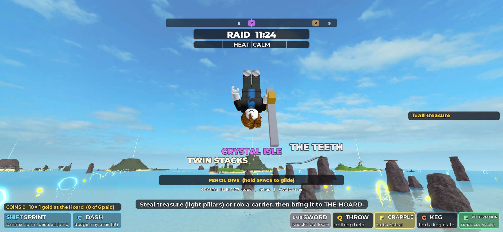

# V7: Skyfall and the competitive archipelago (October 13, 2026)

Branch `feature/v7-skyfall-competitive-archipelago`, cut from `origin/main` at `92c5e7d` (V6 had already been merged: PR #14 at `ef315ff`, with the Skull Chalice repair). PR against `main`; **not merged**. Built by Claude (Sonnet 5.5) in one autonomous session from the V7 one-shot prompt after the first multiplayer playtest of V6.

**Everything below was tested by one AI on one Studio client.** That includes everything about "multiplayer": see section 22. Nothing here has been played by a person. Where a thing is only code, it says so.

## 0. Plan and what was decided

Order of work: foundation (round length, map, routes), boats, fighting, skyship, world systems (alerts, gear, Leviathan), progression, interface, then tests and this report. The prompt asks for progression, pets and monetization, which `AGENTS.md` still lists as excluded "before prototype approval". The prompt is an explicit instruction from the team, so they were built, but **`AGENTS.md` was not edited** (rules need human review): Enrik should decide whether that line is now out of date.

## 1. Summary

| Area | Status |
| --- | --- |
| Raid length 12 minutes, clock runs from the first second of deployment | Implemented and tested |
| Map 20% wider beyond the home ring | Implemented; layout, lanes, courses re-driven |
| Sixteen major islands, computed difficulty tiers | Implemented as data and shown on the map |
| Skyship deployment (cannons, dive, glide, splash, ostrich landing) | Implemented, tested on one client |
| Faster boats, hop, land driving, call-a-boat | Implemented and tested (server sim and the player's own client) |
| Grapple catches, E steals | Implemented; tested with a stand-in thief (no second player) |
| Hoard arrow, quieter compass, treasure board, map tiers | Implemented; arrow not seen on screen |
| Regional alerts | Implemented and tested without ships |
| Gear (three pieces) and gear-gated treasure | Implemented; gating, swim speed and fire tested; pickups not walked |
| Leviathan with a visible body | Implemented; geometry tested, not looked at |
| Shinies, saved profile, five pets, shop | Implemented; saving tested against a stand-in store only |
| Robux plumbing | Implemented and **inert** (no product ids exist) |
| White Navy | Implemented; not looked at |
| 32 players | **Not validated.** Code audit only |
| Final rush, route fixes | Implemented and tested |

## 2. Git

Fetched `origin`: V5 and V6 branches were gone and `main` held V6. `main` was fast-forwarded (local copy was clean), `feature/v7-skyfall-competitive-archipelago` created from it. Commits `2e05aa9` (part 1: sea, boats, grapple, skyship), `466dc4c` (part 2: alerts, gear, progression, Leviathan, route fixes), `099ab1b` (part 3: final rush, interface, laps) and this documentation commit, all pushed normally. No force-push, nothing merged, `main` untouched. The gameplay revision this report describes is `099ab1b`.

## 3. Map

Every island beyond the home ring moved 20% farther from Goblin Cove along the same line (`Archipelago.lua`), keeping its size and Twin Stacks' offset from Crystal Isle. Sea 5,880 by 5,010 studs (V6: 5,080 by 4,390). Farthest island, Skull Rock: 4,544 studs from home (V6: 3,724). A skiff now does 135, so the crossing is 33.6 s (V6: 34.5 s at 108). Region labels moved with it; "THE LONG REACH" became "THE OPEN SEA". After the move the build was clean (`verify`: nothing stranded, all 43 boats afloat, 11 ziplines clear, no coin on land, no warnings), and every sea feature followed because all of them are placed from island positions.

## 4. The sixteen major islands

A major island has a treasure, something living or moving on it, and a tier computed from five 0 to 3 factors (guardian, traversal, hazard, extraction, gear). The tier is the sum: 0 to 3 EASY, 4 to 6 RISKY, 7 to 9 DANGEROUS, 10 up DEADLY. It is shown on the map under each name.

| Island | Tier | Challenge | Needs gear |
| --- | --- | --- | --- |
| Pebble Isle | EASY | Navigation | |
| Coral Atoll | EASY | Timing (the clam) | |
| Smuggler's Cove | EASY | Stealth (the bell) | |
| Windmill Hills | RISKY | Timing (blades, the ram) | |
| Crossroads Ruins | RISKY | Stealth (the Watchers) | |
| Shipwreck Shoals | RISKY | Environment (crab, wreck guns) | |
| Crystal Isle | RISKY | Terrain (cave-in, the Echo) | |
| Tangle Isle | DANGEROUS | Speed (bridges, imps) | |
| Tide Vault | DANGEROUS | Equipment (the flood) | Diver's Rebreather |
| Maelstrom Rock | DANGEROUS | Boat skill | |
| Fort Barnacle | DEADLY | Combat (marines, chain) | |
| Ember Isle | DEADLY | Equipment (lava) | Cinder Boots |
| Sun Temple | DEADLY | Combat (the Guardian) | |
| Frost Spire | DEADLY | Equipment (the Chill) | Frost Claws |
| Leviathan's Rest | DEADLY | Boss | |
| Skull Rock | DEADLY | Stealth (the ghost fleet) | |

This is 3 easy, 4 risky, 3 dangerous and 6 deadly: heavy at the top, on purpose, because that is where the gold is. Nothing was deleted. **Supporting geography kept:** Gull Rock, Twin Stacks, Pilgrim's Rock (nothing to take); Kelp Cay, Lantern Key, Driftwood Key keep their small treasure (Sextant 4, Lantern 9, Castaway's Hoard 9) and the first two hold the gear caches. The three keys were the consolidated "treasure islands": their loot is unchanged and they are no longer counted among the majors.

## 5. Skyship deployment

`server/Skyship.lua`, `client/Skyship.lua`, `shared/Dive.lua`. A ship (about 290 parts: deck, masts, sails, wings, a glowing belly, twelve cannons) hangs at (0, 540, -80), centre of the sea. It is in the persistent `Landmarks` folder. At raid end everyone is put on the deck for the intermission; the raid clock starts at the same moment the cannons unlock (3 s later). A 28 s window follows; anyone still aboard is fired at their chosen island (or a near one) when it ends. A goblin who jumps off the side is a free dive. Respawns and late arrivals during the window start aboard; after it, at the cove.

How a goblin plays it: the map opens by itself (click an island: shown with its tier, a coloured beam stands over it), walk to a cannon and press E, A/D turn and W/S tilt (within 14 and 10 degrees), a ring and two arcs show where a glide (green) and a pencil dive (orange) end, Space fires after a 0.9 s fuse, X climbs out.

Tested: boarding, the map opening, clicking an island (server saw `Cross`), E at a cannon (`loaded`), Space (fuse, launch 210 studs/s at +94), the aim camera, free dive off the side, and the whole fall.

## 6. Dive and landing

One small model in `shared/Dive.lua` (a velocity relaxing toward a target), used by the flying client and by the landing preview. Pencil: 55 along, 150 down. Glide (Space held): 175 along, 30 down, 5.7 studs of reach per stud of height. The cannon throws at 230 and the velocity settles within about two seconds.

| Test | Result |
| --- | --- |
| Pencil dive from the cannon at the Crossroads | Launch 0.8 s after Space, down at 152 studs/s, ground at 5.5 s |
| Ground at pencil speed (impact 95 or more) | Head first, anchored upside down 1.1 s with a wiggle, popped out at 62 up, control back (`landed`) |
| Glide, Space held, aimed at Maelstrom Rock (2,500 studs) | Over it in 17 s at a steady 175 and 33 down; soft landing at y 28 |
| Free dive over open sea | Water at 4.2 s: bounce up at 135; first version bounced only 10 studs and re-detected the water as a second landing |

Fixed during testing: the diver collided with its own cannon and rail (two collision groups: divers pass through the ship only); the bounce got its own ballistic arc (about 100 studs) and a 0.8 s grace; the aim camera sat inside the barrel.

One screenshot of a real pencil dive from the player's own view is `2026-10-13-v7-pencil-dive.jpg` next to this report (head first over the sea, island names and hoops below, the banner reading "PENCIL DIVE (hold SPACE to glide)", the distance to the chosen island and the height). **Not verified:** the glide pose, the arms (the screenshot shows them at the sides, not overhead), other players diving.

The map as a goblin sees it aboard the ship (islands with their difficulty word and gear, a storm over Ember Isle): `2026-10-13-v7-map.jpg`.

## 7. Boats

Skiff 108 to 135, cutter 86 to 104, patrol ship 88 to 106. Turn rate and its fade with speed were changed so a skiff at chain speed turns about as tightly as V6's did. Boost: 1.5 times (202), a 14 studs/s kick at the start, 5 s cooldown. Chains: up to five links, ceiling 242. Drift bursts and clean landings kick harder.

| Measure (skiff, server sim) | V6 | V7 |
| --- | --- | --- |
| Top speed | 108 | 135 (121 at 3 s) |
| Boosted peak | 151 | 194 in the test (202 limit) |
| Turn radius at cruise | | 84 studs at 118 studs/s |
| Turn radius boosted | about 180 at 165 | 146 at 173 |

With the player's own client driving (keys W, Space, Shift, X on a skiff from the cove): cruise to about 124, a Space hop to 8.7 studs up and back down in 0.6 s (the seat did not eject), Shift to 191, X leaves the seat.

## 8. Jump and land driving

`Space` at the wheel hops the boat (58 studs/s up, 1.3 s cooldown, needs water or ground under it). A second press inside the cooldown was refused. A jump from a charged drift releases the burst. A plain hop never gives the landing kick (that needs 0.7 s in the air: a ramp or a boosted jump). Landing on land is a thump, never a burst.

On land a boat drives at 30% of its top speed (about 22 studs/s measured on the flat by the Hoard, a skiff's cap is 40), steers and reverses. A boost does not raise it. On a steep (32 degree) beach it climbs the gentle part and stops at the step, and reversing takes it back to sea: it did not wedge. A boat hitting a beach at speed still takes hull damage.

## 9. Recall (B)

The nearest free boat sails in; with none free a skiff is built (at most six extra, oldest retired). The boat is placed 520 studs out in open water and drives itself in under the same physics, with a green beam on it. Cooldown 45 s, not while seated, not with a boat within 70 studs, a Tug Crab shortens it. Tested: from Kelp Cay a dock boat 480 studs away arrived in 6 s (server call), and with the real B key a boat 390 studs away arrived in 5. Not tested: simultaneous calls, a sunk boat on the way, two goblins on one boat.

## 10. Grapple and theft

F within 40 studs of a carrier (V6: 70, and it stole at once) **catches** them: yanked toward the thrower, knocked down 2 s, nothing stolen. The thrower runs up and presses E within 8 studs: the server checks the thief, the distance, the wall, the hold and the throw cooldown, and takes the treasure only then. Space after 0.9 s gets the victim up; after getting up nobody can be caught for 6 s. The pull to walls, ground and boats keeps its 170 stud range. Loose treasure is still grabbed at 70.

Tested on the server with a stand-in thief (a rig that behaves like a player) and the real goblin as the victim, carrying: a steal while standing refused; catch from 30 studs landed (down 1.9 s, cooldown 4.5); a second catch while down changed nothing; a steal from 30 studs refused; **a steal from 4 studs with 0.68 s of down time left took the treasure** (the victim stood up, immune); a catch while immune refused; full recovery; Space too early ignored, after 0.9 s it worked; a catch inside the Hoard's ring refused. **Not tested:** two real players, latency, the prompt appearing on a real body, a wall in the way.

## 11. Controls and cannons

Final scheme: on foot unchanged (Shift sprint, C dash, Space air jump, E steal or interact, F hook, Q throw, G keg, E with no prompt Poltergoblin); at the wheel W/S/A/D, Shift boost, C drift, **Space hop, X leave, B call a boat**; M map, H help, **T all treasure, P locker**. Gamepad: A, Y, X, B and D-pad down are bound for the new actions. Touch: no new buttons (as before). Every cannon prompt now shows a ring where the shot goes (green ready, red reloading) and READY or the seconds left. **Not done:** a trajectory arc for the island and boat cannons (only the skyship's cannons have one).

## 12. Navigation and interface

Carrying: an arrow on a ring round the middle of the screen points at the Hoard with the distance (hidden within 90 studs). The compass strip lists only treasure within 1,300 studs and none while carrying. The treasure board shows only what is loose or carried, `T` shows all. The map shows tier and gear, who is on guard (red ring) and the chosen landing. The help panel (H) was rewritten. Not seen on screen: the arrow, the compact board.

## 13. Competition

Alerts (section 14), the final rush (last 90 s, banking pays 25% more: tested, an Idol banked for 18), the gear choice, and Shinies that reward trying (section 18). **Not done:** a live standings panel beyond Roblox's own player list; a comeback mechanic inside the raid beyond the rush.

## 14. Regional alerts

`server/Alerts.lua`. A theft puts its island on guard (level 0 to 3, falling 1 per 40 s) and linked islands (`Config.ALERT.LINKS`) by a weight. At level 1 or more creatures wake from 30% farther per level. At level 2 every patrol ship within 1,800 studs turns toward the island for 35 s, so the rest of the sea is quieter. Heat is untouched. Tested: a theft at the Fort gave Fort 1, a second gave Fort 2 and Tangle 1, the attribute `Alert_Fort` was published, the wake factor read 1.6, and everything fell to 0 in 60 s. **Not tested:** a patrol ship actually turning, and the map ring on screen.

## 15. Leviathan

`server/Leviathan.lua`, driven by the Sleeper's own tick. Seven humps swim a circle off the east dock and rise as awareness grows; when the Sleeper strikes, a head and a twelve-segment neck arc 74 studs up and come down on the marked circle exactly as the marker closes (6 studs off in the test). A blast on the head (a keg, a cannonball) makes it recoil and sink: the head fell 24 studs in 0.45 s. The damage, markers and telegraphs are the old strike's. No health bar. **Not looked at.**

## 16. Equipment

Rebreather (Kelp Cay, swim 1.4 times: 24 to 33.5 measured), Cinder Boots (Lantern Key, fire, lava and lava bombs do nothing), Frost Claws (Lantern Key, the Chill drains a quarter as much); Lantern Key offers boots or claws. Without the piece the treasure on Tide Vault, Ember Isle and Frost Spire is refused (checked: the message names the piece and where to find it); no gear for Cross was allowed. Free in the world; Shinies can buy "start with it". **Not tested by hand:** picking up from a cache, boots against real lava, claws against the Chill.

## 17. Shinies, pets and Robux

`Progress.lua`, `Shop.lua`, `Monetization.lua`. Raid Gold wins the raid; **Shinies** are kept. A raid pays 10 for being there 90 s, 1 per gold banked (to 30), 25 for winning, 5 to a goblin who banked something and sits at or below the middle, at most 70.

Tested against a stand-in store: one payout per raid (47 for 12 gold and a win), none a second time, buying (refused when too poor, refused twice, refused for an invented id), equip, a save, a failing store (kept dirty, `SaveState = unsaved`, saved when it came back), a receipt granted once and answered twice, an unknown product refused, **a receipt answered "not yet" when the save failed**. In Studio the real DataStore is unavailable, so `SaveState` read `unavailable` and nothing was saved: **real saving has not been run.**

Pets (one out at a time, different verbs): Tug Crab (boat calls 40% faster), Scout Gull (nearest waiting treasure and its distance), Spring Frog (dash recharges 35% faster), Shell Tortoise (the first catch every 30 s bounces off), Pocket Ghost (Poltergoblin recharges 25% faster). Tested: the attribute path; a pet is drawn on every client from the attribute (not looked at). **Monetization is inert:** `Config.MONETIZATION.PRODUCTS` is empty on purpose. To turn it on: create a Developer Product per pet in the Creator Dashboard, paste `[productId] = { pet = "Gull" }`, publish, test with a second account in a published test place. No id was invented.

**Roblox settings needed (outside the repository):** Max Players 32 in the experience settings; Studio's "Enable Studio Access to API Services" on to test saving; Developer Products for sales.

## 18. Accessibility fixes

| Report | Cause | Fix | Test |
| --- | --- | --- | --- |
| Windmill ladder | stood 9.4 studs from the tower, under the gallery (radius 12) | 13.6 out, tops above the rim | Walked up, on the gallery in 1.5 s |
| Fort cannon stand | ladder ran into the stand's edge, then (after a first fix) topped out at floor height | beside the stand, 20 high | On the stand in 1.5 s |
| Ember crater | the funnel was cut with air slabs 2.2 studs thick; **the engine ignores an air fill thinner than a 4-stud cell**, so the volcano was solid on top since V4 | slabs 6 thick | crater centre 129.8 to 113.1; a path from the beach reaches the crown |
| Tide Vault | gate started closed, its only lever 100 studs away; drain 5 studs wide | gate starts open (the pearl still slams it), drain 8 wide | gate at 15 (open) once the raid runs; a path reaches the altar |
| Skull Rock | (V6 repair) | unchanged | Walked up the ladder in 1.2 s after the merge and the move |

## 19. Sea layout, lanes and courses

All 13 lanes driven by the autopilot at full chain speed with the new boats on the new sea: every hoop taken, speeds 218 to 243. Times: Gate Run 1.8 s, West 4.5, Mill 3.6, Chimney 5.4, Temple 3.8, Ember Road 7.6 (chain 8), Frost 4.5, Lantern 3.6, Tangle 4.9, Leviathan 4.1, Northern Drift 4.8, Tide Run 4.2. Courses: Teeth 2.8, Cinder Slalom 2.7, Serpent Run 2.2 and 2.4 reversed, both directions. The two laps were too tight for the new speed (hoops missed by 20 to 50 studs) so the radii went from 330 and 290 to 400 and 350: Lookout Loop 11.9 s clean forwards and 12.0 reversed with one hoop 3 studs outside the gate, Maelstrom Ring 10.7 and 11.0 with a hoop or two 4 to 7 studs outside. **Pars** (new, measured plus 17%): Teeth 3.3, Cinder 3.2, Serpent 2.8, Lookout 14, Maelstrom 12.8. The first Chimney Run missed a hoop by 49 studs (a short run-up); with a longer one it was clean.

## 20. Performance

World build 3.3 to 3.9 s, sea grid 3.1 to 3.4 s. Server parts 5,689 (V6: 5,382; the ship is about 290), instances 52,498, heartbeat 0.06 ms in the sample. Client 59.8 fps over 4 s at Skull Rock with 7,122 instances streamed, worst frame 18 ms, Studio's window in front. **Not measured:** a busy scene, 32 players, the dive's client cost, the new pets and rings.

## 21. Bugs found by testing

The diver stuck inside its cannon (collision groups); the water bounce too small and re-detected (own arc and grace); the aim camera inside the barrel (scripted camera); the skyship banner not started and overlapping the map; a land test that stopped because a test boat flagged as AI is removed by the raid's reset (test artifact); the stand-in thief's own body blocking the line of sight (test artifact); the home spawn pad widened from 12 to 28 studs for 32 respawns.

## 22. Multiplayer: what was and was not done

**No second player was ever in the game.** Studio's multi-client launcher could not be driven from here. So: PvP was tested with a stand-in thief; the skyship with one goblin; nothing was tested with 32 or even 2. A code audit found nothing that assumes one player: loops are over `Players:GetPlayers()`, boats are 43 plus up to 6 extras, the ship has 36 deck spots and 12 cannons (32 goblins launch in about three rounds of 0.9 s fuses: not measured), home respawn is one wide pad, Navy and creatures target carriers. **Treasure supply is the real risk:** 19 treasures for 32 players means contention and empty islands; whether that is fun is a playtest question.

## 23. Known limitations

The ship and dive have never been seen by a person; the dive pose is untested visually; no touch buttons for the new actions; the Leviathan and white Navy are unseen; the island and boat cannons have no arc; saving has only run against a stand-in; the alert's Navy effect has run without ships; Space on touch for the hop; spawning at a remote island's far side of the sea if the aim is bad costs a long swim (B helps); the skyship does not move; gear can be swapped for another only at Lantern Key.

## 24. Deferred

A live standings panel; an in-raid comeback beyond the rush; a trajectory arc for every cannon; routes that need gear (only treasure rooms do); a real stress test; pose polish; the sound of the ship (built-in sounds only).

## 25. Human playtest plan

Use **Test > Server & Clients** with several players. (1) From the first second: does the ship read, can everyone pick an island and launch without queueing, is falling funny? (2) Land on water, ground and an island in a glide. (3) Two goblins: catch, run up, E: fair? loops? (4) Boats: hop, land driving, B when stranded. (5) Rob an island: does the map ring and the Navy turn make sense? (6) Gear: Tide, Ember, Frost with and without. (7) The Leviathan: dodge it, blast its head. (8) Final rush. (9) P: buy a pet. Report what felt bad; send a screenshot of any red error.

## 26. Next priorities

A real multiplayer session with eight or more; look at the ship, the dive and the Leviathan; real DataStore save in a published test place; treasure supply for 32; touch controls; a cannon arc everywhere.

## 27. Checklist

| Requested | Status |
| --- | --- |
| Main-branch workflow | Done |
| 12 minute rounds | Implemented and tested |
| 32 players | Not validated (audit, wider spawn pad) |
| Sixteen majors, supporting geography | Implemented |
| Larger map, V6 layout kept | Implemented; lanes and courses re-driven |
| Skyship, cannons, destination choice | Implemented, one client |
| Pencil dive, glide, water bounce, ostrich | Implemented, tested by numbers; pose unseen |
| Faster boats | Implemented and tested |
| Boat jump | Implemented and tested |
| Land travel | Implemented and tested |
| Recall | Implemented and tested |
| Grapple/E theft | Implemented; stand-in test |
| Controls, cannons | Partial (aim ring everywhere; no arc on island cannons) |
| Hoard waypoint, map | Implemented; unseen |
| Competition | Partial (rush, alerts, gear; no standings panel) |
| Regional alerts | Implemented; ships untested |
| Leviathan | Implemented; unseen |
| Difficulty tiers | Implemented |
| Equipment | Implemented (treasure rooms only) |
| Currency, progression | Implemented; real saving untested |
| Pets | Implemented |
| Robux | Foundation only; inert |
| White Navy | Implemented; unseen |
| Accessibility fixes | Done and walked |
| Multiplayer stress test | Not done |
