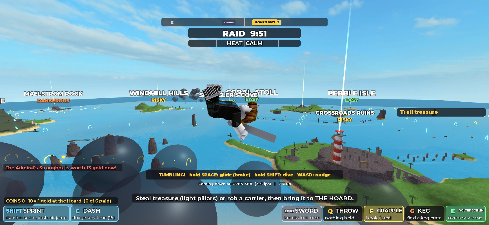
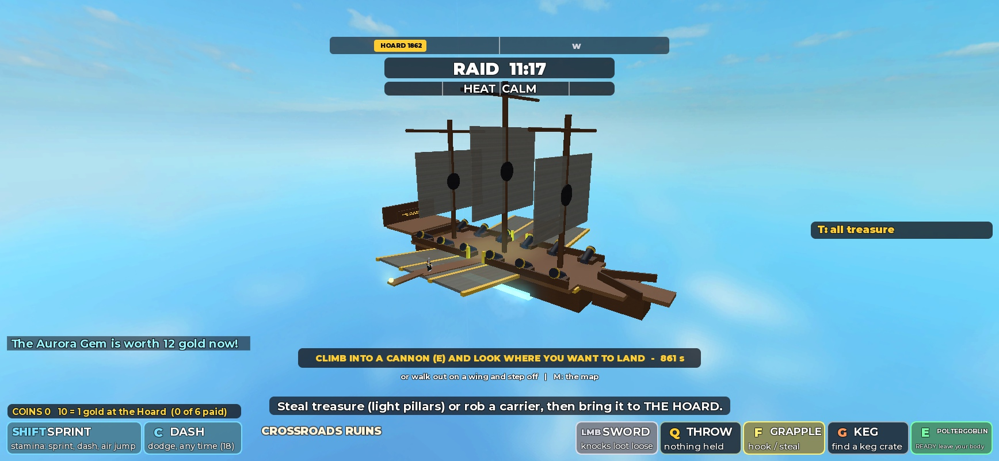
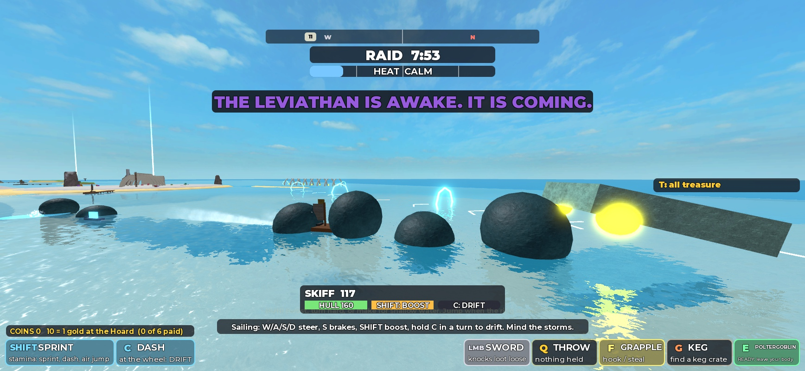

# V8: Chaos & Counterplay (2026-10-13)

Requested by Ninety with the "V8 One-Shot: Chaos & Counterplay" prompt and three sentences of his own: make me impressed, make me want to show someone, make it work reliably. Built by Claude Opus 5.5 in one session.

**Read this first.** Everything below was built and tested by one AI on **one** Roblox Studio client. Nobody has played V8, and it has never had a second player in it. "Tested" in this report means I ran it in Studio play mode and measured it, usually from the server, often with real key presses on the one client. It does not mean it is fun. Where I only have numbers and never looked at the thing, I say so.

## 1. Summary of completed features

| Requested | What was built | Status |
| --- | --- | --- |
| Freely aimable skyship cannons | Aim by looking (mouse or keys); the ring is where you land; the server works out the throw | Implemented and tested |
| Destination visibility | The ship is hidden while aiming; every major island wears its name and tier; a ring and skip marks on the water | Implemented and tested |
| Walkable wings | Gates in the rails, two wings with walkways and diving boards | Implemented and tested |
| Floppy limbs while skydiving | Limb joints switched off on the server while tumbling, back on when gliding or diving | Implemented and tested on one client; **other players' view not tested** |
| Three diminishing water bounces | 95, 66, 40 studs/s up; then a swim | Implemented and tested |
| Nerfed glide | Glide is an air brake (under 1 stud across per stud down; V7 was 5.7) | Implemented and tested |
| Catapults on the same system | All three are launchers: same aim, same flight, same landings | Implemented and tested |
| Stronger boat jump, speed-based super jump | Hop 18 studs; super jump 38 studs at 188 studs/s | Implemented and tested (real driver) |
| Every island creature pursues into the sea | 12 new sea forms on one framework, plus the Leviathan and the existing Ghost Fleet | Implemented and tested (each one run once; see section 10) |
| Creatures using boats | Bramble in a washtub, the imps' raft, the garrison's launch | Implemented and tested |
| Threat severity redesign | Grace, smaller damage, two-strike grip, hulls never sunk by creatures | Implemented and tested |
| Regular aquatic mobs | Nibblers, puffers, lancers: 25 in six regions | Implemented and tested |
| Leviathan: bigger, chases, breaches | 2.2 times the size, hunts boats, breaches, reacts to explosions | Implemented and tested by numbers; **the breach itself was never caught in a picture** |
| Remove mandatory gear | No treasure checks for gear | Implemented and tested (all 19) |
| Fix the Tide Vault | A front door: boardwalk, ramp, open stairway | Implemented and tested on foot |
| Flatten treasure values | Near home 4 to 5, the keys 7 to 8, the rest 9 to 11 | Implemented and tested |
| No new monetization | Nothing added; the inert Robux code is untouched | Not applicable |
| Real multiplayer testing | Only one Studio client was available | **Not done** |

## 2. Verified Git branch and PR base

V7 (PR #17, branch `feature/v7-skyfall-competitive-archipelago`) was still open and unmerged when V8 started, so V8 is branch `feature/v8-chaos-and-counterplay`, cut from the V7 branch at `fcd580c`, and its pull request is opened **against the V7 branch**, not `main`. Nothing was force-pushed and nothing was merged.

The prompt asks for `docs/AI_CONTEXT.md` to be read and updated. That file no longer exists: since the October 12 consolidation the single game description is `docs/GAME_DESIGN.md`, which is what was read and updated.

## 3. Skyship aiming changes

V7 aimed a cannon at the island picked on the map and let the player nudge it 14 degrees. V8: climb in and **look**. The mouse (or `W A S D`) turns a camera above the cannon; whatever the middle of the screen is on is the aim, and the gold ring is where the flight will first touch, worked out by the same model that flies it. The client sends that point; the server works out the throw (`Dive.solve`), so a cannon cannot be asked to throw harder than it can. Past its reach (3,560 studs; the farthest island is 3,130) the ring turns red and shows the farthest it throws that way. While aiming from the ship, the ship itself is hidden so the sea below is in view, and each of the sixteen major islands wears its name and difficulty. The map still helps: `M`, click an island, and the cannon turns to it. Click or `Space` fires after a 0.5 s fuse; `X` climbs out.

Measured: aimed at open sea 1,216 studs away, first touch 42 studs short (3%). Aimed with real key presses and a real map click at Crystal Isle, the read-out named the island and the distance. Two faults found while testing are in section 19 (the hazy view, and the default aim).

## 4. Wing traversal

Each side rail has a gate amidships that opens onto a wing: a 40 by 64 stud canvas deck rising 8 degrees, a plank walkway down its middle and a diving board at the tip. Walked with the goblin's own movement from the deck through the gate to the board and back (five legs, all reached, standing on planks the whole way). Walking off the board starts a free dive: tumble, three bounces, swim.

## 5. Ragdoll/floppy limb implementation

While a goblin tumbles (no keys held), its shoulders, elbows, hips and knees are switched off on the server and the limbs hang from ball sockets, so they flail as the body spins end over end. The moment the player holds glide or dive the joints come back and the goblin strikes a pose (arms out, or arms and legs in a line). Joints are disabled, never destroyed; the neck and waist are untouched, so nothing can break or kill. Landing, death, leaving and the raid's reset restore them.

Found while building it: this place's avatars use Roblox's newer `AnimationConstraint` joints, which already carry a ball socket each, and none of the older `Motor6D`. (V7's dive pose wrote to `Motor6D` only, so it never showed here.) Both kinds are handled.

Measured over a full cannon flight: 8 joints loose while tumbling, 0 while gliding or diving, all 15 joints on after landing, health 100 throughout, limbs never more than 3.6 studs from the body. On the first run limbs stretched 15.8 studs at each water bounce (the body is moved to the surface in one step); they are now hooked back on for that step.

**Not tested:** what a second player sees. The switch is made on the server so that everyone should see the same thing, but there was nobody else to look.

## 6. Water bounce and glide changes

**Bounces.** A fast goblin skips off the sea up to three times: 95, 66 and 40 studs/s upward (about 75, 36 and 13 studs high), keeping 45% of its speed across and never more than 150 studs/s, so three skips add at most about 650 studs. Half a second of grace after each bounce. The fourth touch, a gentle arrival (under 62 studs/s) or arriving in a glide is a plain landing at the surface. Measured twice from a cannon and once from a walk off the wing: bounces 1, 2, 3 in order, each lower, then "landed" at the surface with control back.

**Glide.** V7's glide held 175 studs/s for as long as there was height, so it was the way to travel. Now the throw gives the distance and the glide is a brake: the fall eases to 55 studs/s and the speed across bleeds to 50. Measured: opened at 1,066 studs out and 467 up, the goblin came down 480 studs further on, on its feet, with no ostrich landing. Hold `Shift` instead and it dives: measured 411 studs/s down, landing 210 studs short of the aim, head first.

## 7. Catapult integration

The three island catapults (Crossroads Ruins, Sun Temple, Fort Barnacle) are now launchers on the same system as the ship's cannons: `E` to climb in, look, `Space`. Each starts aimed at the place it was built to reach, so `E` then `Space` still makes the old throw. They lob at 60 degrees (at 44 they could not clear the walls). Measured, each on its own target: landed 30, 23 and 23 studs from the aim point, on top of what was there, head first, popped out, health 100. A catapult tips a goblin out after 25 s so nobody can sit in one.

## 8. Boat jump and super-jump mechanics

`Space` at any speed: a hop of about 18 studs (V7: 8.5), 0.9 s in the air. Faster than 150 studs/s (so: boosting, on a hoop chain, out of a drift) the jump grows with speed. Measured on the server's own simulation: 38.9 studs high and 201 studs flown at 187 studs/s, level the whole way. **Measured with a real driver** (I boarded with `E`, held `W`, pressed `Shift` then `Space`): top speed 188, 37.7 studs up, 1.2 s in the air, never tilted past 0.99 upright, hull untouched, no anti-cheat strike, still at the wheel.

Not separately tested in V8: a jump straight after a drift, landing a super jump on land, and re-entering water from land. The boat's land handling is V7's and was not changed.

## 9. Guardian pursuit architecture

`server/Pursuit.lua`. When a goblin carrying an island's treasure is on the water more than 70 studs off that island's shore, the island sends its sea form. Rules every form shares: one per island and five at once in the whole sea; a tell before every strike and a rest after; a leash measured from the shore; a 50 s limit; it goes home when the treasure is banked, dropped or taken, or the thief has been ashore 5 s; any explosion near it makes it reel for 4 s and the second sends it home; a strike that misses earns only 1.6 s of rest so one dodge is not the end; the raid's reset removes it. Two kinds of body: **swimmers and riders** (a small model moved over or under the waves, steering round land) and **lobbers** (creatures that cannot leave their island throw things, each shot marked on the water first). The sea mobs and the Leviathan use the same tools (`Pursuit.hit`, `batter`, `swim`, `lead`).

## 10. Island-by-island guardian pursuit roster

Each row was run once: the goblin was given that island's treasure in a skiff just off its shore and sailed straight for home at cruising speed for 15 s, doing nothing clever. "Set out" is how long the island took to respond.

| Island | Creature on land | Sea form | Set out | What happened in the run |
| --- | --- | --- | --- | --- |
| Windmill Hills | Bramble the ram | Bramble in a washtub | 0.2 s | Bleated, charged, rammed the boat (10 hull), grip slipped once, treasure kept |
| Tangle Isle | The imps | The imps' raft | 0.0 s | Drew alongside, leap called off as the boat pulled away; no hit |
| Shipwreck Shoals | Old Clacker | Clacker under the water | 0.1 s | Ring, came up through it; the boat had already left the ring |
| Tide Vault | The Warden eel | The Warden at sea | 0.0 s | Closed to 34 studs, lashed, just missed |
| Coral Atoll | The clam | The clam, jetting | 0.0 s | Reached the hull in 1.6 s and clamped for 4 s; no hull damage |
| Maelstrom Rock | The Maw | The wandering whirlpool | 0.1 s | Followed slowly; the boat outran it (closest 95 studs) |
| Crystal Isle | The Echo | The Echo on your wake | 0.0 s | Struck at once from a standing start (fixed: it now waits before following) |
| Fort Barnacle | The garrison | The garrison's launch | 0.0 s | Hung back 84 studs, two near misses (1 and 3 hull) |
| Sun Temple | The Guardian | Boulders from the temple | 0.0 s | One near miss (2 hull), grip slipped once, treasure kept |
| Crossroads Ruins | The Watchers | The walking beam | 0.0 s | Marks walked across the water; no hull damage by design |
| Ember Isle | The Cinderlings | Fire on the water | 0.2 s | Two fire patches crossed (2 hull each), grip slipped once |
| Frost Spire | The Chill | Ice on the water | 0.1 s | Ice set ahead; the boat was not caught |
| Leviathan's Rest | The Sleeper | The Leviathan | section 13 | section 13 |
| Skull Rock | The Captain's Shade | The Ghost Fleet (V4) | not re-run | Unchanged from V7 |

In no run did a pursuer strip the treasure by itself, sink the boat or kill the goblin. In the first version of the Fort run the launch's second shot dropped the treasure; its shots (and the Watchers') no longer touch the grip. Counterplay tested: an explosion on Bramble made him reel, and the framework's limit of two was confirmed in the Leviathan's version of the same rule (three). **Not tested:** each creature's original island behaviour after these changes (their island code was not edited, apart from the Sleeper), a pursuer with two carriers to choose from, and any of this with a human at the wheel.

## 11. Guardian attack and protection rebalancing

`server/Impact.lua` and `Loot.knockLoose`: after a world hit lands, nothing else from the world lands on that goblin for 1.2 s; world damage is 55% of what each source asks for; one hit cannot kill a goblin above 30 health; a hit on a carrier loosens the grip for 6 s and only a second hit in that time drops the treasure, after which it cannot be stripped again for 10 s. The Guardian's leap is the one hit that still drops at once. World blasts bite hulls at 60% and cannot take one below 12%; the Navy is exempt. PvP is unchanged. Measured on a carrying goblin: hit one landed (health 100 to 89, grip slipping, still carrying), a second hit inside the grace did nothing, a third after the grace dropped it, two more inside the recovery did not strip it again, the Guardian's leap dropped at once, and 500 damage on 60 health left 1.

## 12. Aquatic mob types and placement

Nibblers (latch and gnaw; a jump shakes them off), puffers (bounce your boat into the air, harmlessly), lancers (mark a line, then spear down it). Twenty-five, placed once by a fixed seed: The Crossing 3 puffers and 1 nibbler; Western Shallows 3 nibblers and 1 puffer; Eastern Reach 2 lancers and 2 puffers; The Open Sea 3 puffers and 2 lancers; The Far North 2 nibblers and 2 lancers; The Cinders 2 puffers, 1 lancer, 1 nibbler. None in Home Bay or Navy Waters; the nearest to the Hoard is 1,086 studs away; none within 150 studs of a shore. Measured: a puffer threw the boat up with no damage; nibblers chased, latched after 1.4 s, took 15 hull over 5 s and let go; with a jump they were off in 0.6 s for 2 hull; a lancer aimed for 1.1 s, charged, and in one run hit (6 hull, grip slipped) and in another missed. A raid's end sends them all home. The puffer's lift was raised from 86 to 140 after the first run (it was only a hop's worth); the new height was not re-measured.

## 13. Leviathan scale, attacks, movement, and activation instructions

**Scale:** 2.2 times V7: the head is 48 by 31 by 57 studs, with nine humps behind it.

**How to trigger it (either works):**
1. Sail to Leviathan's Rest (far north-west). Off its east dock is the Sleeper's eye. Drive a boat faster than 45 studs/s within 240 studs of it for about two seconds. The banner reads "THE LEVIATHAN IS AWAKE. IT IS COMING."
2. Steal the Leviathan Tooth and put to sea within 90 s.

**Movement:** 165 studs/s (a cruising skiff does 135, a boost 215), in wide turns; it surges to 260 when the boat is more than 260 studs ahead. **The wake:** boats within 62 studs of its head are thrown aside, no damage. **The breach:** within 220 studs it sinks, a 30-stud ring opens where the boat is going to be, and 1.6 s later the head comes up through it; a boat on the ring is thrown into the air and battered, never sunk. It picks the nearest crewed boat again after each breach. **It gives up** after 55 s, 2,400 studs from home, in water under 9 studs deep, or after three explosions on its head.

Measured, one skiff: sailing straight and doing nothing, breached twice (7 and 15 hull) and left behind at the leash after 16 s. Boosting and super-jumping when the ring opened: 35 studs up, hull untouched. Three blasts on its head: it reeled three times and went home. A raid ending mid-hunt: gone.

Found while testing: it was being stepped twice a frame whenever the Sleeper was awake, so it moved at double speed; fixed. **Not verified:** the breach as a picture (I never caught the 2 seconds on a screenshot, so I cannot say it looks right, only that it hits and can be dodged); the shallow-water escape (the test boat never reached shallow water); more than one boat.

## 14. Removed equipment requirements

The Rebreather, Cinder Boots and Frost Claws still exist and still help (breath, fire, grip). The server no longer checks for them, the map no longer says "+ GEAR", and the refusal message is gone. Measured: with no gear, all 19 treasures were taken on their spots, including the Pearl of the Deep, the Ember Crown and the Aurora Gem. **Not re-walked in V8:** the paths to the Ember Crown and the Aurora Gem (V7's route tests stand; the paths were not changed).

## 15. Tide Vault access fix

Three playtests could not find the way in: it was a tunnel on the far side from the dock, behind a gate whose lever stood 100 studs away. Now a boardwalk runs from the dock to the north ramp, and at the top of the ramp an open stairway goes down to the pearl, which glows under a skylight. No gate, no lever, no gear. Taking the pearl floods the vault to just below the top of the stairs, so the way out is the way in. Measured on foot with the goblin's own movement: dock to pearl in 5.0 s; `E` stole it with the camera deliberately turned away; the vault flooded; out to the dock again carrying it in 5.4 s, health 100. Separately, the same pearl banked at the Hoard for 10 gold. **Not done as one unbroken run:** sailing it home from the Tide Vault dock (boats and banking are V7's code).

## 16. New treasure reward table

| Treasure | Island | V7 value | V8 value | V7 respawn (s) | V8 respawn (s) |
| --- | --- | --- | --- | --- | --- |
| Lost Compass | Pebble Isle | 1 | 4 | 20 | 150 |
| Giant Pearl | Coral Atoll | 2 | 5 | 25 | 160 |
| Smuggler's Stash | Smuggler's Cove | 2 | 5 | 25 | 160 |
| Sunken Sextant | Kelp Cay | 4 | 7 | 30 | 60 |
| Storm Lantern | Lantern Key | 9 | 8 | 45 | 60 |
| Castaway's Hoard | Driftwood Key | 9 | 8 | 45 | 60 |
| Golden Gear | Windmill Hills | 4 | 9 | 30 | 60 |
| Lighthouse Lens | Crossroads Ruins | 4 | 9 | 25 | 60 |
| Captain's Chest | Shipwreck Shoals | 5 | 9 | 35 | 60 |
| Crystal Heart | Crystal Isle | 7 | 10 | 40 | 60 |
| Jade Frog | Tangle Isle | 9 | 10 | 40 | 60 |
| Pearl of the Deep | Tide Vault | 8 | 10 | 45 | 60 |
| Tempest Trident | Maelstrom Rock | 8 | 10 | 45 | 60 |
| Ember Crown | Ember Isle | 13 | 10 | 50 | 60 |
| Admiral's Strongbox | Fort Barnacle | 13 | 11 | 50 | 70 |
| Golden Idol | Sun Temple | 14 | 11 | 60 | 70 |
| Aurora Gem | Frost Spire | 17 | 11 | 65 | 70 |
| Leviathan Tooth | Leviathan's Rest | 17 | 11 | 70 | 70 |
| Skull Chalice | Skull Rock | 20 | 11 | 75 | 70 |

V7's values were read from the V7 commit (`fcd580c`); V8's were read back from the running server. V7 ran from 1 to 20 gold, so the far islands were the only sensible choice; V8 runs from 4 to 11. The three nearest home are worth about half and take two and a half minutes to come back (V7: 20 to 25 s), so they cannot win by repetition. Interest still adds up to three steps of about 12% to anything left untouched (seen in play: the Idol at 13, the Strongbox at 14), and the final rush still pays 25% more.

## 17. Multiplayer and performance considerations

**Authority.** A launcher is aimed at a point and the server works out the velocity. Hits, grip, hull damage and treasure are all decided on the server. The goblin's own client flies its own flight (as it drives its own boat); the server rules on how it ends and ends any flight after 45 s. A cheating client could fly its own character where it likes, which is true of every Roblox character and not new.

**Cost.** Server frame time with a pursuit running: 0.87 ms. Sea mobs: 25 bodies of 4 to 8 welded parts, moved only when a crewed boat is near (a sweep four times a second decides). Pursuers: at most 5, one small model each. The Leviathan: about 26 anchored parts moved each frame while it is awake. None of it grows with the number of players. The threats folder holds 326 parts in all.

**Not established:** anything about 32 players. One client cannot show replication cost, how two flights look to each other, or how five pursuits and a Leviathan hunt feel on a busy server.

## 18. Studio tests actually performed

All in Roblox Studio play mode, one client, through the built-in Studio MCP. Real key and mouse input was used where marked.

- **Skyship:** walked the wing and back (own movement); climbed into a cannon with `E` (real key); aimed with `W A S D` (real keys) and with a map click (real mouse); fired with `Space` (real key); tumble to three bounces; glide held from mid-flight (real key) to a soft landing; dive held (real key) to an ostrich landing; walked off the diving board; left aboard until the window closed and was fired off; ended a raid while seated in a boat and was put back on deck.
- **Catapults:** all three, on their own targets, traced to landing.
- **Boats:** hop and super jump on the server's simulation; a super jump with a real driver (real keys), with the anti-cheat's counters read afterwards.
- **Pursuit:** twelve forms, one 15 s run each (section 10); the reset.
- **Sea mobs:** placement listed; puffer, nibbler (with and without a jump), lancer (twice).
- **Leviathan:** five hunts (straight, boosting, jumping, with blasts, toward the island) plus two after tuning.
- **Treasure:** all 19 taken with no gear; values read back; the Tide Vault walked in and out; one bank.
- **Impact:** the grip sequence on a carrying goblin.
- **Checks:** StyLua and Selene clean; `scripts/check.ps1` result is in the pull request.

**Not performed:** anything with a second client; a human playing; a full raid from start to finish; the Ember and Frost paths on foot; each creature's island behaviour; touch or gamepad for the new aim.

## 19. Bugs found and fixed

1. `E` cast Poltergoblin instead of stealing when the camera was turned away from a treasure in reach (Roblox only shows prompts that are on screen). `E` now acts on anything in reach.
2. A storm's lightning struck goblins on the skyship 540 studs up and killed one sitting in a cannon. Weather now ignores anyone above 200 studs.
3. Loose limbs stretched 15 studs at each water bounce. Fixed (section 5).
4. The aim view was a fog: forty layers of nearly clear deck and sail, plus the ship's glow. The ship is now hidden outright while aiming.
5. Island name tags did not draw with "always on top" in the views I could capture; they are ordinary signs now.
6. Catapults fell 60 to 90 studs short at 44 degrees (walls and cliffs). Now 60 degrees.
7. A launcher's starting aim was replaced within a tenth of a second by whatever slope was in the middle of the screen, so `E` then `Space` on a catapult landed on the hillside below its target. It now stays exactly on its starting aim until turned.
8. The Leviathan moved at double speed whenever the Sleeper was awake (stepped twice a frame).
9. A goblin at a boat's wheel when the raid ended was not put back on the skyship: their own client still held them in the seat, the move was undone, and the ship "dived" them into the seabed. It now retries until it takes.
10. Pursuits never started off the bigger islands because the leash was measured from the island's middle. Now from its shore.
11. The Echo struck a boat at once from a standing start. It now waits its delay before following.
12. Mine, in testing only: my chase test left the last treasure in the goblin's hands, so every run after the first tested nothing. The first full set of pursuit results was thrown away and re-run.

## 20. Known issues and limitations

- No human has played this and it has never had two players. That is the largest limitation and it applies to everything above.
- The sea forms and mobs are a handful of blocks and balls each. They read as what they are from a boat; they are not art.
- The Leviathan's breach was not seen in a still image.
- Pursuers steer round land with a look-ahead, not along routes; among tight rocks one can stall until its time runs out.
- Lobbers (boulders, beam, fire, ice) cannot be driven off with explosions; the answer is to get out of range.
- A first strike often misses a boat that is still accelerating from rest, because the tell is aimed at where the boat was heading. That is intended as dodge room; it may prove too forgiving.
- My test boat, driven blind in a straight line, crashed into islands near the end of several runs (about 70 hull each time). That is my test, not the game, but it means the hull numbers at the very end of those runs are not the creatures' doing.
- The old client code for catapult pads is unreachable and still present.
- The new aim has no gamepad stick or touch control. Keyboard and mouse only.
- `AGENTS.md` still lists progression and pets as excluded before prototype approval (raised in V7's pull request; a human decision). V8 added none.

## 21. Incomplete or deferred features

- **Multiplayer testing of any kind.** Not possible here.
- **Other players seeing the loose limbs.** Built to replicate, never observed.
- **The Leviathan with two boats, and its shallow-water escape.** Built, not observed.
- **A boat-form Guardian.** The Guardian throws boulders from its temple instead; it does not swim or sail.
- **A new sea form for the Captain's Shade.** The Ghost Fleet already hunts the thief and was left as it is.
- **Creatures reacting to each other, or to the Navy.** Not attempted.
- **Sound by ear.** The new effects reuse existing sounds; I cannot hear them.

## 22. Human playtest instructions

Double-click **Play Loot Goblins**, wait for Studio, press the blue Play button, press `H` for the help panel. Then try these and say what felt bad:

1. **The cannon.** Climb in (`E`), move the mouse, watch the gold ring. Fire at an island on purpose. Did you land where the ring was?
2. **The air.** Fire again and touch nothing. Then hold `Space` near the ground. Then hold `Shift`. Aim one at open water on purpose.
3. **The wings.** Walk out of the gate in the rail, to the end of the diving board, and off.
4. **A catapult** (Crossroads Ruins, on the crag): `E`, look somewhere else, `Space`.
5. **The boat.** `Space` at cruising speed, then `Shift` and `Space` together.
6. **Steal the Golden Gear** (Windmill Hills) and sail away. Something follows. Try a jump when it bleats.
7. **Steal anything from Coral Atoll** and sail away. When something grabs the hull, jump.
8. **The Tide Vault**: land at its dock and follow the boardwalk. No gear.
9. **The Leviathan**: sail fast past the east dock of Leviathan's Rest. Then run.
10. **Run into a puffer fish** (yellow, spiky, floating) on purpose.

The fourteen questions the team asked, to answer after playing:

1. Is skydiving substantially funnier and more intuitive?
2. Can you aim the skyship cannons at the island you actually want?
3. Are the three water bounces enjoyable?
4. Is gliding better balanced?
5. Are the improved boat jumps fun?
6. Do creatures following you into the water make memorable situations?
7. Do the creatures in boats feel hilarious or annoying?
8. Is the Leviathan intimidating and enjoyable to escape?
9. Do you keep control during chaotic encounters?
10. Are treasure drops and deaths less frustrating?
11. Is the Tide Vault now straightforward?
12. Does removing the gear requirement improve the loop?
13. Do similar treasure values make island choice more natural?
14. Are the sea mobs entertaining without making the ocean exhausting?

Send a screenshot of any red error. None of the checks in this report can answer these questions.

## 23. Recommended next priorities

1. **Play it, with three people.** Every number here is a guess at fun until then.
2. Watch the loose limbs and two simultaneous flights from a second client; that is the most likely place for a surprise.
3. Tune pursuit pressure from play: whether first strikes miss too easily, and whether five at once is too many or too few.
4. Look at the Leviathan's breach with human eyes and give it a proper body if the hunt earns its place.
5. Decide whether the lobbers need a counter other than distance.
6. Remove the unreachable catapult-pad code once the launchers are accepted.
