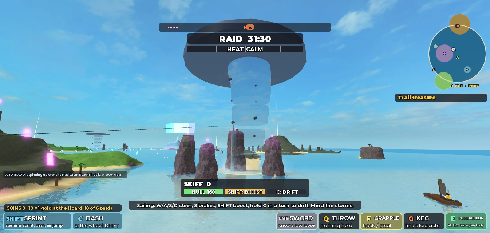
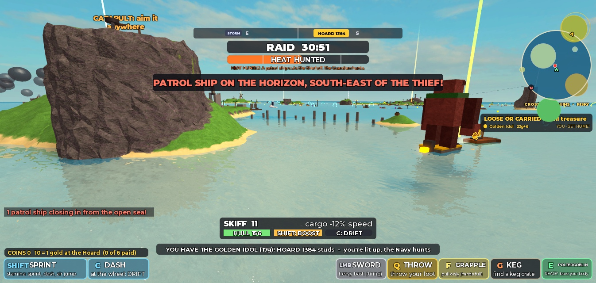
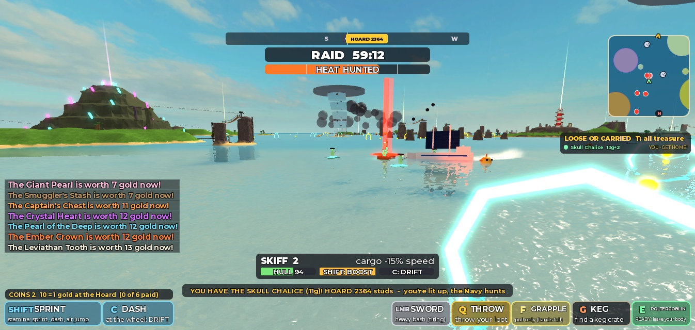
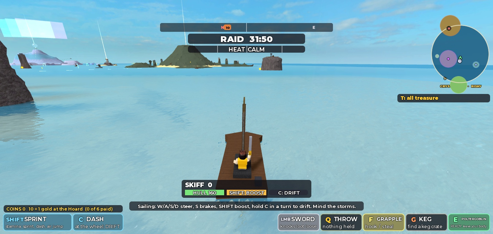

# V9: Relentless Chaos (2026-10-14)

Requested by Ninety with the "V9 One-Shot: Relentless Chaos" prompt (fifteen points from the V8 playtest), handed over by Enrik with three sentences of his own: make me impressed, make it epic, make it reliable. Built by Claude Opus 5.5 in one session.

**Read this first.** Everything below was built and tested by one AI on **one** Roblox Studio client. Nobody has played V9 and it has never had a second player in it. "Tested" means I ran it in Studio play mode and measured it, mostly from the server with a test autopilot driving the boat with the game's own physics, and in the places marked "real keys" with real keyboard input on the one client. It does not mean it is fun. Where I have numbers and never looked, I say so.

## 1. Git branch, base and PR

V7 (PR #17) and V8 (PR #18) were both merged into `main` on October 14, so V9 is branch `feature/v9-relentless-chaos`, cut from `origin/main` at `d1d445f`, and its pull request targets `main`. The code is commit `7b120b1`; this report and the documents follow it. Nothing was force-pushed and nothing was merged.

## 2. Summary of every change

| Requested (playtest point) | What was built | Status |
| --- | --- | --- |
| 1. Leviathan: close behind, no special attack | Breach removed; it shadows a boat about 45 studs back, matching its speed, and catches what slows down | Implemented and tested |
| 2. Sun Temple Guardian in a boat at "Mach 7", 20 ft launch, Golden Idol the best treasure | Leaps into a tiny stone speedboat (250 cruise, 360 surge); 9 s cooldown launch; Idol 17 gold | Implemented and tested |
| 3. Jet Set Radio-inspired one-button boat tricks | R (gamepad R1) in the air; combos; A/D roll, S backflip; callouts | Implemented and tested (real keys) |
| 4. Pursuers follow almost to the Hoard | No timer or leash; ends at the sanctuary | Implemented and tested (all islands, one run each or more) |
| 5. Crystal Echo small, fast, mobile | Tiny crystal rider, 230 to 340 studs/s, turns at 9 rad/s, darts | Implemented and tested |
| 6. Danger follows until near home | The sanctuary: gold lantern buoys 450 studs round the Hoard | Implemented and tested |
| 7. No horizon text | Island names, treasure tags, landmarks are short-range labels; the aim view names only its target | Implemented and tested (screenshot) |
| 8. Minimap | Top right, turns with the camera; islands, Hoard, sanctuary, tornadoes, your pursuers | Implemented and tested (screenshots) |
| 9. Forgiving boost hoops | Swept hull test; a visible touch counts at any frame rate | Implemented and tested |
| 10. More ramps | Seven new, beside lanes and escape routes; ramps throw higher with speed and level | Implemented and tested (one ramp driven, all placed) |
| 11. Six-minute rounds | 360 s clock after a 20 s launch window; whole match structure retuned | Implemented and tested |
| 12. Independent tornadoes | Up to three, in fine weather, in eight open-water "alleys" | Implemented and tested |
| 13. Rideable tornadoes | Boats, goblins and pursuers lifted; jump bails out | Implemented and tested (real keys for a boat) |
| 14. Bigger guardians, Echo excepted | Island bodies 1.5 to 1.7 times, sea forms 1.6, the Guardian 1.7 | Implemented; looked at in screenshots for the Guardian only |
| 15. Ghost Fleet: ships, pirates, tiny boats | Three crewed ships with volleys; five pirate dinghies once clear of Skull Rock | Implemented and tested |
| Multiplayer testing | Only one Studio client was available | **Not done** |

## 3. The six-minute round

`Config.RAID_DURATION` is 360 and the clock **does not run during deployment**. A raid opens with a 20 s launch window (V8: 40 s, with the clock running); the six-minute clock starts when it closes, so a goblin who fires late still gets all six minutes and one who fires at once gets a head start. The HUD shows `LAUNCH WINDOW 18 | RAID 6:00 STARTS AFTER`, then `RAID 5:59`. During the 10 s intermission (V8: 12) a goblin can climb into a cannon and aim; it fires from the bell (2 s after the raid starts). Measured: 367 s left on the clock with 7 s of the window to go (360 + 7).

Everything else that a six-minute raid touches:

| What | V8 | V9 |
| --- | --- | --- |
| Final rush (25% more for banking) | last 90 s | last 50 s (the HUD timer says FINAL RUSH) |
| Last call (red timer) | last 60 s | last 30 s |
| Treasure interest step | 80 s | 45 s (three steps, as before) |
| Respawn of the three nearest treasures | 150 to 160 s | 100 to 105 s |
| Respawn of the rest | 60 to 70 s | unchanged |
| First storm | 50 s | 40 s; gap 35 to 60 s (V8: 45 to 75) |
| First tornado | (none) | 25 s |
| Same island's pursuer again | 40 s | 25 s |
| Shinies per raid | participation 10, gold cap 30, win 25, underdog 5, cap 70, present 90 s | 6, 22, 15, 3, 42, 60 s (about the same per hour) |

Measured with a 70 s test raid on the client HUD, second by second: the launch window counted 20 to 1, the clock started at 1:09, `FINAL RUSH` and its banner came at 0:50, `LAST CALL` and its banner at 0:30, `RAID OVER!` at 0:00, `NEXT RAID IN 10`, and the next raid opened with a new launch window. Intermission aiming, measured: a goblin climbed into a cannon 9.7 s before the bell, a fire before the bell was refused (still loaded), the raid's start did not tip them out, and the fire after the bell launched them. Respawns and late joiners were not changed (a late joiner lands on the skyship while the window is open, at home after).

## 4. The pursuit architecture

`server/Pursuit.lua` was rewritten around one idea from the playtest: **danger stays close, consequences stay small.**

- **No timer, no leash, no global cap of five.** A pursuit ends at the sanctuary, when the treasure is banked or leaves the thief's hands (it changes quarry if a rival snatches it at sea), when the thief dies or leaves, after 12 s ashore, after two explosions, at the raid's reset, or after 150 s as a backstop for one stuck behind an island.
- **Pacing from the gap, with momentum.** Far behind (over 320 studs) a pursuer surges at its form's top speed. Closing, it gains a form-specific margin on the thief's own speed. Close, it **hangs just behind** at its `follow` distance, matching speed. It speeds up and slows down at its own rates, so a thief who keeps their speed is shadowed and one who loses it (a rock, a missed hoop, a rival, a landing) is caught. Every so often it **lunges**, and that is when its tell shows.
- **Tells lock on.** During a short-range form's wind-up it holds onto the hull and matches its speed, so the strike lands unless the thief does something about it (boost, turn, jump). Bramble, who charges from 105 studs, keeps pace and lines up instead.
- **Resurfacing.** A pursuer hopelessly far behind (900+ studs, behind the thief) or blocked by land for 3 s reappears 420 studs behind the thief along their wake, never in front and never in view of their bow.
- **Pursuers fly.** `Pursuit.air` gives every kinematic pursuer an altitude: a ramp throws it, a tornado lifts and spins it, and one in the air cannot strike.
- **One thing at a time.** `Pursuit.hit` asks `Impact.open` before it touches a goblin *or their boat*, so nothing in the world juggles a goblin inside the 1.2 s grace; after the Guardian's launch nothing from the world lands for 3 s (`Impact.protect`). Hulls are never taken below 12% by a creature. The two-strike grip is unchanged.
- **Budgets.** One pursuer per island, at most two island pursuers per goblin, 14 in the whole sea; no rigid cap cancels an important chase.

## 5. Chase limits and the Hoard sanctuary

The sanctuary is the water within 450 studs of the Hoard: just off Goblin Cove's coast all round, taking in the harbor mouth (the harbor jump is 326 out) and the docks (about 210). It is marked by 24 gold lantern buoys (28 positions round the ring; the other four fall on land), a gold ring on the map and on the minimap. A pursuer never steps into it; when its thief enters, it stops at the edge, says so in its own words ("The Guardian's boat skids to a stop at the cove lights. It shakes a stone fist at you."), and sinks away. The Leviathan turns back at the lights; the Ghost Fleet wails and fades. PvP is not affected: a rival can still catch you inside.

520 studs was tried first and measured: the Coral Atoll's shore was inside it, so its clam only set out after the boat had already left the ring. At 450 the near islands' shores are outside it; their chases are short because the islands are near.

## 6. Guardian scale

| Who | Island body | Sea form |
| --- | --- | --- |
| Sun Temple Guardian | 1.7 times (about 34 studs tall); its hit reach grows with it | rides its boat at 1.6 |
| Watchers | 1.6 | 1.6 |
| Old Clacker | 1.6 (sinks deeper into the sand to match) | 1.6 |
| Bramble | 1.7 | 1.6 |
| The Warden | 1.6 (every segment) | 1.6 |
| The Chill | 1.5 (aura 40, was 30) | 1.5 |
| The Maw | 1.4 | 1.4 |
| The Clam | not resized: it is the lid of the Giant Pearl's housing | 1.6 |
| Leviathan | 2.6 (V8: 2.2), 11 humps | the same body |
| Imps, marines, cinderlings | minions, unchanged | their rafts 1.3 |
| **The Echo** | unchanged (small) | a tiny crystal rider, about half V8's sea form |

Reach values were raised with the bodies (Watcher 7.5, crab eruption 14, eel 16, Maw 26, Bramble's hit 6 to 10). **Looked at:** only the Guardian (in its boat, below) and the tornado. The island bodies' fit in their terrain (clipping into ruins, the temple's interior) was **not** inspected.

## 7. Island by island

Each row was run with the test autopilot: the treasure taken off its spot for real (the trouble fires), a skiff put off the island's shore toward home, and the autopilot driving home with the game's boat physics, boosting whenever lined up ("boost") or at cruising speed ("cruise"). Gaps are studs between the pursuer and the boat. "Quit at" is the boat's distance from the Hoard when the pursuer gave up (the first runs used the 520 sanctuary).

| Island | Sea form | Run | What happened |
| --- | --- | --- | --- |
| Windmill Hills | Bramble in a washtub | boost | Followed at 118 average (23 closest); took the Mill Jump mid-chase (34 studs up); one ram after the boat slowed (grip slipped, treasure kept); quit at 513 |
| Tangle Isle | the imps' raft | boost / cruise | Boost: one leap (grip slipped), quit at 492. Cruise: two leaps 5.3 s apart **took the Jade Frog** (it floats loose and can be grabbed back): the imps are thieves on purpose |
| Shipwreck Shoals | Old Clacker under the water | boost | Ring opened, the boat had left it; quit at 505 |
| Tide Vault | the Warden | boost, cruise | One lash each; quit at 497 |
| Coral Atoll | the clam | boost | Shore inside the 520 sanctuary: barely chased (section 5) |
| Maelstrom Rock | the wandering Maw | boost | Followed the whole way at 135 average; reeled once from a blast; quit at 501 |
| Crystal Isle | the Echo | boost, cruise | After its rework: closest 12 against a boosting boat, no hit (it was dodged); against a cruising one, two hits in 13 s, hull 158 of 160; quit at 438 |
| Fort Barnacle | the garrison's gunboat | boost | Hung at 108 (follow 100), shelling, with the Navy's patrol ships out too: three world hits, two separate grip slips, treasure kept, hull 64 |
| Sun Temple | the Guardian's speedboat | boost, cruise | Section 9 |
| Crossroads Ruins | a Watcher surfing a stone slab | boost, freeze test | Short trip, quit at 489; freeze rule measured (below) |
| Ember Isle | the cinderlings' lava raft | boost | Ran **ahead** of the boat (46 average to the boat), one fire patch crossed (grip slipped) |
| Frost Spire | the Chill | boost | 168 average behind, two separate hits, treasure kept, reeled once from a blast |
| Leviathan's Rest | the Leviathan | boost, stall | Section 8 |
| Skull Rock | the Ghost Fleet | cruise (three runs) | Section 12 |

**The Watcher's rule at sea, measured:** with the boat stopped and facing away, it approached at 99 studs/s (259 to 177 studs); the boat was turned to face it and it **froze dead** (177 studs for 1.5 s, eyes dark); turned away again, it came on (146, 109, 71, 42) and began its tell at 21.

**Not tested:** each island's on-land behaviour after the scaling (only the Guardian's and the Watchers' code was changed beyond size); pursuers against a human driver; two thieves from the same island; a pursuer's resurfacing observed directly.

## 8. The Leviathan

**Removed:** the V8 breach (a ring on the water, then the head up through it, 48 hull) is gone from the code; nothing else imitates it. It still rises out of the water now and then for the look of it, only when it is more than 140 studs from its quarry, with a splash and no hit.

**What it does now:** it hunts as before (fast boats near the Sleeper's eye, or the Tooth's thief at sea) but **shadows**: its snout 46 studs behind the stern, matching the boat's speed, surging at 300 when far behind (a boost is 202, a full chain 242). It speeds up at 150 and slows at only 55 studs/s/s. A boat that keeps its speed is never closed below 26 studs; every 7 s it roars and lunges (a toast says "Don't slow down!"), and the lunge falls short. A boat that slows (under 80 studs/s, or 22% under its recent speed) is **caught**: bumped on (push 70, lift 42), swiped aside (82 sideways) or, if nearly stopped, tossed over its head (lift 95). A catch is a world hit (grace, grip rule, 8 hull, never sunk), and the same boat cannot be caught again for 4 s: it swerves off alongside and falls in behind. Boats beside its head are still shoved aside by its bow wave. It cannot follow into water shallower than 7 studs (it waits; after 10 s it gives up), and it stops at the sanctuary.

**Measured** (Leviathan's Rest to home, about 3,000 studs):
- Boosting the whole way: it surged from 505 to 52 studs in 4 s, then held **41 to 44 studs** behind for the whole run; lunges reached 22 to 25; **no contact**. At the end the reef outside Home Bay was too shallow for it.
- Braking hard for 2.5 s at t = 8 s: caught at 8.6 s (8 hull, grip slipped, the boat thrown up 19 to 23 studs). The first version then swam straight through the nearly stopped boat and overshot ahead; now it swerves off (gap 60 to 112) and is back on the tail at 24 studs by 16 s.
- Its blast reaction (three explosions send it home) is unchanged from V8 and was not re-run.

## 9. The Sun Temple Guardian's boat

When the Golden Idol's thief is on the water 70 studs off the temple's shore, a tiny stone speedboat (gold trim, a flaming outboard, a windshield) appears off the shore on their side, and the Guardian **leaps from wherever it stands** onto it in a high arc (1.6 s; `Threats.guardianBoard`). While it is at sea its island stands empty (`GuardianState` = `sail`), and when the chase ends it is back at its altar. The boat cruises at 250, surges at 360 ("Mach 7"), turns wide (1.9 rad/s: a hard turn makes it overshoot) and hangs 40 studs behind. **The launch:** every 9 s, within 120 studs, it raises its fists (a second pair of arms appears overhead), a 20-stud gold ring opens where the thief is going (0.85 s), and a stone fist punches up out of the sea: whatever is on the ring is thrown 118 studs/s up and 30 along its way. No grip hit, about 1 health, 4 hull, and nothing from the world lands for 3 s afterwards. A miss lets it try again in 4.5 s.

**Measured:** boosting home: boarded in 1.6 s, surged to 259, followed at 153 average (19 closest), two launches dodged by the boost, quit at the sanctuary edge (511), Guardian back at its altar. Cruising: the launch landed; the boat went **34 studs up** (the "20 feet", tuned for a goblin-sized world), hull 160 to 156, treasure kept, no grip slip; quit at 515. A goblin hit on foot (swimming) was not measured.

**Golden Idol:** 17 gold (V8: 11), the highest base value; every other treasure is still 4 to 11. Interest (three steps of 12%, 2 each) takes it to 23. The HUD read "YOU HAVE THE GOLDEN IDOL (17g)". The final rush (25%) applies as to anything banked.

## 10. The Golden Idol's new value

Section 9. No other value changed.

## 11. The Crystal Echo

A tiny crystal imp on a sliver of crystal (2 by 0.8 by 5.4 studs) with a trail. Speed 230, surge 340, accelerates at 480 and stops at 380 studs/s/s, turns at 9 rad/s (a skiff manages about 2.5). Far off it cuts straight at you; within 110 studs it **repeats your wake** 0.6 s behind (closing to 0.3), taking every turn you took; every 0.9 to 1.7 s it **darts**, skipping across the water straight at you. Its hit is small: thrown sideways (46), a quarter of your speed taken, 2 hull, never the treasure. It waits 2.5 s after appearing before it can strike. Tell 0.45 s, rest 3.5 s. Measured in section 7. Its first V9 version followed a point 1.4 s back along the wake, which at 180 studs/s was 250 studs behind the boat, and never struck; a frame-by-frame probe then showed its wind-up flew it straight through the boat (section 22).

## 12. The Ghost Fleet

`server/GhostFleet.lua`. Taking the Skull Chalice raises the fog and **three ghost ships** (translucent teal hulls, two masts with ragged glowing sails, a skull flag, lanterns), each with **four ghost pirates** on deck (glowing body, tricorn hat, green eyes, a cutlass) who sway and wave their cutlasses. The ships sail spread across the thief's wake (two either side, one further back, never a rigid line) at up to 170 (surge 230) and fire marked volleys of two. **Volleys throw and batter; they never loosen a grip.** Once the thief is 650 studs off Skull Rock's shore, **pirates leap from the decks** (you see them fly over in an arc) into **five tiny rowing boats** that chase at up to 290, spread across the wake; the ships fall back and sink into the fog 14 s later. A dinghy that gets within 20 studs waves its cutlass (0.7 s) and its pirate leaps aboard (a grip hit). Only one pirate leaps at a time, fleet-wide, at most every 6.7 s: longer than the grip's 6 s window, so **pirates alone can never strip a thief**. A keg or a cannonball sinks a dinghy outright. The fleet ends at the sanctuary, when the Chalice is banked or lost (it follows a new holder at sea), or at the reset. The Captain's Shade rule is unchanged: steal while his eyes are dark and the fleet rises 18 s late.

**Measured:** in the first run a volley loosened the grip and a pirate's leap 3.8 s later took the Chalice, 9 s into the escape: too harsh. Volleys lost their grip effect and the leap gap went to 6.7 s. Then: ships rose and chased (170 to 230), the dinghies went over at 5 s (crews went from 4 to 2, 2 and 3), the ships sank by 23 s, two dinghies were sunk by other blasts (the Navy was out at FRENZY heat), and the rest chased to the sanctuary (34 s). Pirates boarded every 7 to 8 s: four grip slips, **no drop**. With the Shade dozing, the fleet rose at 18 s. **Not captured:** a clear still of the ships and their crews (the Skull Rock fog and a passing tempest washed them out in the one attempt).

## 13. Boat tricks: controls and animations

**R** (gamepad **R1**) in the driver's seat while the boat is in the air (at least 5 studs up). One button, nothing to learn:

| Press | Trick | Time |
| --- | --- | --- |
| First in a flight | SPIN CYCLE: a flat 360 | 0.45 s |
| Second | CORKSCREW: a spin and a roll at once | 0.7 s |
| Third | BOW FLIP | 0.6 s |
| Fourth | DOUBLE SPIN | 0.7 s |
| Holding A or D | PORT / STARBOARD ROLL | 0.5 s |
| Holding S | KEEL FLIP (a backflip) | 0.6 s |

A press during a trick is kept and plays the moment it ends, so mashing R strings a combo. W is ignored (a driver nearly always holds it: the first version used W to pick a front flip and every trick came out as one). On the water R only says how ("Tricks are for the air..."). The driver no longer gets the anchor's R prompt; passengers still do.

**How a trick moves the boat:** while a trick runs, `BoatSim` writes the hull's orientation outright from its heading at the start and the trick's progress (eased), and zeroes its spin; position and velocity stay physics. A trick always ends exactly level, facing the way it started. **Landings:** clean after tricks pays a speed burst (16 + 9 per trick, up to four) and hands back 0.8 s of boost cooldown per trick (the server only pays a hull it saw high in the air, once per flight); a hull still mid-trick when it touches water comes down **level anyway** ("SKETCHY!", no burst, never a capsized boat). Other players see the boat spin (the hull is replicated) and a short-range label over it ("CORKSCREW!"). Callouts are in `client/Tricks.lua`.

**Measured:** off a ramp (server physics): a spin turned the hull a full 360 in 0.55 s (V9's first timing) and ended level, facing the same way; a roll still running at touchdown snapped level (no capsize, 137 studs/s kept). **Real keys** on the client: `W`, `Shift`, `Space`, `R`: a 31-stud super jump and a corkscrew that was still running at touchdown ("SKETCHY!", landed level at full speed), which is what led to the remapping above. **Real keys** in a tornado: `R` mashed near the top chained SPIN CYCLE, CORKSCREW (x2), BOW FLIP (x3), DOUBLE SPIN (x4); the last was still running at splashdown (SKETCHY!), the boat landed upright. A clean landing after one trick from a hop showed "CLEAN! + SPEED + BOOST (x1)". **Not measured:** the boost cooldown refund itself, the gamepad button, how tricks look from a second client.

## 14. How Jet Set Radio inspired the tricks

Not its art, names, music or animations: its **attitude**. In Jet Set Radio tricks are part of ordinary travel, cheap to start, and the game shouts them at you. So: one button, tricks during any airtime (a hop, a ramp, a launch, a tornado), a combo that grows as long as you stay up, and chunky, tilted, loud callouts in shifting colour that pop in, wobble and fly off, with a landing grade (CLEAN, SMOOTH, FRESH, OUTRAGEOUS, or SKETCHY). The reward is style and a little momentum, never gold.

## 15. Ocean ramps

Seven new ramps (12 kicker ramps in the sea now), each **beside** a lane (never on its line, so a hoop chain is never thrown off), pointing the way home, on the routes away from the worst pursuers: CHIMNEY JUMP (from Crystal Isle), MILL JUMP (from Windmill Hills), EMBER ROAD JUMP (the longest open lane), FROST ROAD JUMP, TANGLE JUMP, LEVIATHAN LEAP (from Leviathan's Rest) and SKULL RUN JUMP (south-west of Skull Rock). Every ramp is checked at build time for open water to ride up and to land in (none was refused). A ramp now throws higher the faster you hit it: 76 studs/s up at 34, plus 0.2 per stud/s faster, up to 112 (about 30 studs up and 2 s in the air at boost speed), and it throws the boat **level**.

**Measured** (Mill Jump, autopilot at 177 to 190): the first version flipped the boat over backwards (upright 1.0 to -0.68 in the air) and it landed capsized, losing 110 studs/s; the plank's push was spinning it. Now the kick clears pitch and roll spin: 30 studs up, 1.1 s in the air, level throughout, landing kept the speed (146 to 159 with the landing burst). The other six ramps were placed and checked by the build, not driven.

## 16. Tornadoes: mechanics and locations

`shared/Twister.lua` (the maths, shared), `server/Tornadoes.lua` (where they are), `client/Twisters.lua` (how they look). Up to three at once, **independent of the storms** (storms keep their own spouts), the first 25 s into a raid, each lasting 70 to 105 s and wandering at 8 to 16 studs/s round one of eight open-water alleys (the West Run, the Eastern Reach, the Open Sea, the Leviathan Road, the Far North, the Cinders, Navy Waters, the Maelstrom Reach), never within 1,100 studs of the Hoard, turning away from shallow water. Half of them form at the alley nearest a goblin who is out at sea. The feed announces each one.

**The funnel:** 30 studs wide at the water, 51 at the top, 190 tall. Inside it whatever came in is caught (its motion across turned into the swirl within a fraction of a second), lifted toward a steady 74 studs/s, swung round at 58 and held toward the middle; just outside, it is drawn in and lifted a little; at the top it is thrown out. Boats are lifted by whoever simulates them (the driver's client, or the server), using the same function, so every machine agrees; the anti-cheat allows the height (300) and the speed near a tornado and for 7 s after. **The jump key bails out**: the boat is thrown 120 studs/s the way it points. A goblin on foot or swimming is thrown into the **skydive** (`Flight.launch`, 112 up), so glide, dive and the water skips all work, and falling back in throws them again. Pursuers are lifted and spun (`Pursuit.air`) and cannot strike while up there. Patrol ships are physics boats and should be lifted the same way (not tested). Sea mobs and loose treasure are not lifted.

**Measured:**
- A boat at 181 studs/s (server physics): caught, up to **198 studs** in about 3 s, thrown out, landed upright and sailed on. The first version (a weaker pull) let a boat at 110 punch straight through with a 27-stud hop.
- A client-driven boat with **real keys** at 75 studs/s: caught, up to 198, thrown out; the server saw 199 and never took the hull back.
- A goblin swimming into one: thrown 91 studs up into the skydive (tumbling), then skipped off the sea at 71 and 34.
- Bramble started inside one: lifted to 204 studs, spun, dropped back into the chase and struck shortly after landing.

## 17. Boost hoop detection

V8 asked whether the hull's **middle** was within the hoop's radius on the frame it was checked. V9 sweeps the hull from where it was at the last check to where it is now: a hoop counts if that path crosses the hoop's plane within its radius plus half the hull's width (plus 2), or if the hull ends a frame with its own length across the plane; height counts on its own, smaller reach (half the hull's height), so a boat that jumps through a hoop gets it and one that clears it does not. Chains, ceilings, cooldowns, timed courses and direction are unchanged.

Measured with a synthetic test (a skiff-sized hull moved past a radius-12 hoop, ten phases each):

| Off the hoop's middle | V8, 60 fps (4 studs a frame) | V8, 10 fps (24 a frame) | V9, either |
| --- | --- | --- | --- |
| 0 to 6 studs | 10/10 | 10/10 | 10/10 |
| 10 | 10/10 | 6/10 | 10/10 |
| 12 | 10/10 | 4/10 | 10/10 |
| 14 to 18 (hull visibly over the ring) | 0/10 | 0/10 | **10/10** |
| 19 and more (clear of it) | 0/10 | 0/10 | 0/10 |

Airborne through the middle: counted at 10, 16 and 20 studs up (the ring is 5 plus or minus 12); not counted at 22 or 26. **Not driven by hand.**

## 18. Horizon UI

Island names show within 240 studs of the island's middle (V8: 1,500, so every island was named across the sea), treasure tags within 170 (V8: 3,000 and always on top), sea landmarks, currents, lanes, timed courses and ramps within 180 to 220 (V8: 300 to 700). The Guardian's tag shows within 120. The label over the Hoard shows only while you carry treasure, and the screen-edge arrow toward it hides while the Hoard is on screen (one marker at a time). Aiming from the skyship, only the island under the ring wears its name and tier (V8: all sixteen); the aim banner names it too. Light pillars, the Hoard's beam and prompts are unchanged. **Checked:** the open sea and a chase (screenshots); the harbor, the Hoard and the skyship aim were not each photographed.

## 19. The minimap

`client/Minimap.lua`, top right (the treasure board moved below it). A rounded square about 1,100 studs from the middle to the edge, **turning with the camera** (up is where you look), with N on its rim. It shows the islands (from the shared island list, so it cannot disagree with the world; sized to scale), the name and tier of the island you are at underneath (where island names went when they left the horizon), the Hoard and the sanctuary's ring (off the map, the Hoard is an arrow on the rim, gold and pulsing while you carry), treasure waiting or loose nearby, tornadoes, and **only what is chasing you** (a red pip; on the rim if it is off the map). It hides high in the air (the skyship, a flight). The full map (M) gained the sanctuary ring and the tornadoes.

The first version was round, using a `CanvasGroup` to clip; in Studio it did not clip at all and big islands spilled past the rim. It is now a rounded square clipped by an ordinary frame. **Checked:** screenshots in open water, at home (it named GOBLIN COVE) and in the Ghost Fleet chase (four red pips). Not checked on a small screen.

## 20. Performance

Server, one client, Studio on the development PC (not a phone, not a live server):

| Scene | Server frame rate | Heartbeat work (Stats) | Parts in Threats |
| --- | --- | --- | --- |
| A tornado, nothing chasing | 60.2 | 1.03 ms | 320 |
| Three island pursuers, a Leviathan hunt, three tornadoes | 60.2 | 1.12 ms | 342 |
| The Ghost Fleet (3 ships, 4 dinghies), two tornadoes | 60.3 | 1.26 ms | 458 |

The client held 60 frames a second. World build 5.2 to 6.2 s, sea grid 4.1 to 4.8 s (V8: 3 to 4 s and 3 s). Tornadoes cost the server a few dozen numbers (the funnels are drawn by each client: 26 parts each). A pursuer is one CFrame write a frame; the fleet poses its crew with one `BulkMoveTo`. **Not established:** anything about 32 players, a busy server, replication cost, or any phone.

## 21. Tests actually performed

All in Roblox Studio play mode on one client through the built-in Studio MCP, with a temporary test script in Workspace (never committed) that called the game's own modules, and an autopilot driving with the game's boat physics. Real key input where marked.

- **Round:** a full 70 s test raid on the client HUD (window, clock, final rush, last call, end, intermission, next raid); intermission aiming and the bell.
- **Pursuit:** every island's sea form at least once from a real theft (section 7), several twice; the Guardian four times, the Leviathan three, the Ghost Fleet four, the Echo five; the Watcher's freeze; a pursuer lifted by a tornado; a pursuer thrown by a ramp (Bramble, unplanned).
- **Boats:** a ramp before and after the fix; tricks on a ramp (autopilot) and with real keys (a super jump; a tornado combo).
- **Tornadoes:** boat (autopilot and real keys), goblin, pursuer; the anti-cheat's view.
- **Hoops:** the synthetic sweep (section 17).
- **Pictures:** tornado, Guardian boat, dinghies and minimap, horizon.
- **Checks:** StyLua, Selene and the Rojo build clean; `scripts/check.ps1` result in the pull request.

**Not performed:** anything with a second client; a human playing; a full six-minute raid start to finish with the real duration; a goblin hit by the Guardian on foot; a patrol ship in a tornado; gamepad or touch; the island bodies' fit after scaling; every ramp driven; the hoops driven by hand.

## 22. Bugs found and fixed

1. **Bramble's charge sped up every frame** (it reached 513 studs/s): the charge speed is now fixed when the charge begins.
2. **Ramps flipped boats over backwards** at V9's stronger kick (section 15).
3. **A fast tornado crossing** punched straight through the funnel (section 16).
4. **The Echo never struck:** it followed a point 250 studs back, then flew straight through the boat during its wind-up (a frame-by-frame probe showed it 28 studs past when the strike came). Tells now lock on.
5. **The Leviathan swam through a stopped boat** after a catch and overshot ahead (section 8).
6. **The Ghost Fleet stripped a thief in 9 s** with a volley plus a leap (section 12).
7. **The Coral Atoll was inside the sanctuary** (section 5).
8. **W picked the trick** (section 13).
9. **The minimap did not clip** (section 19).
10. The Guardian's state attribute said "board" while it sailed (cosmetic).
11. The launch-window timer said "6:00" whatever the raid's length.
12. Mine, in testing: my autopilot first steered at the waypoint after next and drove a skiff across the Crossroads; one tornado test was spoiled by puffer fish knocking the test boat off its line; one test teleported a goblin who was mid-skydive into a boat and it ended badly. None was the game's fault; each run was redone.

## 23. Known limitations

- **Nobody has played this and it has never had two players.** That applies to everything above.
- The Guardian leaves its island while it chases at sea: a second goblin on the Sun Temple meanwhile meets no Guardian.
- The imps can take a cruising thief's treasure with two leaps, on purpose (they are thieves); the treasure floats and can be grabbed back.
- Pursuers are kinematic: they do not collide with boats or each other; every touch is a scripted hit.
- The Watcher's "facing" is where a goblin's body (or boat) points, not their camera.
- The near islands' chases are short because the sanctuary is near them.
- Ghost ships in fog are hard to see in a still; the Leviathan's head was out of frame in the only shot of it.
- Island guardian bodies were scaled without checking how they now sit in their terrain.
- Tricks: keyboard and gamepad only; no touch button.
- A modified client driving a boat gains more room near a tornado (the anti-cheat allows 300 studs up and more speed there).
- 32-player scalability is not established.

## 24. Deferred or incomplete

Nothing of the fifteen points was left out. Incomplete: multiplayer testing; a human playtest; tornadoes lifting loose treasure or sea mobs (not attempted: pursuers and boats only); pictures of the island guardians at their new size.

## 25. Human playtest instructions

Double-click **Play Loot Goblins**, wait for Studio, press the blue Play button, press `H` for the help panel. Then try these and say what felt bad:

1. **Six minutes.** Watch the top of the screen: a launch window, then the clock. Is six minutes enough to make two or three runs?
2. **The Golden Idol** (Sun Temple). Take it, get in a boat, sail for home. Something is coming. When the gold ring opens under you, turn or boost.
3. **The Leviathan.** Take the Leviathan Tooth (far north-west) and sail home. Keep your speed up. Then try braking.
4. **The Echo** (Crystal Isle). Take the Crystal Heart and look behind you.
5. **Skull Rock.** Take the Skull Chalice and keep going. Watch the ships. Then watch behind you again.
6. **Tricks.** Hold `Shift` for a boost, press `Space` to jump, press `R` in the air. Press it again. Hold A or D and press it.
7. **A tornado.** The feed says when one forms; the minimap shows `@`. Drive into it. Press `R` near the top. Or press `Space` to bail out.
8. **The minimap** (top right): can you find your way home with it?
9. **Hoops.** Do they count when you clip one?
10. **The horizon.** Is it clearer? Is anything you needed missing?

The team's questions to answer after playing: Are the chases funnier? Does the danger stay close without feeling unfair? Is the Guardian's boat absurd enough? Do the tricks feel stylish? Is anything frustrating now? Send a screenshot of any red error.

## 26. Recommended next steps

1. **Play it with three people.** Every number above is a guess at fun until then; especially how often pursuers strike, the Echo's bump rate, and whether the imps should be able to rob you.
2. Tune the Leviathan's following distance (46) and lunge with people watching: "breathing down your neck" is a feel, not a number.
3. Look at the island guardians at their new size in their islands, and fix any clipping.
4. Give the ghost ships more presence in fog (brighter outlines or lanterns).
5. Decide whether loose treasure and sea mobs should ride tornadoes too.
6. Measure a busy server (several thieves, several chases, three tornadoes) with real clients before calling it 32-ready.
