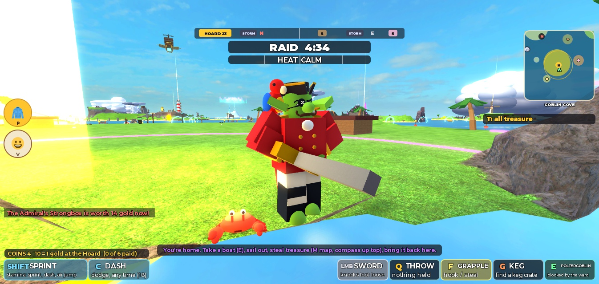
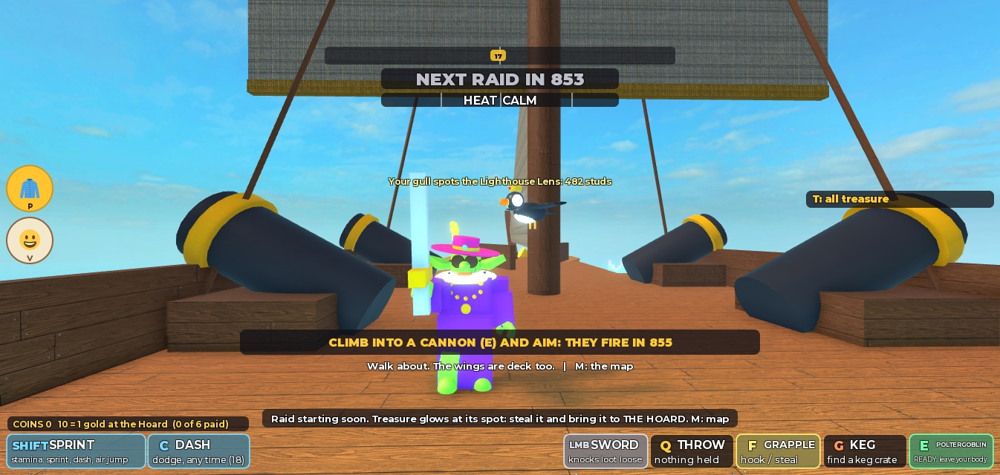
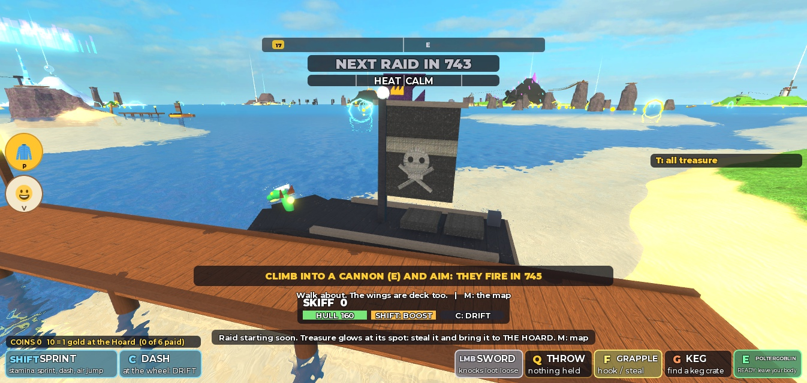
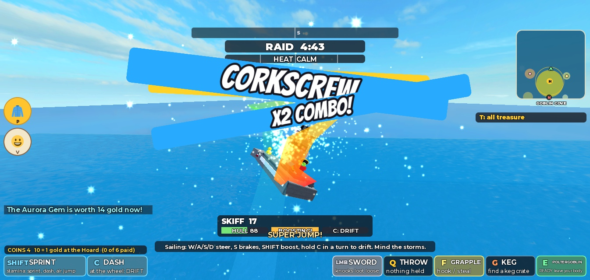
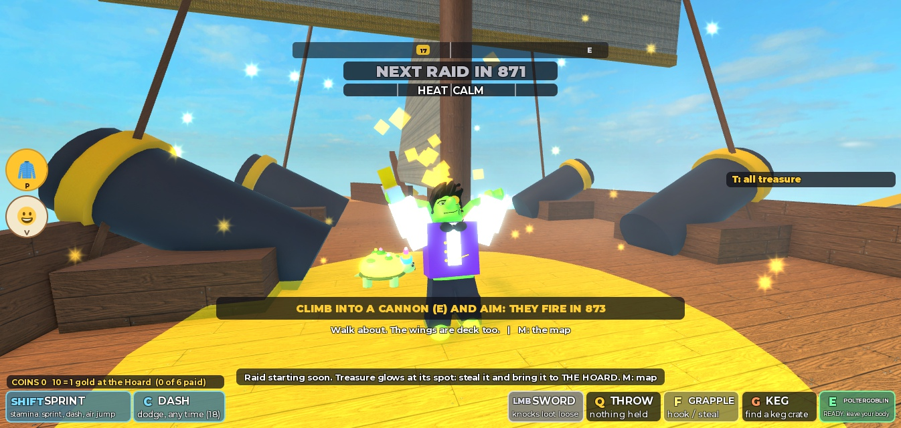
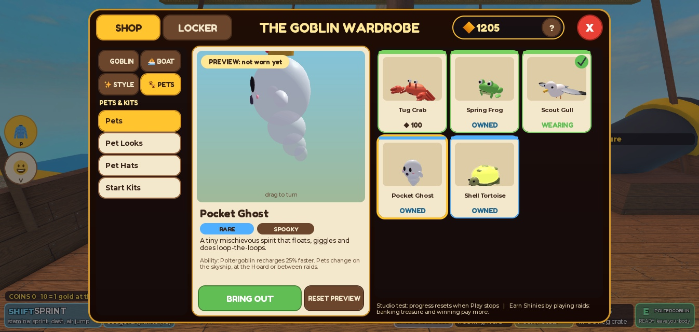
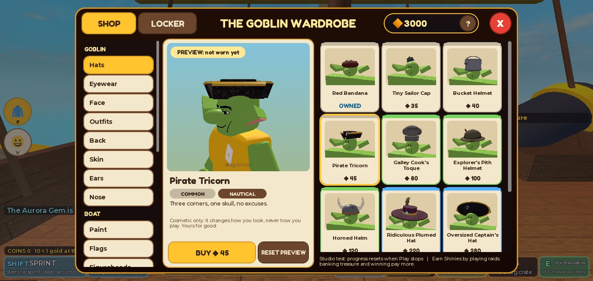
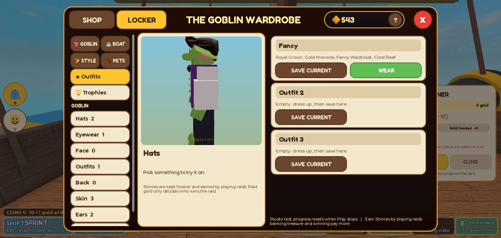
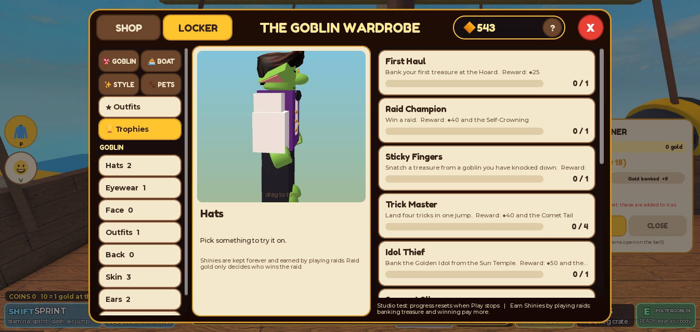

# V11: Goblin Life (2026-10-17)

Requested with Ninety's "V11 One-Shot: Goblin Life" prompt (customization, pets, progression and monetization), run by Enrik with: make it look good, make it reliable, make me impressed. Built by Claude Opus 5.5 in one session on 2026-10-17.

**Read this first.** Everything below was built and tested by one AI on **one** Roblox Studio client, mostly through real key presses and mouse clicks plus a Studio-only test harness. Nobody has played V11 yet. It has never had a second player. Saving ran on an in-memory stand-in for Roblox's DataStore, because this Studio place has no DataStore access: the save logic is tested, **live saving is not**. No real Robux purchase was made, and none can be made: no product exists yet. Where I built something and did not look at its final version, I say so.

## 1. Executive summary

- **One ownership system** for everything a goblin keeps: Shinies, 121 catalogue items in 21 slots, 11 achievements, outfit presets and Robux entitlements, in one saved profile per player. V7 profiles are migrated in place, keeping every Shiny, pet, kit and receipt.
- **Reliable saving**: every read and write is one `UpdateAsync` with a **session lock**. A server never writes over a profile another server has opened. Saves happen within seconds of a change, every 60 s anyway, on leaving and on shutdown; failures are retried; a goblin whose profile is busy plays on and keeps what they earn.
- **Goblin customization**: hats, eyewear, face, outfits, back pieces, skin, ears and nose (55 items). They are built on the real avatar by shared code, so the shop preview **is** the in-game look. They survive respawn, appearance loading, ragdoll tumbling and rejoining.
- **Boats wear their driver's look**: paint (9), flags (6), figureheads (4), boost trails (6) and wakes (3). The Navy and every AI ship are never painted.
- **Trick style**: trick effects (4) and callout styles (5) on top of V9's tricks, which are unchanged.
- **Emotes and victory dances**: 7 emotes on a wheel (`V`, D-pad up, or a screen button) and 4 victory dances the raid's winner plays on the skyship's deck. All are procedural poses: no uploaded animations, and an emote can never move a goblin.
- **Five redesigned pets** with personalities. They walk beside you, ride your boat's deck, cling on when you fly, swim or are launched, react when you steal, bank or win, and do idle quirks. There are 5 alternative looks and 4 pet hats.
- **The Goblin Wardrobe**: a shop and locker in one window with a turning 3D preview of your own goblin, boat or pet, 3D thumbnails on every card, two-press buying, outfit presets, a trophy cabinet, and mouse, gamepad and touch controls. A tailor's stall on the skyship opens it.
- **Raid results** show the winner, the gold table and exactly what you earned and why.
- **Robux plumbing** with idempotent receipts and game-pass checks, **switched off**: no product ids are invented, and sales stay disabled until a human creates products (`docs/MONETIZATION.md`).
- **46 automated Luau tests** (catalogue, economy, migration, damaged data, session locks, store failures, receipts), all passing. On top of that came live Studio tests of the whole loop, including leave-and-rejoin and a rejoin while another server held the profile.

## 2. Git state and PR

V10 (PR #21) and V9 (PR #20) were merged into `main` before this started (`3bbcb28`), so V11 is branch `feature/v11-goblin-life` cut from `origin/main` at `3bbcb28`. Its pull request targets `main` and is not merged. Commits: `1189cad` V11 (code), then documentation, then notebook observations. Nothing was force-pushed.

AGENTS.md (2026-10-14) explicitly opens the scope ("progression, shops, pets ... anything"). It has no outdated restriction left that conflicts with this work, so nothing in it was changed. One small conflict: AGENTS.md's document-ownership list does not mention the new `docs/MONETIZATION.md` setup guide. I left AGENTS.md alone (governance) and flag it here.

## 3. The progression architecture

| Layer | Module | What it does |
| --- | --- | --- |
| What exists | `shared/Catalog.lua` | Every item (id, slot, name, description, rarity, price / free / achievement / Robux key, vibe) and every achievement. Slot definitions and defaults. Encodes a worn look as one string. |
| The rules | `server/Economy.lua` | Pure functions: buy, equip, presets, payout breakdown, lasting stats, achievements, grants, merging earnings. No network, no DataStore. |
| The shape on disk | `server/ProfileSchema.lua` | Version 2 profile, migration from version 1, repair of damaged data, refusal of newer versions. Pure. |
| The store | `server/ProfileStore.lua` | Session-locked `UpdateAsync` open and save, retries, request-budget waits; an in-memory stand-in (`ProfileStore.mock()`) for tests and Studio. |
| The goblins here | `server/Progress.lua` | Sessions (loading, saved, stand-in, lost), save scheduling, shop requests, publishing attributes, raid payouts, achievements. |
| Robux | `server/Receipts.lua`, `server/Monetization.lua` | Idempotent Developer Product receipts; game-pass checks; guarded purchase windows; price lookups. Off until configured. |
| Looks | `shared/Wardrobe.lua`, `shared/BoatLook.lua`, `shared/PetLook.lua`, `shared/EmoteMoves.lua`, `shared/StyleFx.lua` | How every item looks, used by the server (live goblins, boats) and the client (previews, pets, effects). |
| Live presentation | `server/GoblinLook.lua`, `server/BoatStyle.lua`, `server/Emotes.lua`, `client/Pets.lua`, `client/Looks.lua`, `client/Tricks.lua` | Dressing characters and boats, emote state, pets, trails, trick effects, callouts, celebrations. |
| Interface | `client/Shop.lua`, `client/Emotes.lua`, `client/Results.lua`, `client/Ui.lua` | The wardrobe, the emote wheel, raid results, the interface kit. |

The trust boundary: the client sends intent only (`ShopRequest("buy", id)`, `EmoteRequest(id)`). The server checks ownership, price, slot, rate (8 requests a second) and, for pets, place. Ownership and balance live on the server. Clients only read them from attributes (`Shinies`, `Owned`, `Look`, `Presets`, `Achievements`, `AchievementProgress`, `SaveState`).

## 4. Player profile schema and migration

Version 2, one key per player (`u<UserId>`) in the same DataStore V7 used (`LootGoblinsProfile_v1`), so nobody is reset:

| Field | Holds |
| --- | --- |
| `v` | 2 |
| `shinies` | whole number ≥ 0 |
| `owned` | `{ itemId = true }` for everything not free (ids this server does not know are **kept**: a newer server may have written them) |
| `equipped` | `{ slot = itemId }` for every worn slot and the start kit |
| `petSkins` | `{ petId = itemId }` |
| `presets` | up to 3 `{ name, look }` |
| `stats` | raids, wins, banked gold, treasures, snatches, best trick combo, banked count per treasure |
| `achievements` | `{ id = unix time }` |
| `receipts` | Robux purchase ids already granted, oldest first, last 500 kept |
| `history` | the last 40 purchases (time, kind, item, amount, balance) |
| `welcomed`, `created`, `seen` | first-visit flag and times |
| `lock` | `{ job, session, at }`: which server session has it open |

**Migration from V7 (v1 → v2)**, in `ProfileSchema.load`: Shinies kept; owned pets become `owned[petId]`; owned kits become `owned["kit_" .. gearId]`; the chosen pet and kit become `equipped.pet` and `equipped.kit`; raids, wins and banked move into `stats`; every V7 receipt id is kept (sorted, since V7 stored a set). Migrated goblins also get the V11 welcome (60 Shinies). A profile is migrated the first time it is opened and immediately saved as v2.

**Damaged data** is repaired, not refused: wrong types become empty, numbers become whole and non-negative (text, NaN, infinity and negatives go to 0), bad presets and receipts are dropped, and lists are capped. Unknown items and top-level fields are kept. A value that is not a table becomes a fresh profile flagged `repaired`. **A profile written by a newer game version (v > 2) is never opened for writing**: that goblin plays unsaved, so an older server during a rolling update cannot erase newer data.

## 5. Persistence and reliability

- **Session lock.** Opening takes the lock unless another session holds a fresh one (refreshed within 180 s). Every save checks the lock is still this session's and refuses ("lost") otherwise, including when the key was deleted. A server that lost its lock stops saving that profile and tells the goblin. The save made on leaving releases the lock, so the next server opens it at once.
- **Opening.** The goblin plays immediately on a blank stand-in profile (`SaveState` loading). The real profile is tried 5 times, 4 s apart. If it still cannot be opened (another server is closing it, or the store is down), the goblin keeps playing on the stand-in (`standin`) and it is retried every 20 s. When it opens, **what was earned moves across**: Shinies and stats. Buying waits until then (nothing bought on a stand-in can be lost).
- **Saving.** Within 6 s of a change (at once after a purchase, a receipt or an achievement), every 60 s anyway (which keeps the lock fresh), on leaving (with release), and on shutdown (`BindToClose`, parallel, up to 25 s). Each call is retried 4 times with growing waits (1, 2, 4 s). It waits for the `UpdateAsync` request budget when that is exhausted. After two failures in a row the goblin is told their progress is kept in this server and will be saved when possible.
- **Never overwrite good data with bad**: a failed load never saves; a newer version is never written; a lost lock is never written; a stand-in is never written over the real profile, only merged into it once that is open.
- **Unlimited currency** cannot be created: payouts are once per goblin per raid (a raid counter), achievements pay once (recorded with the payment in the same profile), and receipts are recorded with their grant.
- **Studio**: with no DataStore access (an unpublished place, or API access off) the server uses the in-memory stand-in and `SaveState` says `studio` ("progress resets when Play stops"). In a live server the real DataStore is used. **Live DataStore saving has not been run** (see section 28).

## 6. Economy and Shinies balance

The raid payout is V9's, unchanged (`Config.PROGRESS`): 6 for taking part (60 s of the raid at least), 1 per gold banked up to 22, +15 for the winner (shared by a tie), +3 for a goblin who banked something and finished in the bottom half, at most 42 a raid. New in V11: 60 welcome Shinies on a goblin's first visit (new and migrated profiles), and achievements (25 to 150 each, once).

What a goblin earns per raid, from the formula and the treasure values (4 to 11 gold, the Golden Idol 17; banking in the last 50 s pays 25% more; untouched treasure gains interest):

| Goblin | Banked | Shinies |
| --- | --- | --- |
| New, took part, banked nothing | 0 | 6 |
| Banked one ordinary treasure, behind | 7 | 6 + 7 + 3 = 16 |
| Competent, several treasures, did not win | 25 | 6 + 22 = 28 |
| Winner | 25 | 6 + 22 + 15 = 42 (cap) |
| Lost but did reasonably (one big treasure), in the bottom half | 11 | 6 + 11 + 3 = 20 |

At about 9 raids an hour that is roughly 140 to 380 Shinies an hour. Prices follow from it (all 121 items in section 7):

| Tier | Price | Raids for a typical goblin (about 15 a raid) |
| --- | --- | --- |
| Commons | 25 to 80 | 1 to 3 (the first one at once with the welcome Shinies; measured: a fresh goblin bought the Pirate Tricorn, 45, before their first raid) |
| Uncommons | 70 to 150 | 5 to 10 |
| Rares | 180 to 280 | 12 to 18 |
| Legendaries | 600 to 700 | 40 to 45 (a few hours) |
| Pets | 100 to 220 | 6 to 14 (the first one after about 2 to 3 raids with the welcome and the First Haul trophy: measured, a fresh goblin had 107 after one stolen treasure and one won raid) |
| Trophies | not sold | one clear deed each |

All 94 Shinies items together cost 11,865: a long-term collection, not a requirement. Nothing sold changes how strong a goblin is except the five pets (small sidegrades, all sold for Shinies) and the three start kits (gear that is free in the world). One currency only: Shinies. Robux is an optional second way to a few things.

**Pet ability balance.** I reviewed the five V7 abilities. Four are modest conveniences that do not touch other players (recall wait −40%, dash recharge +35%, Poltergoblin recharge +25%, the gull's treasure distance). The Shell Tortoise is the only one that touches player-versus-player: it bounces one grapple catch. V11 makes it rest 45 s instead of 30 s, and **its shell glows while it is ready, visible to everyone**, so an attacker can see the bounce coming and wait it out. Prices were reordered by usefulness (Crab 100, Frog 130, Gull 150, Ghost 180, Tortoise 220). Every pet is sold for Shinies; Robux only ever offers the same pet. **Pets change only where nothing is chasing you**: on the skyship, at the Hoard, or between raids (measured: a pet bought mid-raid is owned but stays in the locker until then). That stops a goblin swapping to the Tortoise just before a fight.

## 7. The catalogue

121 items: 13 free for everyone, 94 for Shinies, 10 trophies, 4 premium-only (not on sale). By rarity: 50 common, 38 uncommon, 15 rare, 4 legendary, 10 trophy, 4 premium. ◆ is Shinies.

| Slot | Items |
| --- | --- |
| Hats (11) | Red Bandana (free), Tiny Sailor Cap ◆35, Bucket Helmet ◆40, Pirate Tricorn ◆45, Galley Cook's Toque ◆80, Explorer's Pith Helmet ◆100, Horned Helm ◆120, Ridiculous Plumed Hat ◆220, Oversized Captain's Hat ◆280, Royal Crown ◆650, Idol King's Crown (trophy: bank the Golden Idol) |
| Eyewear (7) | Eyepatch ◆30, Oversized Spectacles ◆40, Googly Eyes ◆75, Brass Diving Goggles ◆90, Gold Monocle ◆110, Star Shades ◆220, Pickpocket's Mask (trophy: snatch a treasure) |
| Face (6) | Battle Scar ◆30, Curly Moustache ◆35, Gold Tooth Grin ◆45, War Paint ◆70, Braided Beard ◆110, Old Salt's Mutton Chops (trophy: 25 raids) |
| Outfits (9) | Deckhand Stripes ◆60, Barrel Overalls ◆70, Explorer's Vest ◆120, Fancy Waistcoat ◆130, Pot-Lid Armour ◆140, Captain's Coat ◆280, Royal Robe ◆600, Ghostly Pirate Coat (trophy: bank the Skull Chalice), Admiral's Regalia (premium) |
| Back (6) | Loot Sack ◆50, Tiny Anchor ◆90, Tattered Cape ◆100, Stuffed Parrot ◆120, Bat Wings ◆240, Bulging Hoard Sack (trophy: 150 gold banked) |
| Skin (8) | Classic Goblin, Moss, Swamp (free), Sea Goblin ◆40, Cave Goblin ◆40, Hobgoblin ◆100, Bog Violet ◆200, Golden Goblin (trophy: 750 gold banked) |
| Ears (5) | Long Pointed, Droopy (free), Tiny Nubs ◆30, Bat Ears ◆35, Gold Hoop Earrings ◆80 |
| Nose (3) | Big Round Nose (free), Long Pointy Nose ◆25, Warty Potato ◆30 |
| Boat paint (9) | Class Colours (free: V10's look), Sunset Run ◆60, Pumpkin Patch ◆80, Coral Reef ◆120, Shark Bite ◆150, Jolly Goblin ◆260, Royal Barge ◆600, Leviathan Scale (trophy: bank the Leviathan's Tooth), Starlit Galleon (premium) |
| Flags (6) | Jolly Goblin Flag (free), Chequered Flag ◆40, Fish Windsock ◆50, Golden Crown Banner ◆100, Spectral Pennant ◆200, Chart Flag (trophy: treasure from 8 islands) |
| Figureheads (4) | Goblin Bust ◆60, Rubber Duck ◆120, Sea Dragon ◆280, Golden Idol ◆700 |
| Boost trails (6) | Gold Sparkle ◆60, Bubble Stream ◆70, Ember Sparks ◆120, Ghost Wisps ◆120, Rainbow Ribbon ◆250, Aurora Ribbon (premium) |
| Wakes (3) | Squid Ink ◆60, Glitter Wake ◆100, Petal Wake ◆110 |
| Trick effects (4) | Starburst ◆50, Confetti Cannon ◆110, Fireworks ◆260, Comet Tail (trophy: four tricks in one jump) |
| Callouts (5) | Street Style (free: V9's look), Gold Rush ◆40, Comic Pop ◆50, Spooky ◆80, Royal Decree ◆180 |
| Emotes (7) | Wave, Cackle (free), Salute ◆30, Panic! ◆45, Goblin Jig ◆50, Faceplant ◆80, Flex ◆90 |
| Victory dances (4) | Arms Up (free), Victory Stomp ◆120, Gold Shower ◆260, Self-Crowning (trophy: win a raid) |
| Pets (5) | Tug Crab ◆100, Spring Frog ◆130, Scout Gull ◆150, Pocket Ghost ◆180, Shell Tortoise ◆220 |
| Pet looks (6) | Hermit Crab, Puffin, Dart Frog, Mossback, Pumpkin Ghost (◆90 each), Golden Crab (premium) |
| Pet hats (4) | Pet Bow ◆30, Pet Party Hat ◆35, Pet Tricorn ◆40, Pet Crown ◆100 |
| Start kits (3) | Rebreather, Cinder Boots, Frost Claws (◆90 each, V7's) |

Every row has a real look; a test fails if one does not (section 22). Rarity is a label on what something costs or how hard it is earned; there is no random drop of any kind anywhere.

**Achievements (11)**: First Haul (bank a treasure, ◆25), Raid Champion (win, ◆40, Self-Crowning), Sticky Fingers (snatch from a downed goblin, ◆30, Pickpocket's Mask), Trick Master (four tricks in one jump, checked by the server, ◆40, Comet Tail), Idol Thief (bank the Golden Idol, ◆50, Idol King's Crown), Serpent Slipper (bank the Leviathan's Tooth, ◆50, Leviathan Scale), Skull Rock Survivor (bank the Skull Chalice, ◆50, Ghostly Pirate Coat), Island Hopper (treasure from 8 islands, ◆60, Chart Flag), Old Salt (25 raids, ◆60, Mutton Chops), Hoarder (150 gold, ◆60, Hoard Sack), Hoard Legend (750 gold, ◆150, Golden Goblin).

## 8. Goblin customization

`shared/Wardrobe.lua` dresses a character: it paints the skin (BodyColors and every body part; Golden Goblin is Foil), builds the ears and nose, then the hat, eyewear, face, outfit and back piece. Head pieces are written for a 1.2-stud head and scaled per axis to the real head; body pieces are sized from the real body parts, so they fit any avatar shape. Every part is welded to a body part and is **massless, non-colliding, never hit by rays, never touched**: movement, hitboxes, grapples and the Poltergoblin body copy are unchanged, and the pieces ride the loose-limbed tumble because they are welded per limb.

- **Combining**: one item per slot, all slots combine. An avatar's own Roblox item that would clash is hidden while a game item is worn and comes back when it is taken off: hats and hair under a hat, face accessories under eyewear or face items, shirts and jackets under an outfit (trousers too when the outfit has legs), back items under a back piece. Clothing is put in a `GoblinStash` folder; accessories are made invisible with their original transparency remembered.
- **When it runs** (`server/GoblinLook.lua`): at once on spawn, when the avatar's appearance has loaded, 2 s after spawning, and whenever the `Look` attribute changes. It is idempotent: it rebuilds only when the look changed or the head or torso was replaced, and otherwise only re-applies colours and hiding. Measured: after a respawn the full outfit (62 parts) was back on the new head 2 s after spawning; the "at once" call was added after that measurement to remove the gap and was not re-measured.
- **Cost** (measured on the server): the heaviest possible goblin (the biggest item in every slot) is 80 parts; dressing one takes 1.6 ms, once per spawn or change; re-dressing an unchanged goblin is 0.05 ms.
- **Material**: cloth is SmoothPlastic. A first pass used Roblox's Fabric material, which in a screenshot read as noisy knitted wool at a goblin's scale (`2026-10-17-v11-before-fabric.jpg`); the clean colour matches V10's toy look.

## 9. Outfits and presets

Three saved outfits per goblin (Locker → Outfits): **Save current** stores the goblin, boat and style slots (not the pet, which has its own rule about where it can change); **Wear** puts it back on. A preset can never put on anything not owned: every slot is checked again when it loads, and an item no longer owned leaves its slot empty (a test caught the first version leaving the previous hat on). Names are editable (24 characters). Pointing at an outfit row previews it.

## 10. Boat customization

**Policy** (`server/BoatStyle.lua`): a player boat wears the look of whoever is **driving** it (paint, flag, figurehead, and that driver's trail, wake, trick effect and callout as attributes). Passengers change nothing. A boat keeps its last driver's look while it sits, so hopping out to grab treasure does not flicker it; the next driver repaints it. A boat called with `B` arrives in the caller's colours. A boat that sinks and comes back, or is reset at the end of a raid, returns to class colours. The Navy, the Guardian's speedboat and every AI ship are never painted.

**How** (`shared/BoatLook.lua`): paint recolours the parts V10 gave each boat by role (hull, stripe, trim, sails, sail stripe, mast, cabin), remembering each part's own colour the first time, so Class Colours restores V10 exactly. Liveries add details: the shark's teeth and eyes, the Jolly Goblin's skull sails, the Leviathan's amber eyes, scales and sail fins, the Starlit Galleon's stars, the reef's spots, the pumpkin's stalk. Flags are built round the boat's own flag (the free Jolly Goblin flag keeps each boat's coloured flag and adds a skull, because the colours tell boats apart). Figureheads lean off the bow. Nothing changes the hull's size, mass, collision or physics: new parts are welded, massless and non-colliding, and recolouring touches only Color and Material. Measured: boarding a skiff repainted it in 33 decoration parts with the driver's attributes set.

**Trails and wakes** are drawn on each client (`client/Looks.lua`, `shared/StyleFx.lua`) for boats within 420 studs. A trail is one Trail ribbon behind the stern while boosting, plus at most one sparkle emitter; a wake is one emitter at speed. The first rainbow trail washed out to white over the bright sea at boost speed; it now has low light emission and a wider ribbon (not re-photographed after the fix).

## 11. Trick effects

V9's tricks are unchanged. A trick effect streams particles off the hull through each trick and bursts on a clean landing: half the burst for one or two tricks, the full burst for three or more (the Fireworks effect adds a firework then). Bursts are capped at 40 particles, halved on low graphics settings. Callout styles restyle the shouted trick names: your own on your screen, each goblin's own over their boat. Measured with real keys: a boosted super jump into a corkscrew showed the Comic Pop callouts. Their blue backing panels were as wide as the whole callout area and hid the middle of the screen, so they now hug the words and are slightly see-through (not re-photographed after the fix). That jump landed "SKETCHY", so the clean-landing confetti burst was not seen.

## 12. Emotes and victory celebrations

- **Emotes** (`shared/EmoteMoves.lua`): Wave, Cackle, Salute, Panic!, Goblin Jig, Flex, Faceplant. Each is a pose written over the avatar's animation each frame through each joint's Transform (V8's method; this place's avatars use AnimationConstraint joints and the code handles Motor6D too). **An emote never moves the character.** The server (`server/Emotes.lua`) allows one only for an owned emote, on a live goblin standing on something, not seated, flying, knocked down or a spirit, and at most one start a second. It ends when its time is up or the goblin moves more than 2.5 studs, sits or is launched; the goblin's own client also stops it the moment they move or jump. Every client within 220 studs poses it. Measured with real keys: `V` opened the wheel, `3` started the Goblin Jig, and the joint readings and a screenshot showed the dance.
- **The wheel** (`client/Emotes.lua`): `V`, D-pad up, or the dock's 😀 button. Choose by clicking, tapping, a number key, or the left stick and A. While it is open, the number keys, A, B and the left stick are taken from the game, so choosing never picks a tool, jumps or walks away.
- **Victory**: the raid's winner (every winner on a tie) plays their equipped victory dance on the skyship's deck 1.2 s after the results, with the Gold Shower's coins or the Self-Crowning's crown descending onto their head. The auto-opening map is held for 5.5 s after a raid with a winner so the deck can see it. Measured: the Gold Shower played on deck (screenshot below).

## 13. Pet-by-pet redesign

All five are built from 11 to 27 parts each (`shared/PetLook.lua`), with faces, a readable silhouette and their own movement:

| Pet | Look | Moves | Idle quirk |
| --- | --- | --- | --- |
| Tug Crab | squat coral-red crab, eyes on stalks, one claw bigger, six legs | scuttles **sideways** with alternating legs | snaps its pincers |
| Scout Gull | round white seabird, grey wings, black tips, yellow beak | flies at your shoulder, flapping faster at speed, gliding when calm | looks about; every 9 s (yours) it flies a short way toward the nearest waiting treasure |
| Spring Frog | fat green frog, huge eyes, pale throat that pulses | hops in arcs | catches a fly (tongue out) |
| Shell Tortoise | domed shell with paler plates, slow head, stumpy legs | plods; its shell **glows while ready** to bounce a grapple | yawns |
| Pocket Ghost | round spirit, wispy waving tail, nub arms, blushing cheeks, "o" mouth | floats and bobs, tail and arms waving | loops the loop |

Looks: Hermit Crab (striped shell), Puffin (black and white, striped orange beak), Dart Frog (blue with black spots), Mossback (flowers and tufts on the shell), Pumpkin Ghost (a carved glowing pumpkin), Golden Crab (premium). Hats: bow, party hat, tricorn, crown, worn on each pet's own hat spot.

## 14. Pet ability balance

See section 6. Abilities are decided on the server from the player's `Pet` attribute (`Gear.pet`, read by Recall, Movement, Poltergoblin and Combat), never from anything drawn. The Shell Tortoise rest is `Config.PET_TORTOISE_REST` = 45 (V7: 30); its ready state comes from the existing `ShellReadyAt` attribute, which every client reads to light the shell.

## 15. Pet following and reactions

- **On foot** the walkers walk, hop or plod to a spot beside you with a spring led by your own speed. Measured: a plain spring trailed 10 studs behind a goblin walking at 28 studs/s, so the lead was added.
- **In a boat** they ride on the deck beside the driver's seat, positioned from the seat each frame, so they keep up at any speed. Measured: the crab sat 2 studs beside the driver.
- **In the air, the water, a dive, a launch or above 60 studs/s** they cling on: the crab to your back, the frog on your head, the tortoise like a backpack. Measured: at launch speed the crab switched to clinging within a frame.
- **The fliers** (gull, ghost) hold a spot in your own frame of reference and sway back a little when you speed up, so they never fall behind. A switch between walking, riding and clinging is a quick 0.35 s hop, not a jump cut. A pet more than 40 studs from its spot (respawn, teleport) reappears there with a puff.
- **Reactions**: a hop and spin (cheer) when you steal, snatch or bank; a tumble when the Guardian launches you; a four-hop dance when you win; trembling while something is chasing you (any model whose `Chasing` attribute is you, as the minimap uses).
- **Never in the way**: pets are anchored, non-colliding, never hit by rays and never touched; your own pet fades when the camera is pushed within 4 studs of it (a lesson from Tiny Wins Tycoon).

## 16. The shop

The Goblin Wardrobe (`client/Shop.lua`) opens with `P`, D-pad right, the dock's 🧥 button (left side of the screen, under 50% height), or Madame Ragwort's tailor stall on the skyship's quarterdeck (`E`). It closes with `P`, the X, B on a gamepad, clicking outside, or by itself when you climb into a cannon, fly or pick up treasure (measured).

- **Left**: four group tabs (👺 Goblin, ⛵ Boat, ✨ Style, 🐾 Pets) and that group's sections. A first version listed all 21 sections in one long scroll that hid Pets at the bottom.
- **Middle**: the stage (a turning 3D preview, drag or right stick to turn) and the item's name, rarity, vibe, description and what it does. Every cosmetic says "Cosmetic only: it changes how you look, never how you play. Yours for good."; pets state their ability and where they can be changed; trophies say how to earn them, with progress.
- **Right**: cards with a real 3D thumbnail (on a goblin mannequin, a real boat, the real pet), the name, and the state: price (red when you cannot afford it), OWNED, WEARING ✔, 🔒 TROPHY, or a Robux price / NOT ON SALE.
- **Buying** is two presses: BUY ◆45, then CONFIRM ◆45? within 5 s. The server checks again; a purchase is worn at once where that makes sense. Not enough Shinies says how many more and how to earn them. The balance counts down and the card pops. Rapid presses of one item are ignored while a request is pending, and the server rate-limits (measured: the 9th and 18th of 18 requests sent at 10 a second were refused).
- **Help**: the ? beside the balance explains exactly how Shinies are earned.

## 17. The locker

The LOCKER tab shows only what you own, with counts per section, plus **★ Outfits** (three presets) and **🏆 Trophies** (every achievement with its progress bar, reward and DONE state; pointing at or pressing one previews its reward). Wearing, taking off (back to the slot's default), bringing out and putting away pets, choosing the start kit and playing an emote all happen here. The server's answer updates the cards immediately; other goblins see changes through the replicated character and attributes.

 

## 18. Item previews

- **Goblin items** preview on a **copy of your own character**: the clone is anchored, its joints are read (Motor6D or AnimationConstraint), it is put into a rest pose by forward kinematics, and everything welded to it (your avatar's accessories, the game's cosmetics) follows. It is dressed with `Wardrobe.dress`, the same function the server uses, so the preview cannot disagree with the game. Emotes and victory dances play on it with the same pose code. If the character cannot be copied, a goblin mannequin stands in.
- **Boat items** preview on a still copy of a real skiff that the server places in `ReplicatedStorage.LootGoblinsPreview` at start-up, painted by `BoatLook.apply`.
- **Pets** preview with the same rig and pose code the world uses.
- **Trails, wakes, trick effects and callouts**: a ViewportFrame cannot draw particles or Trail objects, so these show as flat previews in the trail's real colours (an animated ribbon), the callout in its real font and colours, and the boat spinning for trick effects. They are honest about colour and style, but not the real particles; the real ones were seen in the game (section 11).
- "PREVIEW: not worn yet" shows whenever the stage differs from what is worn; RESET puts it back.

## 19. Premium monetization architecture

`Config.MONETIZATION` lists nine entries: the five pets (the Robux way to the same pet) and four premium-only cosmetics (Admiral's Regalia, Starlit Galleon, Aurora Ribbon, Golden Crab). Each entry has a kind (`pass` recommended: Roblox itself remembers who owns a game pass; `product` is supported too), an `id` (nil: no product exists), and what it grants. `SALES_ENABLED = false`.

- **Game passes**: when a goblin's profile opens, every configured pass is checked with `UserOwnsGamePassAsync` (retried) and its grants are added to the profile. A purchase made in this server is granted from `PromptGamePassPurchaseFinished` (a server event).
- **Developer products**: `ProcessReceipt` is installed only when a product-kind entry has an id, and runs `server/Receipts.lua` (section 21).
- **Prompts** are refused, with a reason, unless sales are on, the item has a configured product, the goblin's profile is open and they do not already own it. Only one purchase window per goblin is pending at a time (10 s).
- **Prices** are read from Roblox (`GetProductInfoAsync`; `GetProductInfo` is deprecated) for configured products only, and published as one attribute. A product whose price cannot be read is not shown as buyable.
- **Visibility**: unconfigured premium items are hidden in live servers, and shown in Studio (previewable, "ROBUX: NOT ON SALE") so the team can see them.
- **Analytics** (`server/Analytics.lua`): Roblox's AnalyticsService only, wrapped so a failure never matters. It logs Shinies sources and sinks (`LogEconomyEvent`), onboarding steps 1 to 4 (joined, first raid, first purchase, first item worn), and ShopOpened, FirstShiniesPurchase, CosmeticEquipped, PetEquipped, AchievementUnlocked, PremiumPurchase, PurchaseFailed and SaveFailed. No personal data, no outside service. Studio printed "event fired" for each; the dashboard side was not looked at.

## 20. Creator Dashboard configuration required

Step by step in `docs/MONETIZATION.md`: create the Game Pass (or Developer Product) with its own icon and price, paste its id into `Config.MONETIZATION.PRODUCTS.<key>.id`, set `SALES_ENABLED = true`, publish, and test with a test purchase in a published test place. The team decides prices; none are invented here. Also needed for live saving: the experience must be published, with **Enable Studio Access to API Services** on to test saving in Studio.

## 21. Receipt and entitlement safety

`server/Receipts.lua`, by rule:
1. An unknown product id is never granted ("retry": Roblox keeps the receipt; a human may map it later).
2. A goblin not in this server, or whose profile is not open here (loading, stand-in, lost), is not granted here ("retry"; Roblox calls again when they join).
3. The receipt's PurchaseId is recorded **in the same profile, in the same change, as the grant**, and only a successful save answers PurchaseGranted. If the save fails the answer is "retry" and the grant stays in memory, so it goes out with the next save.
4. A receipt already recorded grants nothing again, but still needs its record on disk before it is confirmed.
5. A permanent item paid for twice (two purchase windows racing) is not lost money: the second payment becomes 150 Shinies, and the goblin is told.
The session lock is what makes rule 3 safe across servers: a server that has lost the profile cannot save, so it cannot confirm.

## 22. Testing of purchases and failure cases

**Automated (46 Luau tests, `tests/luau`, run in Studio's Edit mode, all passing):**
- Catalogue: unique ids; valid slots, rarities and prices; exactly one way to obtain each item; trophies and achievements point at each other; every Robux key configured, every product id empty or a real whole number, and sales off while none is configured; pets match `Config.PETS` and are all earnable; slot defaults free; **every item has a real look**; looks survive encoding and junk is dropped; every goblin item builds within its part budget and is massless, non-colliding, never ray-hit or touched, and dressing twice changes nothing; every boat item builds without changing the hull and Class Colours restores it; every pet, look and hat builds anchored and harmless; every emote poses from start to end.
- Shop: buy with enough; without enough (nothing changes, says how many more); already owned (no second charge); 10 rapid repeats charge once; trophies, premium, free and unknown ids refused; pet looks need their pet; equip needs ownership and the right slot; unequip returns to the default; the look drops anything not owned whatever the data says; a pet look only on its own pet; presets save and load, never put on unowned items, refuse bad indexes; payouts for every case in section 6; achievements unlock once, pay once and grant; earnings merge once; welcome once; grants do not duplicate.
- Receipts (simulated): valid (granted, recorded, saved); duplicate (no second grant); unknown product; player not here; profile not open; save failure then retry (granted once, nothing lost); a second payment for an owned item (compensated); malformed receipts; the receipt list keeps the newest 500.

**Live in Studio, against the running server** (a product id mapped at runtime for the test, never in the repository): a valid receipt → PurchaseGranted, item owned, profile on the store; the same receipt again → PurchaseGranted with no change; an unknown product → NotProcessedYet; a second purchase of the owned item → PurchaseGranted and +150 Shinies; a buyer not in the server → NotProcessedYet. **No real Robux transaction was made.** The game-pass path and the prompt windows were not exercised (they need real passes).

## 23. Persistence testing

Automated, on the stand-in store with a fake clock: first open creates and locks; a second server sees "locked" and writes nothing; release on leave lets the next server open at once with everything; a crashed server's stale lock is taken over after 180 s **and its late save is refused** with the newer data intact; a deleted key is not re-created; 2 and 3 transient failures are retried, 10 report an error and leave the stored value untouched, and a later save succeeds; a newer version's profile is never opened or written; a V7 profile in the store is migrated on open and saved as v2 at once; the game's copy and the store's copy are separate tables; an exhausted request budget is waited out; V7 migration keeps everything; damaged fields are repaired with unknown ids kept; non-table values and newer versions are handled.

Live in Studio (stand-in store, the real `Progress` sessions):
- **Leave and rejoin** in the same server: Shinies, owned items, the worn look, presets, pet and trophies identical afterwards (twice, in two sessions).
- **Rejoin while another server holds the profile** (a fresh foreign lock planted in the store): this server refused to open it, retried 5 times (16 s), then let the goblin play on a stand-in; they earned 18 Shinies from a raid and a purchase was refused; the stored profile stayed at 525 under the other lock. When the other server let go, the background retry opened it within 20 s and merged the earnings: **525 + 18 = 543**, everything intact, saved under this server's lock with the raid counted.

**Not tested**: Roblox's live DataStore (this place has no API access), real cross-server rejoining, `BindToClose` on a real shutdown, and DataStore throttling under load. The code uses the documented `UpdateAsync` pattern; those still need a published test.

## 24. Multiplayer replication testing

**Not tested with a second player**: the MCP tools here run one Studio client. How each piece reaches other players:
- Goblin cosmetics are parts in the character, built by the server, so they replicate like any character part.
- Pets, trails, wakes, trick effects, emote poses and celebrations are drawn by every client from replicated attributes (`Pet`, `Look`, `Emote`, boat `Trail`/`Wake`/`TrickFx`/`StyleOwner`/`Pilot`), with the same loops over every player that drew the local player's in these tests.
- Boat paint and figureheads are server-built boat parts.
- Inventories and balances are per-player server sessions; the receipt and lock tests show one goblin's profile cannot touch another's.
Two players on one boat, two winners dancing, other players' pets near yours and the 32-player crowd remain human tests (section 30).

## 25. Performance measurements

On the development PC, Studio client at 60 fps (V10 baseline also about 60):

| What | Measured |
| --- | --- |
| 32 pets in view, every part moved every frame (worst case: everyone on the deck) | 562 parts, 1.9 to 2.1 ms a frame of script time, 60 fps held |
| The same with one anchored root per pet and welded parts (the V10 creature method) | 1.45 ms; not worth a rewrite |
| Building 32 pets | 14.5 ms in total |
| Heaviest dressed goblin | 80 parts; 1.6 ms to dress once; 0.05 ms to re-check |
| Fully dressed captain goblin (typical "big" look) | 62 parts |
| Skiff repainted (Jolly Goblin, crown banner, dragon) | 33 decoration parts |
| World build | 6.4 to 7.4 s across sessions (V10: about 6.6); the skyship stall adds 32 decorative parts |

Budgets added after measuring: other goblins' pets update every frame within 50 studs, every 2nd frame to 140, every 4th beyond, and are not drawn beyond 360 studs. On low graphics settings (quality 1 to 3) only the nearest 12 other pets are drawn and particle rates are halved. Trails and wakes are drawn within 420 studs only, and bursts are capped. The LOD tiers were not re-measured with 32 pets after they were added. **Not measured**: a phone, a weak PC, 32 real players, or server cost with 32 dressed goblins in physics.

## 26. Visual screenshots

All in `docs/reports/`, taken with Studio MCP on the live client:

| File | Shows |
| --- | --- |
| `2026-10-17-v11-wardrobe-preview.jpg` | trying on the tricorn: the stage is the player's own goblin, PREVIEW chip, BUY |
| `2026-10-17-v11-wardrobe-bought.jpg` | after buying: WEARING ✔, TAKE OFF |
| `2026-10-17-v11-captain-jig-crab.jpg` | tricorn, eyepatch, moustache, captain's coat, parrot, mid-jig, Tug Crab |
| `2026-10-17-v11-royal-puffin.jpg` | plumed hat, spectacles, royal robe; the Puffin gull with its crown |
| `2026-10-17-v11-deck-crab.jpg` | the captain on the skyship with the crab |
| `2026-10-17-v11-carrier.jpg` | carrying the stolen Lost Compass in a tricorn |
| `2026-10-17-v11-boat-jolly.jpg` | the Jolly Goblin skiff with a dragon figurehead |
| `2026-10-17-v11-trick-callout.jpg` | super jump + corkscrew with Comic Pop callouts (before the backing fix) and the rainbow trail |
| `2026-10-17-v11-gold-shower-mossback.jpg` | the Gold Shower victory dance; Mossback in a party hat |
| `2026-10-17-v11-emote-wheel-frog.jpg` | the emote wheel; the frog with a bow |
| `2026-10-17-v11-results.jpg` | raid results with the Shinies breakdown and a trophy |
| `2026-10-17-v11-pets-tab.jpg`, `2026-10-17-v11-boat-tab.jpg` | wardrobe sections with 3D thumbnails |
| `2026-10-17-v11-locker-outfits.jpg`, `2026-10-17-v11-locker-trophies.jpg` | the locker |
| `2026-10-17-v11-pet-adopted.jpg` | adopting the Tug Crab |
| `2026-10-17-v11-compact-layout.jpg` | the compact layout for short screens (forced on in Studio) |
| `2026-10-17-v11-before-fabric.jpg` | the first outfit pass in Fabric material (replaced) |

Not photographed: all 121 items one by one (they are covered by the build tests and thumbnails; I looked at about 40 in screenshots), the ghost and tortoise following in the world, the Self-Crowning crown, the confetti landing burst, the tailor's stall, and the trail and callout fixes made after their screenshots.

## 27. Regression testing

With cosmetics and pets on, in Studio on one client: skyship deployment and the auto-fire at the end of the launch window; landing; stealing a real treasure with `E` (Lost Compass: Heat rose, carried overhead); banking it at the Hoard (6 gold with interest; First Haul paid); the final rush; ending a raid (payout, Wins +1, reset, back on the deck); boat boarding, boosting at 162 studs/s, a super jump and two tricks with the server's checks; respawn; the intermission rule that keeps goblins on the ship. **Collision**: every V11 part is non-colliding (tested for every item). I did not re-run V10's whole-world collision fingerprint; the only world change is the tailor's stall, whose 32 parts are all created non-colliding and not ray-hit. Not re-tested in V11: grappling, guardian pursuits, the Leviathan, tornadoes and the Ghost Fleet; no code they use changed except Boats (styling on driver change, a new signal) and Recall (styling a called boat).

## 28. Known limitations

- **Live saving untested** (no DataStore access in this Studio place); real Robux untested (no products).
- **No second player** in any test (section 24).
- **Touch was not tried on a device**; the compact layout was checked only by forcing it on in Studio. Gamepad: `D-pad right` opened the wardrobe and the bindings exist, but full gamepad navigation of the grid was not walked through.
- **Avatar variety**: tested on one R15 avatar with AnimationConstraint joints. Emotes on the classic six-part avatar map only shoulders, hips, neck and root, and will look wrong. Unusual heads (dynamic heads, Rthro) are scaled from the head's size but were not looked at.
- **Viewport previews cannot draw particles or trails**: the trail, wake and trick-effect previews are flat colour previews.
- The outfit shells are boxy by design; long robes clip a little through walking legs; a cape does not stream behind at speed (it is static).
- Pet hats sit on a fixed spot per pet and can clip a little through the Pumpkin Ghost's stem.
- Prices are first guesses from the formula; nobody has played long enough to judge them.
- Royal and magenta colours read very saturated under V10's colour grade.

## 29. Deferred work

Gamepad grid navigation pass and a phone test; avatar-variety pass (R6 emotes, Rthro and dynamic heads); the 32-player load test and re-measuring the pet LOD with 32 pets; a published test place for live saving and test purchases; analytics dashboard review; more items in the thin slots (wakes 3, figureheads 4, trick effects 4); seasonal or event cosmetics if the team wants them (never random).

## 30. Human playtest recommendations

On one PC with **Test > Server & Clients > 3 players**, or better three PCs:
1. Each player opens the wardrobe (`P` or the 🧥 button), buys something with the welcome Shinies and wears it. Do the others see it?
2. Buy a pet on the skyship. Run, sprint, dash, jump, drive, launch from a cannon, swim: does it keep up and look alive? Does it ever get in the way?
3. Two players on one boat: whose paint does it wear (the driver's)? Swap drivers.
4. Boost, super jump and trick with a trail and trick effect equipped: readable or noisy?
5. Use the emote wheel (`V`) on the deck. Try to move while emoting.
6. Finish a raid: is the results card clear? Does everyone see the winner's dance before the map opens?
7. Leave and rejoin (on a **published** place with API access on): is everything still there?
8. On a phone or tablet: can you open, browse, buy and close the wardrobe with your fingers?
9. Say what felt bad and send screenshots of any red errors.

## Feature completion status

| Feature | Status |
| --- | --- |
| Catalogue, profile schema, migration, Economy rules | Implemented and tested (automated) |
| Session-locked persistence, retries, stand-in and merge | Implemented and tested on a stand-in store; **live DataStore requires creator setup** (published place, API access) |
| Goblin cosmetics (55) | Implemented, visually inspected (about 25 in screenshots plus all as thumbnails) and tested |
| Outfit presets | Implemented and tested |
| Boat paint, flags, figureheads | Implemented, inspected (2 paints in the world, all as thumbnails) and tested |
| Boost trails and wakes | Implemented, partly inspected (rainbow and glitter), tuned after inspection; insufficiently tested |
| Trick effects and callout styles | Implemented; Comic Pop inspected and fixed; landing bursts not seen; insufficiently tested |
| Emotes and wheel | Implemented, inspected and tested (Jig, wheel) |
| Victory dances and celebration | Implemented; Gold Shower inspected; Self-Crowning not photographed |
| Pets (5), looks (5), hats (4) | Implemented, inspected (crab, gull/puffin, frog, mossback, all in thumbnails) and tested; ghost and tortoise not watched following in the world |
| Pet following and reactions | Implemented and tested on one client; reactions partly seen (fly-catch quirk) |
| Wardrobe (shop and locker) | Implemented, inspected and tested with real mouse and keyboard; touch and full gamepad insufficiently tested |
| Raid results and rewards | Implemented, inspected and tested |
| Achievements (11) | Implemented; First Haul and Raid Champion unlocked live, the rest by automated tests |
| Robux infrastructure | Implemented and tested with simulated receipts; **requires creator configuration**; no real purchase |
| Analytics | Implemented; events fired in Studio; dashboard not reviewed |
| Multiplayer visibility | Implemented; **not tested with a second player** |
| Mobile | Compact layout implemented; **not tested on a device** |
