# V12: the Cohesion Pass (2026-10-18)

Requested with Ninety's "Loot Goblins — V12 One-Shot: The Cohesion Pass" prompt ("Make me impressed."): play the game as a player, find what makes it feel disconnected or confusing, fix the most important of it, test it and document it, without losing its identity (ridiculous treasure, recoverable chaos, player agency). Built by Claude Opus 5.5 on 2026-10-17 and 2026-10-18, on top of V11 (Goblin Life).

**Read this first.** Everything below was found, built and tested by one AI on **one** Roblox Studio client on the development PC, through real key presses where it says so and a Studio-only test hook (a Workspace script obeying a `DebugCmd` attribute, never committed) elsewhere. Nobody has played V12. It has never had a second player, a phone or a real controller. No treasure value, speed, Heat rule or raid timer changed.

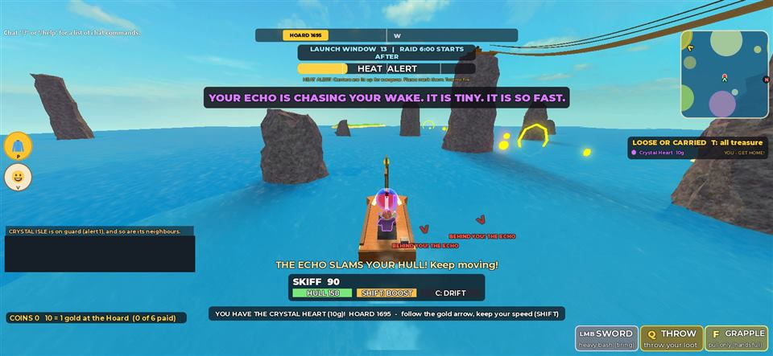

## Summary

- **A picked island is where you land.** Through V11 a map pick, and the ship's auto-fire, aimed at the island's middle at sea level, every throw sank about 40 studs under its own arc, and the server counted a splash up to 21 studs early. A Pebble Isle pick skipped three times and stopped 390 studs past the treasure. Now each island has a **landing spot** (dry, open ground near its treasure, ship side first), and all 16 islands were measured landing on dry ground 2 to 22 studs from it.
- **The first minute is one thing at a time.** V11 opened four overlays at join (a sixteen-row help wall spilling out of its panel, the map, the welcome card, the deck banner). Now the map and the deck banner open, the deck banner names the island your cannon is aimed at, the help is a one-screen controls card on `H`, and the welcome card waits for a calm moment at the Hoard.
- **The screen always says the next step and its key** (the objective line), **banners take turns by importance** instead of wiping each other, and **the HUD shows what the moment needs** (ship, flight, boat, foot).
- **You can see what is chasing you**: red arrows at the edge of the screen point at your pursuers.
- **Small lies fixed**: the bank banner now shows what was paid, nineteen "is worth N gold now!" lines became one, the storm warning no longer says "1 STUDS. SAIL AROUND IT!" on land, and `E` a step short of a boat no longer throws you out of your body.
- **Controller and touch**: `L1` throw, `L2` grapple, `R3` map, D-pad left keg; touch buttons for FIRE, BOAT, HOOK, THROW, BOOST, HOP and TRICK. Testing found that Roblox swallows `L1`, `R1` and `R3` before the game sees them, so **V9's `R1` trick had never worked on a controller**; all three are now bound above Roblox's own actions.
- **Reliability**: a race that occasionally dropped a goblin straight off the deck (once in about forty launches) is closed; late joiners get 12 s on deck before the ship fires them.
- **53 Luau tests** (V11's 46 plus 7), all passing; lint clean; 60 fps held.

## Git state and PR

V11 is pull request #22 (`feature/v11-goblin-life` into `main`), still open and unmerged; its tip `97e52c0` is the verified base. V12 is branch `feature/v12-cohesion-pass` cut from `97e52c0`, and its pull request targets `feature/v11-goblin-life` (a stacked PR) so its diff shows only V12. It is not merged. When V11 is merged, the V12 PR is retargeted to `main` before V11's branch is deleted. Nothing was force-pushed. AGENTS.md needed no change.

## A. Initial assessment

Method: V11 played in Studio as a new goblin, from joining through the deck, the launch, flight, landing, stealing, carrying on foot and by boat, a pursuit, banking, the raid's end and the next raid; then read the code behind every surprise. Shared notebook retrieval succeeded at the start (29 lessons). The strongest things already there: the skyship start and its cannons, the flight with loose limbs, V9's pursuers, boats and tricks, the minimap, V10's look and V11's wardrobe. The problem was rarely a missing system; it was systems contradicting each other or the screen saying something untrue or nothing at all.

| ID | What a new goblin meets (V11) | Evidence |
| --- | --- | --- |
| C1 | Picking an island on the map, or being auto-fired, often lands you **in the sea** beside it | Pebble Isle pick: three skips, stopped 390 studs past the treasure. Cause found in three layers (section C1) |
| C2 | **Four overlays at join**: the help wall (16 rows of sentences, the last spilling out of the panel), the map, the welcome card, the deck banner, over the first 20 s | `2026-10-18-v12-before-join-help.jpg` |
| H1 | **Banners overwrite each other**: "YOU STOLE THE …" was replaced 1.1 s later by the trouble banner before it could be read | Observed while stealing; `Hud.banner` replaced unconditionally |
| H2 | **Feed spam**: up to 19 "The X is worth N gold now!" lines at once, every interest step | `2026-10-18-v12-before-deck.jpg` |
| H3 | **The objective never names a key**: "Steal treasure (light pillars) or rob a carrier, then bring it to THE HOARD"; carrying: "HOARD 264 studs" with no how; `B` (call a boat) appears nowhere a stranded goblin looks | `2026-10-18-v12-before-boat-carry.jpg` |
| H4 | **The bank banner shows the base value** (4 g) when 5 g with interest was paid | Banked the Lost Compass |
| H5 | **"STORM TO THE NORTH - 1 STUDS. SAIL AROUND IT!"** to a goblin standing on land inside the storm | `2026-10-18-v12-before-storm-on-land.jpg` |
| H6 | **`E` a step short** of a boat or cannon casts Poltergoblin (you leave your body instead of boarding) | Observed at the docks |
| H7 | **HUD clutter**: all seven ability slots, the coin purse and the objective on the skyship and in flight, where none work; toasts drawn over the boat panel | Before shots |
| H8 | **Pursuers behind you are invisible** except as a small dot on the minimap; the V8 playtest's best moment was a creature right behind a fleeing boat | Pursuit test |
| H9 | **Controller gaps**: no grapple, throw, map or keg; the grapple aimed at the mouse | Code read |
| H10 | **A late joiner is fired off at once** if the window is ending | Code read (`Skyship.tick`) |
| M | Also: the carried treasure's glow covers the carrier's view; a belly-flop landing feels the same as a gentle one; touch can steal but cannot fire a cannon, call a boat or boost; every `E` press scanned about 57,000 instances for prompts | Observed and measured |

## B. Prioritization

Ranked by how often a player meets it, how badly it breaks trust in what the game says, and risk of the fix:

1. **C1** (critical): the first decision a goblin makes (where to go) was silently overruled; it also strands players in the sea on their first raid.
2. **C2** (critical): the first 20 seconds decide whether a new player understands the game.
3. **H3, H1, H7** (high): the screen's voice: what to do, what just happened, what matters now.
4. **H8** (high): makes the game's best moment (being chased) readable.
5. **H4, H2, H5, H6** (high, cheap): small untruths that make the game feel careless.
6. **H10, H9**, touch (high for fairness and devices; cannot be fully verified here).
7. The rest (medium): carried glow, landing feel, prompt cache, launch-timer wrap.

Deliberately **not** done: no new mechanics, no retuning of values, Heat, pursuit, timers or speeds (the identity and chaos were judged sound), no tutorial pop-ups (the objective line teaches in place), no changes to V11's economy or saved profile, no Robux changes (still switched off).

## C. Implemented improvements

### C1. Landing where you picked

- **Issue.** Map picks and auto-fire landed in the water.
- **Evidence.** Three causes, each measured: (1) the target was the island's middle at y 0, often water (Coral's middle is its lagoon); (2) the client sets the flight's velocity every frame from `Dive.step`, but Roblox's gravity also acts inside every physics step, so the goblin sank below the arc the aim ring promised: 25 studs low after 7 s, 40 at touchdown; (3) once (2) was fixed, throws still came down about 20 studs short: the server's latency allowance counted a splash when the goblin was up to `3.2 + fall × 0.06` studs above the water surface it was *heading towards*, which over a beach was up to 21 studs early.
- **Solution.** `shared/Landing.lua` (pure) and `Skyship.findLandings`: one landing spot per island, published as `Land_<island>`; strict and loose passes; probes from 900 studs up so overhangs and cave roofs never qualify; lava and water excluded around the spot; `refs.landingHints` for treasures under a roof (Crystal Isle's shelf over the west tunnel; Skull Rock's beach by its mouth) and a `way` on their treasure for the objective line. Client: a `VectorForce` ("FlightLift") equal to the body's weight while diving (the limbs are separate assemblies while tumbling, so their mass is counted). Server: `Flight.resolveLanding` counts an early splash only if the projected point is water.
- **Test.** `CohesionSpec`: candidate order, acceptability rules (strict and loose), apron and approach points, and a `Dive.solve` + `Dive.step` round trip landing within 12 studs for three targets. In Studio, every island by the real cannon path:

| Island | Studs from its landing spot | Studs from its treasure | Notes |
| --- | --- | --- | --- |
| Pebble Isle | 13 | 27 | |
| Coral Atoll | 9 (and 8, 9, 9 later) | 23 | V11: in the lagoon |
| Smuggler's Cove | 9 | 23 | |
| Crossroads Ruins | 6 | 9 | |
| Shipwreck Shoals | 10 | 24 | |
| Windmill Hills | 22, 10 | 29, 35 | the spot is on the hill; a goblin can slide 20 studs down |
| Crystal Isle | 9, 10 | 146 | the shelf over the tunnel (the Heart is inside the spire) |
| Tangle Isle | 8 | 8 | |
| Tide Vault | 11 | 30 | was 45 before the sky probes |
| Maelstrom Rock | 10 | 10 | |
| Fort Barnacle | 12, 10 | 34, 32 | one earlier run: 40, on a wall, then down; dry |
| Ember Isle | 18 | 44 | the crater rim (was 68 on the outer slope) |
| Sun Temple | 6, 5 | 21 | |
| Frost Spire | 4 | 18 | |
| Leviathan's Rest | 12 | 33 | |
| Skull Rock | 14 | 121 | the beach by the mouth (the Chalice is inside) |

- **Observed.** Every landing on dry ground. Crystal Isle's objective line reads "The Crystal Heart is 148 studs away, through the tunnel at the foot of the spire: HOLD E at it." (`2026-10-18-v12-after-crystal-landing.jpg`). The first version of the fix was checked on three islands and passed; the full sixteen found Crystal Isle (cave roof) and Ember (rim too high), which is why every island was measured.

### C2. The first minute

- **Issue.** Four overlays at join.
- **Solution.** The help no longer opens by itself. `H` opens a **controls card**: the goal, keys by place (on foot, at sea, in the air, menus), three rules of the sea, the controller buttons; it fits one screen and sits on its own layer (the hoard arrow was first seen drawing over it). The **welcome card** (V11) waits for a calm moment (a raid running, landed, empty-handed, inside the ward) and the wardrobe button pulses gold meanwhile. The map still opens on the deck (it is the island pick); picking closes it with a chime and the **deck banner** names the island ("CLIMB INTO A CANNON (E): IT IS AIMED AT CORAL ATOLL"). The map's strip says the whole loop: "1 PICK AN ISLAND > 2 CANNON: E, then CLICK > 3 HOLD E on a glowing treasure > 4 BRING IT TO THE HOARD".
- **Test / observed.** `2026-10-18-v12-after-deck.jpg`, `2026-10-18-v12-after-controls-card.jpg`, `2026-10-18-v12-after-welcome-card.jpg` (the card appeared at the Hoard with empty hands; cropped from a frame where the map had been left open by a test teleport, before the fix that closes it).

### H1. Banners take turns

- **Solution.** `client/BannerQueue.lua` (pure): priorities 4 act now, 3 your own moment, 2 the world reacting (default), 1 news; a lesser banner waits and shows only if under 5 s old; only the most important waiting one is kept. Every call site in `Main.client.lua` was given a priority (your steal 3, someone else's 1, a stomp 4 ...).
- **Test.** Three specs (wait then show, replace and drop stale, keep the most important).
- **Observed.** The steal banner stayed up its full time and the trouble banner followed it.

### H2. One feed line for interest

- **Solution.** `Loot.tick` gathers every treasure that grew this tick into one line ("18 untouched treasures grew. The Golden Idol is worth 19 gold now (T: every value)."), and all interest clocks start at the raid's start so they grow together.
- **Observed.** One line (`2026-10-18-v12-after-step-closer.jpg`, left).

### H3. The objective line names the next key

- **Solution.** `client/Objective.lua` (pure): between raids the map (`M`) and a cannon (`E`); carrying, value with interest, distance home and the way (B to call a boat; within 320 studs follow the gold arrow; at the wheel keep your speed with SHIFT; near the Hoard run into the gold ring; when B will be ready); swimming, B; at home, a boat at the docks; within 170 studs of a waiting treasure HOLD E, or its way in.
- **Test.** One spec with 13 checks.
- **Observed.** In the screenshots: the tunnel line on Crystal Isle, "follow the gold arrow, keep your speed (SHIFT)" at the wheel, "B: call a boat, then follow the gold arrow" at the docks 204 studs from the Hoard. That last one was wrong (the goblin was on Goblin Cove and could walk), so the 320-stud "follow the gold arrow to the GOLD RING" tier was added; it passed its spec but was not seen on screen.

### H4. The bank banner shows what was paid

- `Raid` sends the paid amount (interest and the final rush). **Observed**: "+5 GOLD (5 total)" for the 4 g Lost Compass with 1 g of interest, banked on foot in 2.8 s.

### H5. Storm warnings that make sense

- Only beyond 80 studs, as news (priority 1); "SAIL AROUND IT!" only at the wheel. Code-checked; the original situation was not recreated.

### H6. `E` a step short

- Within 6 studs beyond a prompt's reach, `E` says "A step closer to board (E)." instead of casting Poltergoblin. Prompts come from a cache kept by `DescendantAdded`/`DescendantRemoving` instead of a scan of about 57,000 instances per press. **Observed** 17 studs from a skiff whose reach is 14 (`2026-10-18-v12-after-step-closer.jpg`).

### H7. The HUD by mode

- `Hud.mode()`: ship, flight, boat, foot. Slots only where they work (sword, throw and grapple at the wheel), the coin purse and the objective hidden on the ship and in flight, toasts above the boat panel at the wheel. The launch-window timer was shortened to `LAUNCH 13s | THEN RAID 6:00` (it wrapped at two digits). **Observed** in the deck, flight and boat screenshots.

### H8. Danger arrows

- `client/Danger.lua`: whatever has `Chasing` set to you, within 520 studs and off screen, gets a red arrow on a flattened ring with its name and distance; "BEHIND YOU! THE ECHO" within 90 studs behind; hidden while the map is open; two on one bearing share an arrow.
- **Observed** over three iterations: the first ring put the label on the boat panel's SHIFT: BOOST, the second on the "THE ECHO SLAMS YOUR HULL!" toast; the third clears both (`2026-10-18-v12-after-danger-arrows.jpg`, two Echoes: the island's own and one the test sent). The account name in that frame's feed is blacked out.

### H9. Controller

- New: `L1` throw, `L2` grapple (aimed at the middle of the screen, as is the throw, when the last input was a controller or touch), `R3` map, D-pad left keg; the right stick turns a cannon.
- **Test.** `user_keyboard_input` sends gamepad key codes as keyboard input, and an `InputBegan` logger showed which arrive "already processed": `L1` and `R1` (Roblox's hotbar), `R3` (the camera's zoom) and `Select` (interface navigation) did. The first V12 version bound the map to `Select` and the throw to `L1` in the ordinary handler; neither could ever have fired, and **V9's `R1` trick never had**. `L1`, `R1` and `R3` are now one ContextActionService binding above Roblox's (`LootGoblinsPad`); the map moved from `Select` to `R3`.
- **Observed** after the fix: `L1` threw the carried Compass, `R3` closed the map, `R1` at the wheel reached the trick code (on the water it shows the "Tricks are for the air" hint), and the sword stayed in hand throughout. **Not tested with a real controller**; the camera's `R3` zoom toggle is lost.

### H10. Deck grace

- `SKYSHIP.MIN_DECK` 12: a goblin is fired off no sooner than 12 s after coming aboard (`LaunchBy`, counted down in the deck banner). **Observed**: boarded at 7.7 s, fired at 19.6 s.

### Touch

- `client/TouchControls.lua`: Roblox's own context-action buttons, bound only on a touch screen and only while they mean something (FIRE aiming; BOAT, HOOK, THROW while carrying on foot; BOOST, HOP, TRICK at the wheel), calling the same functions as the keys. Dragging aims a cannon.
- **Test.** Forced on in Studio: at the wheel exactly BOOST, HOP and TRICK were bound. Roblox draws the buttons only on a touch screen, so **how they look, where they sit and how they feel were not seen**.

### Other

- **The carried treasure** is faint for its carrier (neon 0.65, the rest 0.35); others see it as before. **Observed** (the Heart over the skiff in the danger-arrow shot).
- **Landing feel**: `BoatSim` reports air time; the landing spray grows with it and a belly flop from a real fall gets a splash ring and a thud on your own boat. **Not observed** in a screenshot.
- **The map closes** when the goblin leaves the deck any way (a test teleport left it open over the sea). **Observed.**

## D. Design decisions

- **A landing spot, not the treasure itself.** The treasure is often on a pedestal, in a building or a cave; the spot is the nearest safe, open ground on the ship's side, so the arc comes in over the sea, not through a mountain, and a slightly short throw still lands dry. For treasures under a roof the spot is **the way in** and the objective line says so; this keeps the island's designed route (Crystal's tunnel, Skull Rock's mouth) instead of dropping goblins next to the prize.
- **Fix the physics, keep the model.** The anti-gravity force makes the real flight match `Dive.solve`, which the aim ring, the server's validation and the tests all assume; retuning `Dive` instead would have changed every arc in the game. It acts only on the goblin's own client-owned character, which the client already flew; the server still decides every landing, splash and bounce.
- **The objective line teaches, not pop-ups.** One steady place at the bottom, always true for the current moment, with the key. The controls card is there on `H` for anyone who wants all of it.
- **Banners by importance, news can wait.** Your own moments must be readable; someone else's steal is news (priority 1) and goes to the feed if the screen is busy. If a playtest shows rivals' steals should be louder, it is one number per call site.
- **Danger arrows only when useful**: off screen, within 520 studs, not over the map, so the V9 rule "no text on the horizon" holds.
- **What stayed**: every value, speed, timer, Heat tier and pursuit rule; the economy and saved profile; Robux (still off, no product ids). The 12 s deck grace changes only when a late arrival is fired.

## E. Visual evidence

| Before (V11) | After (V12) |
| --- | --- |
| 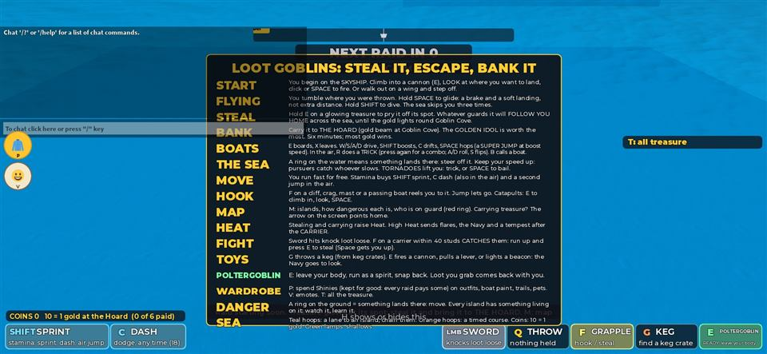 The help wall at join | 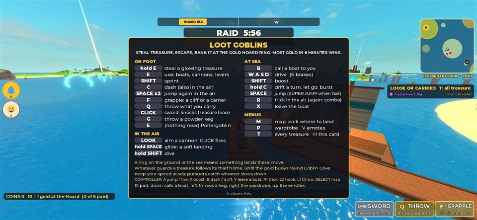 The controls card (`H`), on top of everything |
| 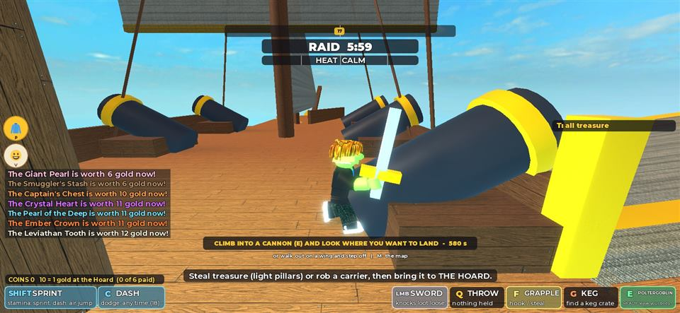 The deck: seven interest lines, every slot | 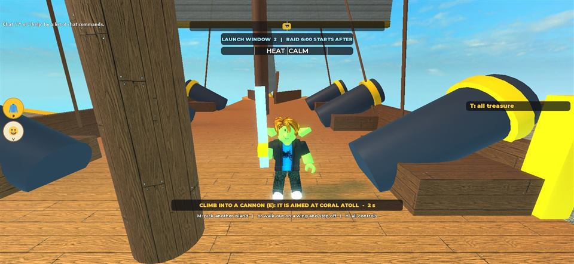 The deck: "IT IS AIMED AT CORAL ATOLL", no slots |
| 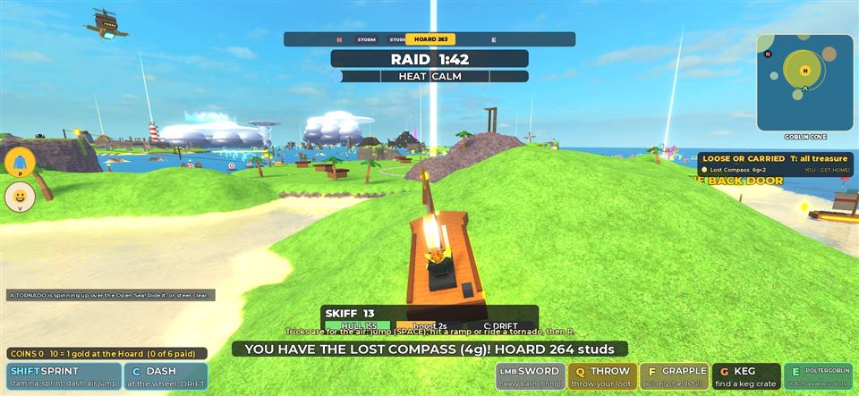 Carrying at sea: a toast on the boat panel, no key |  Carrying at sea: the key, the arrows, toasts clear |
| 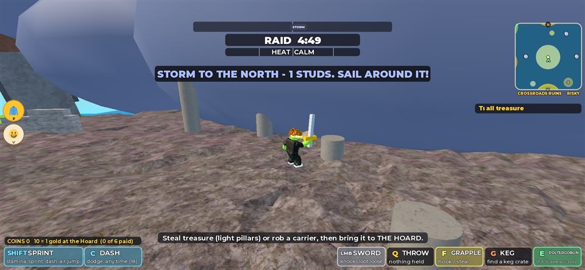 "1 STUDS. SAIL AROUND IT!" on land | 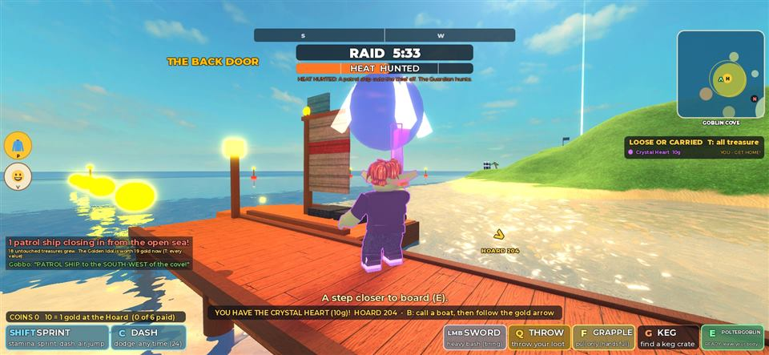 `E` a step short: "A step closer to board (E)." |

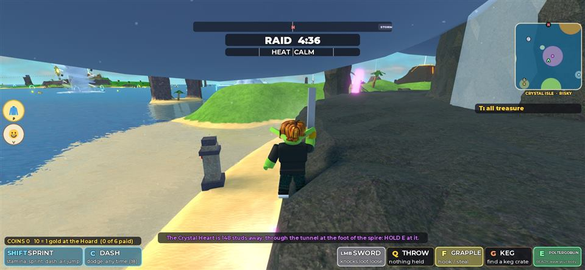

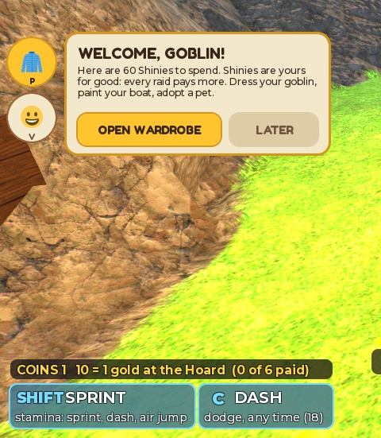

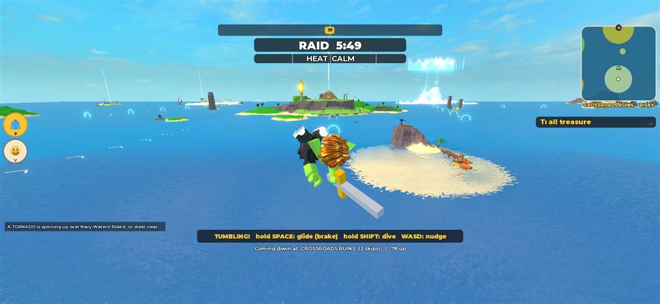

The last frame is the one failure seen in about forty launches (section F): a throw aimed at Coral Atoll, 2.2 s after launch, falling straight down beside the skyship.

## F. Reliability

- **Tests**: 53 Luau tests pass in Studio (V11's 46 and 7 new in `tests/luau/Specs/CohesionSpec.lua`). StyLua and Selene clean. `./scripts/check.ps1` passed (see the PR).
- **The dropped throw.** Once in about forty launches the goblin fell straight down off the deck under ordinary gravity (about 470 studs in 2.2 s; the flight's own model falls far less), then landed in the sea under the ship. The launch sends a `DiveStart` message and sets the `Diving` attribute; Roblox does not promise their order, and the client cancelled a dive on any frame where the attribute was missing, so a message arriving first meant the dive was dropped on its first frame. The client now gives the attribute one second to arrive (the end of a dive is still the attribute clearing). The fault could not be reproduced on demand before or after; three launches after the fix landed 5 to 10 studs from their spots. The check is V11's, so the bug predates V12.
- **Lifecycle**, observed: the raid ending while seated in a boat and carrying (back aboard, the treasure home); the raid ending mid-flight (aboard, standing); death while carrying (the treasure loose, respawn aboard with `LaunchBy`); banking on foot.
- **Performance** (one client, Studio window in front): 60.0 to 60.1 fps, worst frame 19 ms, during a chase at sea with two pursuers; server heartbeat 0.91 ms in the same scene; 9,179 world parts, 203 lights, 24 emitters. The landing search runs once at start-up; if it had to try every ring of every island it would cast 1,824 rays in 73 ms. World build 3.8 s. No game errors in the output (one Roblox avatar asset warning not from this code).
- **Authority**: unchanged. Landing spots are chosen by the server; the client's anti-gravity acts only on its own character's flight, which it already simulated, and the server still resolves every landing; no new remote; the deck grace and auto-fire are server-side. No anti-cheat check was loosened (`Flight.resolveLanding`'s change only stops an *early* splash over land).
- **Studio notes**: the display sleeping stopped Studio rendering twice (0 fps, captures timing out, keys not arriving); waking it from a shell fixed it each time. A test teleport while carrying sometimes dropped the treasure (apparently the server's movement check doing its job), so banking was tested by walking in.
- **Not verified**: any second player, any phone, any real controller, the touch buttons' look, live DataStore, Robux (unchanged and off), the belly-flop splash by eye, three players' banners competing.

## G. Human acceptance questions

1. Pick an island on the map at the start and fire. Did you land where you expected, on dry ground near the beam? Try **Crystal Isle** and **Skull Rock**: is landing at the way in (the tunnel, the mouth) better than a landing beside the treasure?
2. Is the line at the bottom of the screen helpful, or does it nag? Is anything in it wrong?
3. With three players: when someone else steals or banks, is it right that it waits behind your own banner (and shows in the feed), or should rivals' moments be louder?
4. Do the red arrows help you escape, or clutter the screen?
5. Is the controls card on `H` enough for a first-timer, or should it open once on the very first join?
6. Is 12 s on the deck right for someone who joins late?
7. If anyone has a controller: do `L1` throw, `L2` hook, `R1` trick, clicking the right stick for the map and the D-pad work, and is losing the camera's zoom on the right stick a problem?
8. If anyone can try a phone or Studio's device emulator (Test tab, Device): are FIRE, BOAT, HOOK, THROW, BOOST, HOP and TRICK where your thumb expects them?

## Human playtest guide

1. Double-click **Play Loot Goblins**, wait for Studio, press the blue **Play** button.
2. On the ship the map opens: click **Crystal Isle**. The map closes and the banner says the cannon is aimed there. Walk to a cannon, press `E`, click to fire.
3. You land on a rock shelf. Read the bottom line, drop down to the beach, go into the tunnel and hold `E` at the Crystal Heart.
4. Run out; the Echo chases you. Watch for the **red arrow**. Press `B` for a boat, drive with `W A S D`, `Shift` to boost, follow the gold arrow home.
5. Drive or run into the gold ring. The banner says how much gold you got.
6. Press `H` for the controls card. Walk to a boat at the docks, stop a step short and press `E`: it should say "A step closer", not throw you out of your body.
7. For three players: **Test tab > Server & Clients > 3 players > Play**. Steal from each other, chase each other, bank, and watch the banners and arrows.
8. Tell the AI what felt bad, and send a screenshot of any red error.
