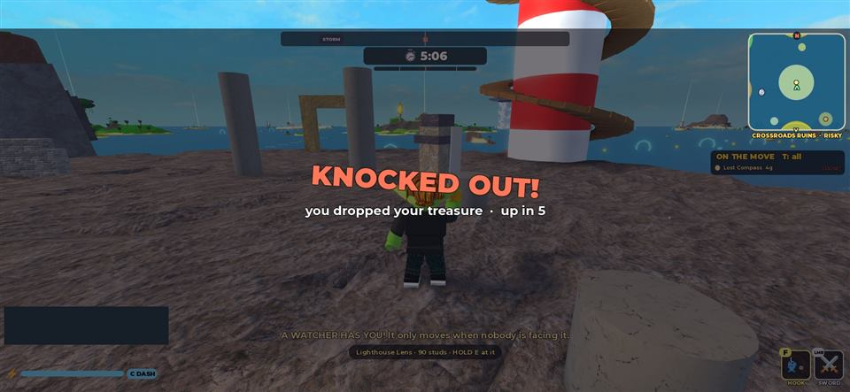
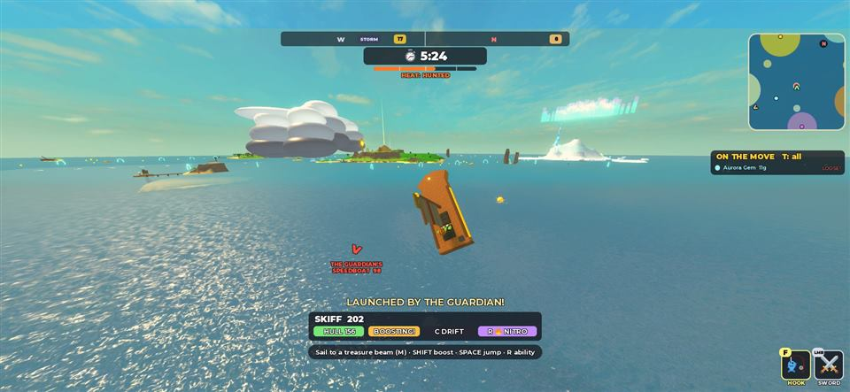
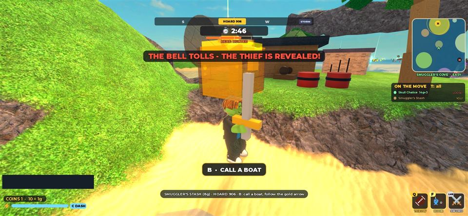
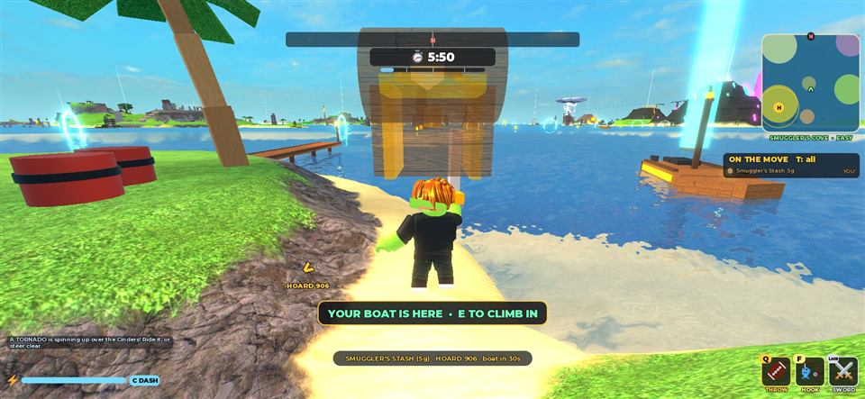
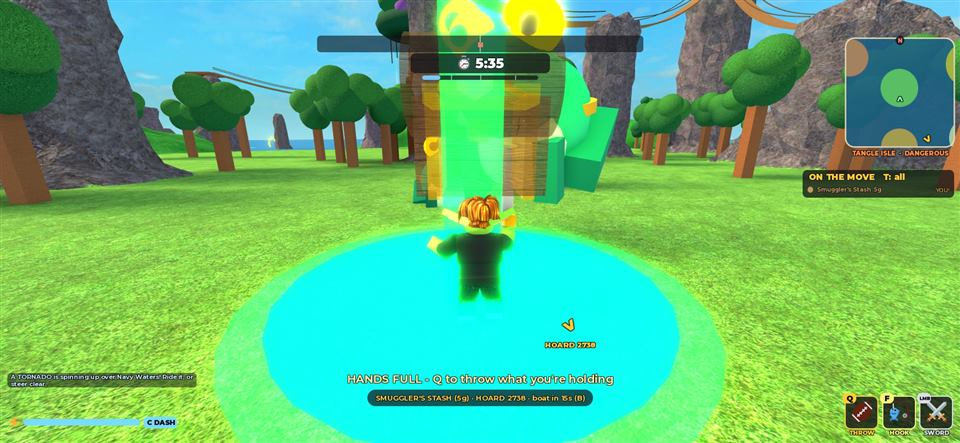
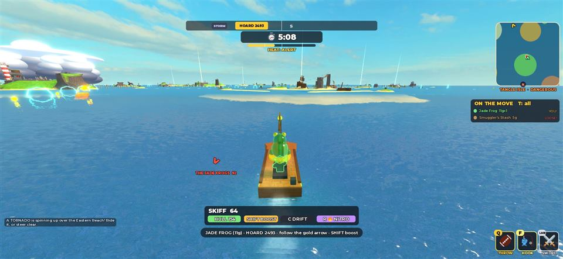

# V13.1: the V13 playtest fixes (2026-10-18)

Ninety played V13 (the Goblin Port) and sent ten points to fix ("go, make me impressed"). Built by Claude Opus 5.5 on branch `fix/v13-playtest-feedback`, stacked on V13 (`feature/v13-goblin-port`, PR #24, not merged), in one session.

**Read this first.** Everything below was built and tested by one AI on **one** Roblox Studio client, through a Studio-only test hook (a Workspace script obeying a `DebugCmd` attribute; never committed) and real key presses where it says so. Nobody has played V13.1. It has never had a second player.

## The ten points, and what happens now

| # | Ninety's point | What changed | Seen in Studio |
| --- | --- | --- | --- |
| 1 | The Ghost Fleet gets stuck and doesn't follow; it should follow alongside the pirates | Ships and dinghies sail **through land** (ghosts); ships surge to 330 and rise again behind a thief they lost; once the pirates are in the dinghies the ships **escort** them on both sides instead of sinking | A 40 s run from 700 studs off Skull Rock: ships 145 to 200 studs off the whole time, dinghies 10 to 60; the thief knocked out at 24 s by pirates and shells |
| 2 | The Guardian's hit on a boat should send it flying very high and spinning | Thrown 255 studs/s up (**about 170 studs**) and **tumbling end over end** for the whole flight (a new BoatSim "tumble" that lands level); the boat police allow the altitude | 170 studs up, two launches in 32 s, the boat upside down mid-flight; a second run's launches knocked the carrier out |
| 3 | No boss steals treasure; treasure drops only at death; death is a 5 s knockout, no respawn; all bosses attack a carrier repeatedly and reliably | **The knockout** (`server/Knockout.lua`): health 0 is 5 s down where you fell, treasure dropped there, up with full health; no world hit ever takes treasure (`Loot.knockLoose` hurts a carrier instead: 22 per hit, about four knock them out); every creature strike on a carrier counts; pursuers wait by a knocked-out thief | See the table below |
| 4 | Jade frogs: attack on the island and hop into the water reliably | Tangle Isle's imps became **three jade frogs**: they bound after a carrier and **pounce** (a ring, then a belly slam); the moment the thief is in the water they hop in after them, as a pack bounding over the waves that pounces on a ringed boat | On land: a hit every 2 to 3 s, a still goblin knocked out in 16 s. At sea: out 0.2 s after the thief reached the water, entering 59 studs away on the thief's side; a still boat knocked out in 13 s |
| 5 | The Aurora Gem island boss and its chase into the water need a rework | **The Chill** chases a carrier anywhere on Frost Spire and drops **hail** (a ring, then ice) every 3.4 s; at sea it comes down after the thief at once and bursts **ice spikes** up under a ringed boat | On land: hail hit every 3 to 5 s. At sea: out 0.2 s after the thief reached the water, the island Chill hidden meanwhile; three ice-spike hits in 15 s on a boat sailing straight (ring, strike, rest, chase, every 7 to 8 s) |
| 6 | The Leviathan needs to attack | Its lunge **bites**: a 0.9 s roar with jaws open, then 150 faster than the boat for 1.2 s; a boat holding its course is caught and thrown end over end | Four bites in 30 s on a boat sailing straight through deep water |
| 7 | Pick treasure up by boating over it | `Loot.sweepBoats`: a driver with empty hands whose hull passes over loose treasure takes it | Picked up the floating Crystal Heart 1.6 s after setting off toward it, still seated |
| 8 | Can't press E to get off a boat | Your own boat's Board prompt is hidden while you sit in it (it took the key); E with nothing else in reach climbs out | Real key press: E unseated the driver |
| 9 | Sunset Poltergoblin, keep the code, free E | `Config.POLTER_ENABLED = false`: the server ignores the request; E and Y no longer cast it; its slot and card lines are gone; a step short of a prompt still says "A step closer" | E and Y pressed on foot: no spirit |
| 10 | Calling a boat: keep the tesla arrival, stop reliably near you; make B readable at the edge with treasure | The boat races in (188 studs/s) and **brakes hard to a dead stop** at the water nearest you (followed as you walk the shore), then **holds** there 30 s; a big gold pulsing **B · CALL A BOAT** for a carrier at the island's edge, then **A BOAT IN 12s**, **YOUR BOAT IS COMING**, **YOUR BOAT IS HERE · E TO CLIMB IN** | Stopped from 188 studs/s in under a second and held still 6 s; parked where the sand flat drops to skiff depth |

## The knockout in detail (point 3)

- The humanoid's Dead state is switched off on the server and on the goblin's own client (the client runs its own humanoid's states), so health 0 is just a number; `Knockout.watch` turns it into a knockout. Roblox's own health regeneration is held back while they are down.
- Down: flat on the back on foot (their own client lays the body down), slumped at the wheel in a boat (the boat coasts; BoatDrive ignores their keys). The screen dims, **KNOCKED OUT!** wobbles, and it counts down and says who did it. Nothing targets them (`Util.aliveRoot`), and their pursuer, the Ghost Fleet and the Leviathan wait 9 s by them and their treasure.
- The treasure drops where they lie, loose: a rival can take it, and they can grab it back when they get up (the chase resumes).
- Up: full health, where they were, 2 s before the world can hit them again.
- Respawns left: a body that falls out of the world, and the Reset button (for a goblin who is stuck); both drop the treasure first.
- Feed: "… was KNOCKED OUT and dropped the …" (or, empty-handed, "… was knocked out by …").

| Check | Result |
| --- | --- |
| Health drained to 0 while carrying | Knocked out, treasure loose, same place; up after 5 s with 100 health, not platform-standing |
| Creature hits on a carrier | No drop; 22 health each after the grab's brief immunity; a Watcher finished the knockout on its own between test calls |
| Knocked out at the wheel | Stayed seated (a first version unseated the driver: a "stand up" helper for grapple catches used `ChangeState(GettingUp)`; replaced by a quiet cancel), treasure loose, driving again after 5 s |
| Pursuer during the knockout | The jade frogs circled and the chase continued |
| Ghost Fleet during a knockout | Gave up after 3 s in the first run; now waits 9 s like the others |

## Design decisions

- **A carrier hit is 22 on top of the creature's own damage**, so four or five hits knock a carrier out; a player who dodges rings will take far fewer. Non-carriers keep V8's gentler rules (scaled damage, no one-hit knockout).
- **Grace stays**: one world hit per 1.2 s, so creatures attack repeatedly but never juggle.
- **The frogs and the Chill set out from where their island creature is, on the thief's side**, and the island creature hides while its sea form is out: one creature, not two.
- **Ghost ships phase through land** rather than steering round it: ghosts that cannot be wedged is the simplest reliable answer and fits them.
- **The called boat parks where the water is deep enough for it**, which off a long sand flat can be 60 studs out; it holds there rather than drifting off.
- **SPIRIT pets** (they sped up Poltergoblin) now shorten the knockout, so nobody's pet lost its use.
- **Rivals still steal** (sword, keg, cannon, grapple catch): the point was "no bosses steal".

## Tests and checks

- **82 Luau tests pass** in Studio (V13's 76, plus `PlaytestSpec`: the knockout's numbers, Poltergoblin off, the Guardian's height and the tumble landing level and passing upside down, a tumble starting from the water and paying nothing, the Leviathan's lunge able to close to a bite, the called boat's stopping distance).
- StyLua and Selene clean; `./scripts/check.ps1` passes (see the PR).
- Server heartbeat 0.42 ms at 60 physics frames a second mid-raid. The client read 60 fps earlier in the session with Studio in front; a later reading of 15 was Studio's background cap.

## Not tested

- A second player: a rival taking a knocked-out goblin's treasure, two goblins in one fight.
- The Reset button's respawn; a knockout in lava (it can repeat after the 2 s grace); the Guardian throwing heavy classes; a phone or a real controller.
- The creature numbers are first guesses: the knockout times above are for a goblin who stood still or sailed straight.

## Playtest guide

1. Double-click **Play Loot Goblins**, press the blue **Play** button, walk aboard the airship, fly to an island.
2. **Tangle Isle** (the Jade Frog): steal it and run. The frogs bound after you: step off the green rings. Jump in the sea: they hop in after you.
3. **Frost Spire** (the Aurora Gem): the Chill rains hail on you; at sea it bursts ice spikes under you.
4. **Sun Temple** (the Golden Idol): take it to sea and get punched sky high by the Guardian's fist.
5. **Skull Rock** (the Chalice): the ghost ships should stay with you all the way, beside their dinghies.
6. Get **knocked out** (let something keep hitting you): 5 s down, the treasure on the ground, then up again. Grab it back.
7. Drop a treasure in the sea (Q from a boat) and **drive over it**.
8. In a boat, press **E** to get out. On foot with nothing near, E does nothing now.
9. With treasure at the edge of an island: the big **B · CALL A BOAT**. Press B, and watch it race in and stop beside you.
10. Tell the AI what felt bad, especially whether the bosses now hit too hard or not hard enough.
