# V13: The Goblin Port (2026-10-18)

Requested with Ninety's "Loot Goblins — V13 One-Shot: The Goblin Port" brief, passed on by Enrik ("make me impressed, make me want to play it, make it reliable"). Built by Claude Opus 5.5 on 2026-10-18 on top of main after V11 and V12 merged.

**Read this first.** Everything below was built and tested by one AI on **one** Roblox Studio client on the development PC, through real key presses and clicks where it says so and through a Studio-only test hook (a Workspace script obeying a `DebugCmd` attribute, created in the Studio session and never committed) elsewhere. Nobody has played V13. It has never had a second player, a phone or a real controller; real DataStore saving and real Robux purchases have not run. Each claim below is labelled:

- **Tested**: implemented, and seen working in Studio or proven by a passing test.
- **Partly tested**: implemented; some paths seen, others only by rule or code reading.
- **Prototype**: works, but is a first version the team should judge.
- **Not implemented** / **Needs creator setup**.

## 1. Executive summary

V13 builds the half of Loot Goblins that happens between raids.

- **The Goblin Port** (Tested): a harbour town on its own island replaces the 10 s skyship intermission. A 60 s countdown, a boarding pier to a little airship (walking aboard is being ready; everyone aboard brings the raid forward to 8 s), a Shipyard with all seven boats on slipways, Mother Mossback's Menagerie with four pens of living pets, Madame Ragwort's Wardrobe, a Spyglass tower to watch the raid, and a winners' podium with a champion statue. Winners come home onto the podium; everyone else to the fountain.
- **Late entry and spectating** (Partly tested): join a running raid while two minutes or more are left; watch any raider with a camera and a bar. The server decides both. Seen with one goblin only.
- **Seven boat classes** (Tested in Studio, balance untested by people): the free Skiff and Cutter and five earned with Shinies (Reefhopper, Broadside, Stormrunner, Wraith, Ironbelly), each with its own silhouette, numbers, weakness and an ability on the stunt key. Every ability was fired through the real `R` key and accepted by the server.
- **The bestiary** (Tested): 37 new pets (42 in all) in four themes on one shared animator, each with a kind of movement and an idle quirk of its own; six shared utility archetypes so rarity is never power; seven island pets earned by escaping that island's creature.
- **Economy** (Tested by model and tests; pacing untested by people): deeds, ten achievements, profile v3 with an in-place v2 upgrade, a written model: a typical goblin earns a boat in about 2 to 4 hours, all five in about 14.
- **Monetization** (Needs creator setup): product keys for the boats and two show-only cosmetics, no ids, sales off.
- **A quiet raid screen** (Tested): icon moves with key chips, a slim stamina bar, a one-strip boat panel with the ability, a short objective chip that stops teaching after three raids.
- **A V11 bug found and fixed**: the server dropped the item from a shop request, so WEAR IT on anything already owned took that slot off.
- **76 Luau tests pass** (53 before; LobbySpec, BoatClassSpec and PetSpec are new). StyLua, Selene and both Rojo builds pass. 60 fps in the Port with the menagerie running.

## 2. Git branch, base and PR

- Branch `feature/v13-goblin-port`, from `origin/main` at `055953f` ("Merge pull request #23 from EnrikR2002/feature/v12-cohesion-pass"), which already contains V11 (PR #22) and V12 (PR #23). That is the verified correct base: V13 depends on both.
- One PR against `main`. **Not merged** (the brief: "Do not merge any PR").

## 3. Lobby architecture

| Piece | Where | What |
| --- | --- | --- |
| The rules | `src/shared/Lobby.lua` (pure, tested) | `inPort(position)`, `raidLeft`, `canJoinLate(phase, now, endsAt, alreadyIn)`, `portEndsAt(now, endsAt, inPort, ready, inServer)`, `raidAbandoned`, `sortTargets`/`cycle` (the spectating ring), `status` (what the Port screen says) |
| The round | `src/server/Raid.lua` (rewritten) | phases `port` and `raid`; an explicit `participants` set; `start` (everyone in the server goes), `joinLate`, `finish` (results and Shinies for participants only, everyone home, winners to the podium), `placeCharacter` (every spawn: aboard, Goblin Cove or the Port), the readiness sweep every 0.25 s |
| The town | `src/server/Port.lua` (new, ~1,500 lines) | builds the island and every building; `arrive`, `arriveWinners`, `isReady`, `setChampion`, spectating (`spectate`, `targets`, `tick`, `stopAll`) |
| Isolation | `Lobby.inPort` asked by `Combat`, `Kegs`, `Poltergoblin`, `Recall`, `Storms`, `Tornadoes`, `Blast.safe` | nothing of a raid reaches the Port |
| The screens | client `PortHud.lua`, `Spectate.lua`, `PortLife.lua` | the Port's sign and wallet, the departures board, fades; the spectator camera and bar; the menagerie's pets |

State the client reads: workspace `RaidPhase` (`port`/`raid`), `PhaseEndsAt`, `RaidClockAt`, `PortReady`, `PortCount`; player `Zone`, `InRaid`, `Ready`, `Spectating`. Server authority is complete: the client only asks (`PortRequest("join")`, `PortRequest("spectate", action)`, rate-limited to five a second).

## 4. Port environment (Tested)

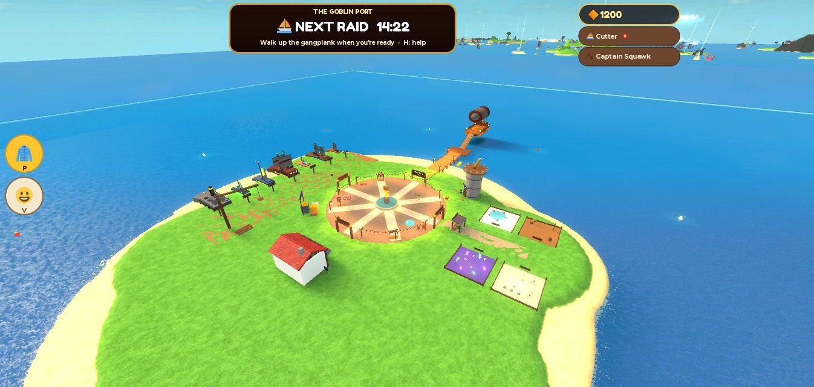

Built at start-up from parts and terrain, about 1,080 parts in `PortTown` (streamed) and 35 in `PortCore` (persistent: floors, gangplank, podium, boards). At `Config.PORT.CENTER` (0, 0, 4600), more than 1,500 studs beyond its own radius from every island (a test checks it), out of the raid's streaming range.

- **Plaza**: cobbled disc, the Golden Goblin fountain, two bounce pads, lamps, bunting, market stalls, arrival rings facing the pier.
- **Boarding pier → The Little Goblin**: a pier, a platform, a gangplank and a little airship; its deck is the ready zone. A departures board at the pier's start shows the countdown (or the raid's time left), written by each client. A gold marker floats over the gangplank until you are aboard.
- **Shipyard** (west): seven slipways, each boat on chocks with a board (name, role) and a prompt that opens the showroom on it.
- **Mother Mossback's Menagerie** (east): a pavilion with its keeper and four themed pens where up to ten pets each wander (section 15).
- **Madame Ragwort's Wardrobe** (south): a red-roofed shop with three dressed mannequins in the window.
- **The Spyglass** (north-east): a tower with a telescope and benches; its prompt starts spectating.
- **The Podium** (south-west): three steps for the winners, a champion plinth with a dressed statue and a crown, and a banner with their name and gold.

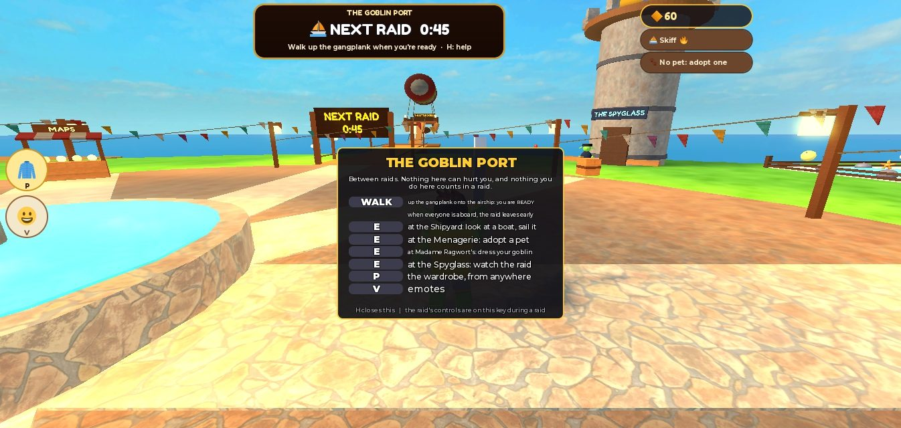

## 5. Round lifecycle and timings (Tested)

| Phase | Length | What happens |
| --- | --- | --- |
| Port | `PORT.DURATION` 60 s | arrive, shop, watch, ready up. Everyone aboard: brought forward to `READY_SECONDS` 8 s (never pushed back). Empty server: held |
| Launch window | `SKYSHIP.WINDOW` 20 s | everyone in the server boards the skyship and fires off (unchanged V9 to V12 flow) |
| Raid | `RAID_DURATION` 360 s | the clock starts when the window closes; final rush and last call unchanged |
| Results | in the Port | everyone in the raid arrives home (winners on the podium), the results card shows for 22 s, the champion dances after 2.7 s |

About 440 s a cycle, 8.2 raids an hour. Seen in Studio: the countdown; walking aboard took it from 571 s to 6 s ("Everyone's aboard! Casting off in 6..."); the raid starting by itself and launching the goblin; raid end with podium, statue, results card and payout; a raid whose only raider left ending at once.

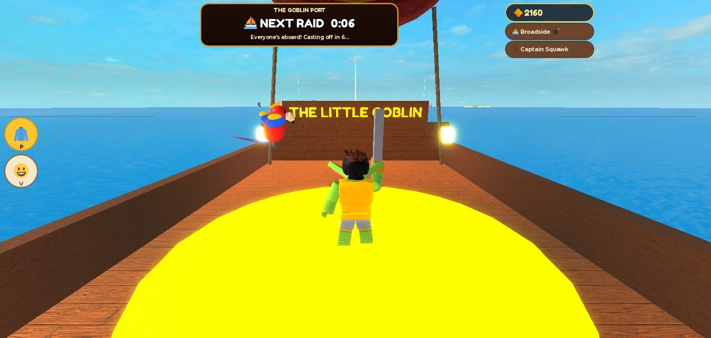

## 6. Late-entry policy (Partly tested)

A goblin in the Port may join a raid that has at least `LATE_JOIN_MIN` (120 s) left: the JOIN button on the Port's sign, the JOIN button on the spectator bar, or the prompt at the pier (enabled only while allowed). They board the skyship like everyone else (with its deck grace), start with **zero gold**, and their participation is counted from when they joined (Shinies are earned by participation, not by being in the server). Too late: "Too little of this raid is left. Get ready for the next one!" A goblin who joins the server mid-raid arrives in the Port and can watch or join.

Tested by `LobbySpec` (plenty left, too little, no raid, already in, junk times) and by the Port screen showing "Too late to join: watch it" with under two minutes left. **Not seen**: an actual late join while someone else raids (with one client, the only raider leaving ends the raid).

## 7. Spectator implementation (Partly tested)

- **Server** (`Port.spectate`): only a non-participant may watch, only a participant alive in the raid may be watched, the target is chosen from a ring sorted by name (`Lobby.cycle`), the server streams the world round the target (`ReplicationFocus`, `RequestStreamAroundAsync`) and follows them every 0.5 s, moves the spectator on when the target is gone (`SpectateSwitch`), and stops everyone when the raid ends or the spectator joins (`SpectateEnd(why)`).
- **Client** (`Spectate.lua`): camera on the target's humanoid, the goblin's controls off and its movement keys caught, a bar (◀ name ▶, gold and what they are doing, the raid clock, JOIN while allowed, PORT), keys Left/Right (Q/E, D-pad, L1/R1) and Backspace (B). A respawn while watching keeps watching; leaving restores camera and controls.

Seen: with the watch state forced onto the only goblin, the bar, the clock and the Port screen stepping aside; W moved the goblin 34 studs in the first version (controls alone were not enough), **0 studs** after the movement keys were also caught; Backspace ended it and W walked again (28 studs). Refusals seen: watching with no raid running. **Not seen**: watching another player, switching targets, a target dying or leaving, streaming round a far raider.

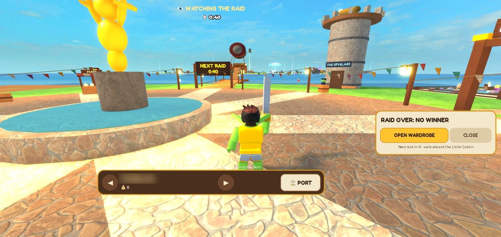

## 8. UI changes (Tested)

- **Raid screen** (client `Hud.lua`, rewritten): a 240-pixel clock pill with an 8-pixel heat bar (its name only above calm); moves as 54-pixel icon buttons (⚔ sword, 🎣 hook, 👻 spirit, 💣 keg, 🏈 throw) with a key chip (keyboard key; controller button on a controller; none on touch), a cooldown that darkens from the top, a dimmed icon when unusable, THROW and KEG only when there is something to throw, and a caption only for a goblin's first three raids; a slim stamina bar with a ⚡ (❄ when chilled) and a DASH chip lit when affordable; COINS as a chip once there are any; the treasure board only when something is loose or carried (T for all); the boat panel as one strip (speed, hull, boost, drift, the class ability and its cooldown); the feed at four lines for six seconds, wrapping long ones; toasts and banners unchanged in behaviour.
- **Objective chip** (`Objective.lua`): short; teaches everything for `TEACH_RAIDS` (3) raids, then only speaks when carrying, swimming, near a treasure, or in spirit form ("Lighthouse Lens · right here: HOLD E").
- **Port screen** (`PortHud.lua`), **spectator bar** (`Spectate.lua`), a Port help card on `H`, the minimap and compass hidden in the Port, the dock (wardrobe and emotes) shown in the Port and at the Hoard only.
- **Wardrobe** (`Shop.lua`): a Boats group first (the showroom: 3D preview of the real class, a stat card with five pips, the ability and its key, best and worst, SAIL IT), five groups in the rail, pet theme filters (All, Ocean, Pirate, Magic, Island), pet descriptions from the ability archetypes, opening at the right page from each Port counter.
- **Results card**: a Deeds chip, gone after 22 s.

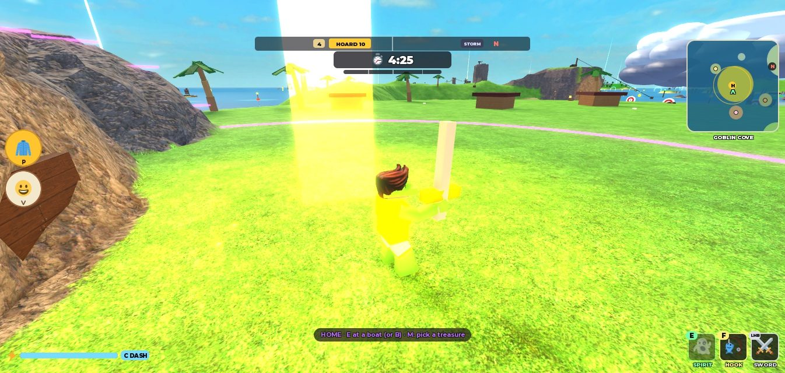

## 9. Free boat balance (Prototype)

- **Skiff** keeps its V7 to V12 numbers (135 top speed, 160 hull) and gains NITRO, so the free starter boat is the best escape boat in a straight line.
- **Cutter** was the slow one; V13 raised it a little so it does not feel like a barge (accel 68 → 72, top 104 → 110, turn 1.7 → 1.8) and gave its driver a BOW GUN on the stunt key. It now just outruns a patrol ship (106) and carries three friends.
- Neither free boat is dominated by any paid one (the balance test in section 11).

## 10. Specialty boat designs (Prototype, abilities Tested)

- **Reefhopper** (350, stunt boat): small, light, twin pontoons and a gold spring. Jumps 25% higher, steers well in the air (0.75 air control), tricks 35% faster and lands with a bigger burst. SPRING leaps off flat water; Space in the air hops once more. Weak: 150 hull, a little slower on the straight.
- **Broadside** (700, gunboat): a big square-rigged warship. BROADSIDE fires three shots from the side you look at; two passenger seats are gunners on side cannons. Weak: slow (98), wide-turning (1.45), a big target, a 6 s boost cooldown.
- **Stormrunner** (550, storm chaser): one tall lightning sail and a spinning vane. 18% faster in a storm cell or near a tornado, thrown 45% farther when it bails out of a funnel, and TWISTER spins up a real tornado 85 studs behind that drifts after it for 12 s (at most four summoned on the sea; never near home or in the Port). Weak: ordinary in calm water; its own twister catches it if it stops for long after a 5 s grace.
- **Wraith** (500, phantom): low, narrow, black, translucent glowing sails. The sharpest steering (3.1) and highest grip; PHANTOM slips it sideways and leaves a ghost running on that fools pursuers within 700 studs for 2.6 s. Weak: the most fragile hull (120, crashes hurt 25% more).
- **Ironbelly** (600, bruiser): a riveted iron tug with a ram, tyres and a funnel. 640 hull taking 30% crash damage, shoved half as far, rights itself 60% faster, four passengers, swimmers can climb aboard from 40 studs. RAM PLOW is a 2.6 s charge that shoves boats aside once each and knocks pursuers back. Weak: the slowest and widest-turning (96, 1.35).

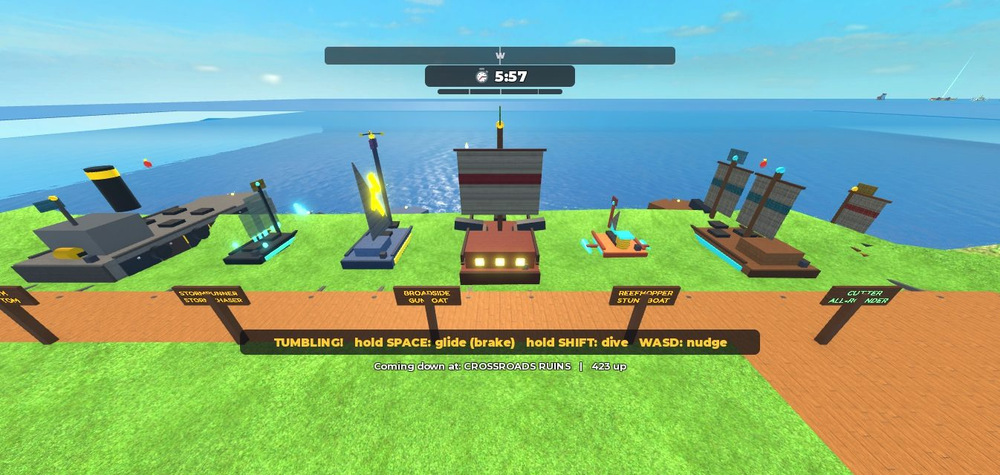

## 11. Full seven-boat comparison

| Class | Price | Role | Size (W × H × L) | Top speed | Accel | Turn | Hull | Crash taken | Crew | Boost cd | Ability (cooldown) |
| --- | --- | --- | --- | --- | --- | --- | --- | --- | --- | --- | --- |
| Skiff | free | Escape artist | 9 × 3 × 20 | 135 | 100 | 2.50 | 160 | ×1.00 | 1 | 5 s | 🔥 NITRO (14 s) |
| Cutter | free | All-rounder | 14 × 4 × 34 | 110 | 72 | 1.80 | 420 | ×0.60 | 3 | 5 s | 💥 BOW GUN (6 s) |
| Reefhopper | 350 | Stunt boat | 10 × 3 × 18 | 124 | 92 | 2.40 | 150 | ×1.10 | 1 | 5 s | 🌀 SPRING (9 s) |
| Broadside | 700 | Gunboat | 16 × 5 × 38 | 98 | 58 | 1.45 | 520 | ×0.50 | 3 | 6 s | 💣 BROADSIDE (10 s) |
| Stormrunner | 550 | Storm chaser | 11 × 3.5 × 26 | 122 | 84 | 2.10 | 260 | ×0.85 | 2 | 5 s | 🌪 TWISTER (28 s) |
| Wraith | 500 | Phantom | 8 × 2.6 × 22 | 128 | 96 | 3.10 | 120 | ×1.25 | 1 | 5 s | 👻 PHANTOM (11 s) |
| Ironbelly | 600 | Bruiser | 18 × 6 × 36 | 96 | 54 | 1.35 | 640 | ×0.30 | 4 | 6 s | 🐗 RAM PLOW (14 s) |

Showroom pips (speed / handling / toughness / air / firepower): Skiff 5/4/1/3/1, Cutter 3/3/4/2/3, Reefhopper 4/4/1/5/1, Broadside 2/2/4/1/5, Stormrunner 3/3/3/4/2, Wraith 4/5/1/3/1, Ironbelly 1/1/5/1/3.

**Horizontal balance, as a rule** (`BoatClassSpec`): for every pair of classes, each has something over the other among top speed, acceleration, turning, effective hull (hull ÷ crash taken), air (jump) and crew. **This is not evidence they feel balanced**; that needs people racing and fighting in them.

## 12. Mounted cannon and ability systems (Tested)

How one press works: `R` (R1, touch STUNT) → `BoatDrive.stunt` → in the air a trick, on the water `BoatSim` plays the physical part at once and reports `out.ability` → the client sends `BoatAbilityRequest(aimPoint)` → `BoatAbilities.request` checks the driver, a 0.2 s rate limit and its own cooldown (`AbilityReadyAt`, with 0.25 s slack), fires whatever the server owns, widens `Boats.police`'s allowance for that boat for the burst, and broadcasts a `BoatFx` for everyone's effects; a refusal sends `AbilityRefused` and the client forgets its prediction. If the server is simulating the hull, the ability is queued into its own BoatSim step.

- **Cannons**: the Cutter's bow gun fires within a 70° cone up to 420 studs where the driver looks; the Broadside's volley picks the side by the aim and fires three staggered shots 9 studs apart up to 300 studs. Both use `Config.BOAT_SHOT` (radius 13, 6 damage, 70 knockback, 22 hull, 82 boat push): built to shove and splash, not to sink. Boat guns cannot hurt anyone inside the home ward or in the Port; a shot never hits its own boat. The Broadside's two gunner seats sit by side cannons with a 3.4 s cooldown and an arc check (a side gun cannot fire across the deck).
- **Twister**: `Tornadoes.summon` (owner, life 12 s, drift 12 studs/s along the boat's heading, at most four summoned, one per owner), refused over shallow water, near the Hoard or in the Port.
- **Phantom**: a ghost model runs on for 2.6 s; `Pursuit.decoy` makes pursuers within 700 studs chase it (no lock-on tell while fooled); the Leviathan and Ghost Fleet are fooled too.
- **Ram Plow**: a 2.6 s charge (thrust ×1.7, top speed ×1.18, shoves taken ×0.2); a boat within 10 studs of the bow is shoved once at 95 studs/s; pursuers in front are knocked back (`Pursuit.shoveAt`).

Seen through the real `R` key in Studio, each accepted by the server (its `AbilityReadyAt` set): Wraith PHANTOM (ghost afterimage, 11 s cooldown), Stormrunner TWISTER (feed "…whipped up a tornado!"), Reefhopper SPRING, Broadside BROADSIDE (three shots in flight), Ironbelly RAM PLOW, Cutter BOW GUN, Skiff NITRO (215 studs/s; a second press showed "NITRO 14s"). In the air (a storm funnel) the same key did a trick ("SPIN CYCLE"), as intended.

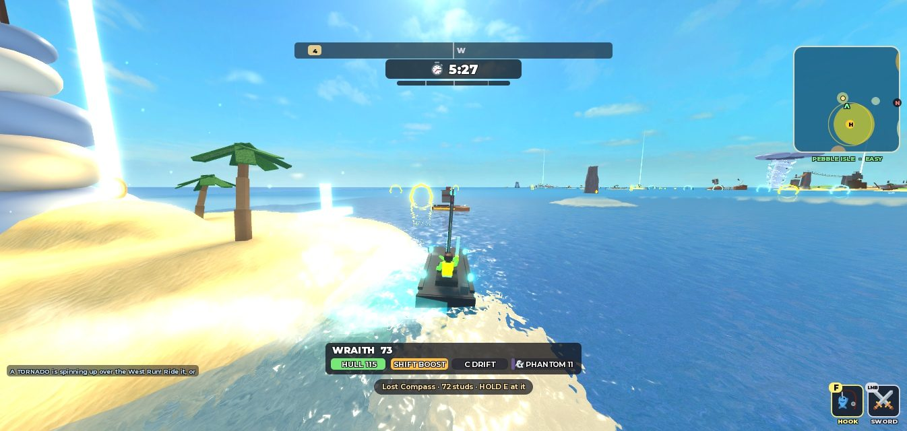 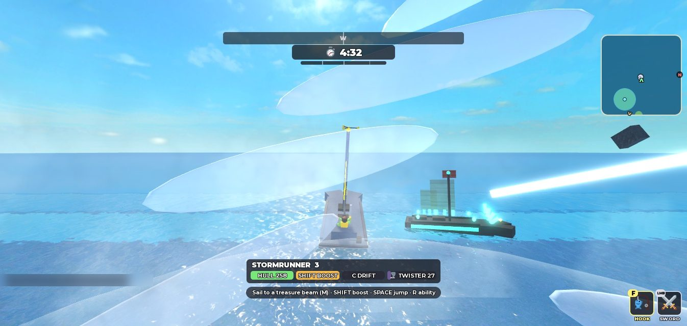 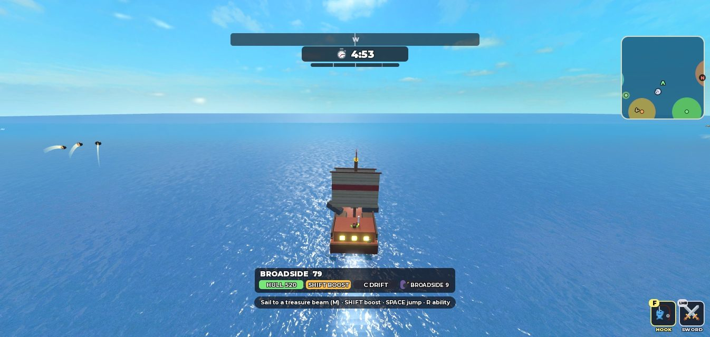 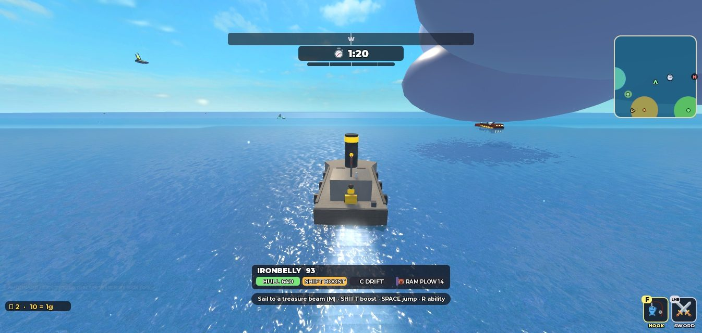 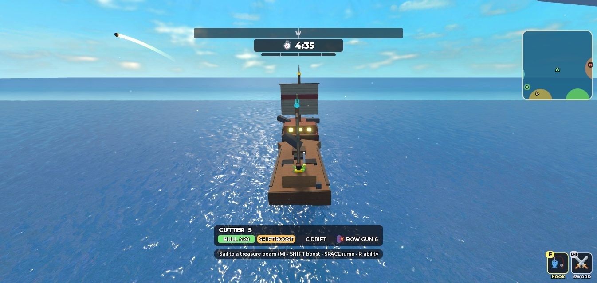 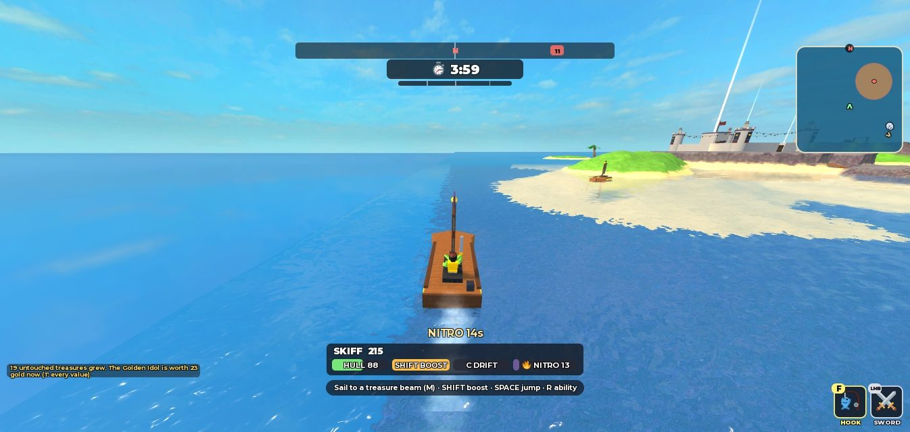

## 13. Boat selection, ownership and persistence (Tested in Studio; live saving not run)

The `boat` catalogue slot: `boat_skiff` is the default and `boat_cutter` free; five are bought with Shinies (or a pass, once configured). The chosen boat is saved with the profile like anything worn, published as the `BoatClass` attribute, and is what `B` calls (`Recall.classOf`); cannons are mounted on a called Broadside or Cutter. **A boat changes only in the Port or at the Hoard** (`Progress.boatSafe`): seen refused on the skyship and accepted in the Port and at the Hoard. The dock boats at Goblin Cove are still Skiffs and Cutters anyone may take. Seen: buying the Broadside (2,179 → 1,479 Shinies, charged once), SAIL IT, buying the Wraith, switching to the Cutter.

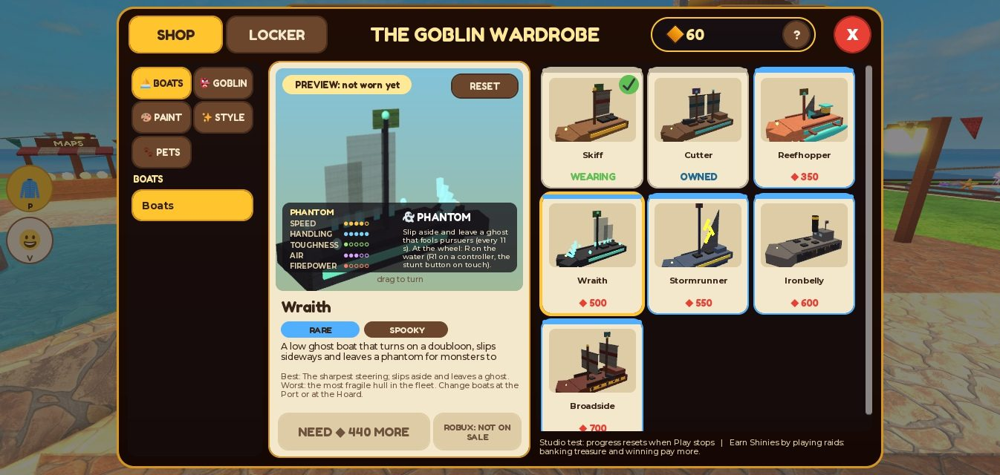

## 14. Complete new pet species catalogue

42 species. **New in V13: 37.** Prices in Shinies; parts as built (8 to 40 allowed).

| Pet | Name | Theme | Moves | Idle quirk | Ability | How | Parts |
| --- | --- | --- | --- | --- | --- | --- | --- |
| Rat | Scuttlebutt | pirate | walker | sniff | Tug | ◆70 | 19 |
| Nudi | Nudi | ocean | crawler | wiggle | Tug | ◆80 | 18 |
| Twinkle | Twinkle | ocean | walker | cartwheel | Spring | ◆90 | 16 |
| Glimmer | Glimmer | magic | floater | loop | Spirit | ◆100 | 9 |
| Bat | Flittermouse | pirate | flier | hang upside down | Scout | ◆110 | 14 |
| Clammy | Clammy | island | hopper | chomp | Tug | ◆110 | 13 |
| Bubbles | Bubbles | ocean | swimmer | bubbles | Scout | ◆120 | 16 |
| Spore | Spore | magic | hopper | spore puff | Spring | ◆120 | 15 |
| Ferret | Noodle | pirate | walker | wiggle | Spring | ◆130 | 15 |
| Puffle | Puffle | ocean | swimmer | puffs up (and when chased) | Shell | ◆140 | 22 |
| Twig | Twig | island | hopper | clap | Tug | ◆140 | 18 |
| Otter | Kelp the Otter | ocean | walker | floats on its back | Tug | ◆150 | 17 |
| Inky | Inky | ocean | walker | ink puff | Mender | ◆160 | 24 |
| Rubble | Rubble | magic | plodder | stomp | Shell | ◆160 | 13 |
| Waddles | Waddles | island | walker | belly-slides at a run | Spring | ◆170 | 13 |
| Wobble | Wobble | ocean | floater | pulse | Spirit | ◆180 | 11 |
| Monkey | Rascal | pirate | hopper | clap | Tug | ◆190 | 17 |
| Bonefish | Bonefish | island | swimmer | rattle | Mender | ◆190 | 17 |
| Parrot | Captain Squawk | pirate | flier | look about | Scout | ◆200 | 16 |
| Fuse | Fuse | pirate | walker | fuse sparks | Mender | ◆210 | 14 |
| Flurry | Flurry | magic | floater | spin | Spirit | ◆220 | 18 |
| Cinderling | Cinderling | island | hopper | flare | Mender | ◆230 | 13 |
| Lumo | Lumo | ocean | swimmer | lure | Scout | ◆240 | 17 |
| Nibs | Nibs the Shark | ocean | swimmer | circles you | Spring | ◆260 | 13 |
| Moth | Lantern Moth | magic | flier | look about | Scout | ◆260 | 13 |
| Shard | Shard | magic | floater | spin (orbiting shards) | Spirit | ◆280 | 9 |
| Chompers | Chompers | pirate | hopper | chomp | Shell | ◆300 | 24 |
| Tusk | Tusk the Narwhal | ocean | swimmer | flip | Mender | ◆320 | 18 |
| Dubloon | Dubloon | magic | roller | flip | Shell | ◆550 (legendary) | 12 |
| Levi | Little Leviathan | island | slither | loop | Mender | trophy: outrun the Leviathan | 20 |
| Sunny | Sunny | island | plodder | stomp | Shell | trophy: escape the Guardian's speedboat | 21 |
| Echo | Little Echo | island | floater | dart | Spirit | trophy: escape the Echo | 10 |
| Lamb | Lambkin | island | walker | headbutt | Spring | trophy: escape Bramble's Tub | 19 |
| Bones | Bones | island | floater | brandish | Spirit | trophy: escape the Ghost Fleet | 14 |
| Zap | Zap | island | slither | spin | Mender | trophy: escape the Warden | 20 |
| Peek | Peek | island | walker | moves only when unwatched | Scout | trophy: escape the Watcher | 14 |
| Whelp | Gilded Whelp | magic | flier | loop | **none** | premium (Robux, show only) | 15 |

The V11 five (Tug Crab ◆100, Spring Frog ◆130, Scout Gull ◆150, Pocket Ghost ◆180, Shell Tortoise ◆220) keep their looks and prices. New pet looks: Glow Octopus (Inky, ◆90), Blue Macaw (Captain Squawk, ◆90), Moon Jelly (Wobble, premium).

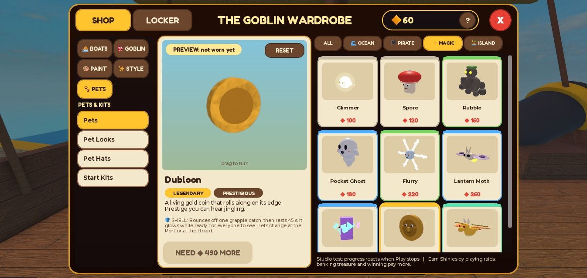

## 15. Pet animations and personalities (Tested)

One animator for every pet (`PetLook.pose`): parts in named groups (legs, wings, fins, tails, chains of segments, tentacles, arms, head, lid, halo, orbit, flame, lure, bell, puff) and a species row with its **kind** (walker, hopper, plodder, crawler, roller; flier, floater, swimmer, slither) and **quirk**. Walkers stride, hoppers hop, plodders stomp, the coin rolls on its edge, swimmers beat their tails in the air, slitherers wave down their segments, floaters drift. Quirks play when the goblin stands still (an ink cloud, bubbles, spores, sparks from Fuse's fuse); a few answer the game (the pufferfish puffs up while something big chases its goblin, the penguin belly-slides at a run, Peek freezes whenever the camera can see it and catches up when it cannot). Followers ride decks, cling on in the air and water, and keep station at any speed (V11's rules, by kind). The shop preview and the Port's pens use the same animator; the pens' pets wander, look at a goblin who comes near, skip out of the way, and the nearest shows its name and price (✔ when owned, 🏆 for a trophy).

`PetSpec` builds every species, checks no two look identical, and poses each through 61 frames in four situations including its quirk with every part staying near its origin.

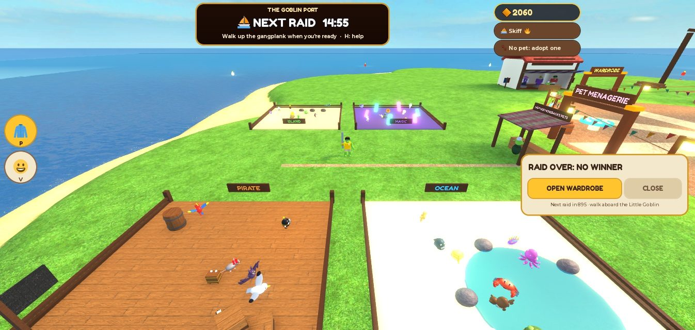 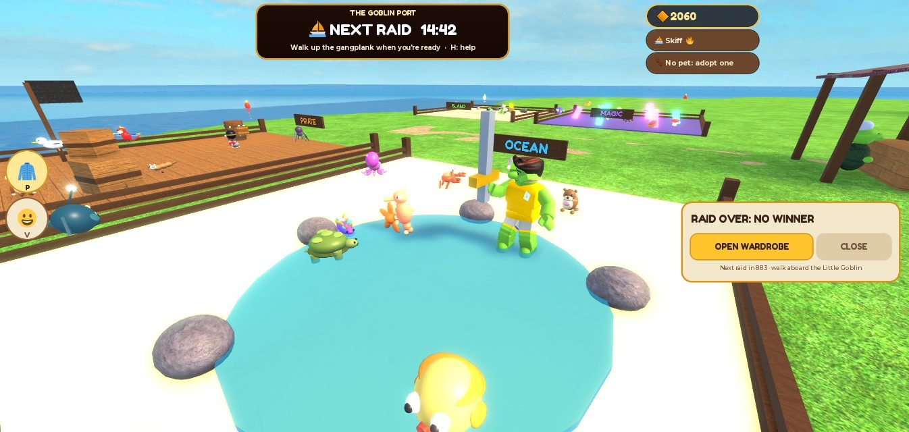

## 16. Pet utility archetypes (Tested by rule)

| Archetype | Effect | Pets |
| --- | --- | --- |
| ⚓ TUG | boat calls (B) 40% shorter wait | 7 (cheapest ◆70) |
| 🔭 SCOUT | spots the nearest waiting treasure and says how far | 7 (◆110) |
| 💨 SPRING | dash recharges 35% faster | 7 (◆90) |
| 🛡 SHELL | bounces off one grapple catch, rests 45 s, glows while ready | 6 (◆140) |
| 👻 SPIRIT | Poltergoblin recharges 25% faster | 7 (◆100) |
| 🔧 MENDER (new) | the boat starts patching after 4 s instead of 9, twice as fast | 7 (◆160) |

Every archetype has a common or uncommon pet (a test checks), so rarity is prestige, never power. The Gilded Whelp (Robux only) has no ability. Code asks `Gear.petIs(player, "Crab")` meaning "a pet with the Tug ability", so the V11 code paths needed no change.

## 17. Pet collection progression (Prototype)

34 pets for Shinies (◆70 to ◆550, 6,260 in all), seven escape trophies, one premium show pet. The early buys are cheap (four under ◆100); the island pets are the long-term aspiration and each one is a story ("I outran the Leviathan"). The pens let a goblin see every pet before buying. One pet out at a time; pets change only in the Port or at the Hoard.

## 18. Economy modelling (Tested by model)

One currency, Shinies. Raid payout (`Economy.payout`): participation 8, +1 per gold banked up to 22, +15 for a win, +3 for an underdog bank (banked something, finished in the bottom half), and **deeds** once a raid each: steal from a spot 2, escape (a pursuer gives up at the sanctuary) 4, snatch from a downed goblin 3, clean tricks 1 each up to 3; capped at 50. Assumption: 8.2 raids an hour (60 s Port + 20 s launch + 360 s raid; less if the Port is cut short by everyone readying).

## 19. Expected Shinies earnings

| Player | One raid | Shinies | Per hour (8.2 raids) |
| --- | --- | --- | --- |
| Newcomer | plays, banks nothing | 8 | 65 |
| Typical | banks one 10 g treasure, below the middle, one steal, one clean trick | 8 + 10 + 3 + 2 + 1 = 24 | 196 |
| Good | banks 18 g, a steal, an escape, two tricks | 8 + 18 + 2 + 4 + 2 = 34 | 278 |
| Winner | banks 22 g or more, wins, steal, escape, three tricks | 54, capped to 50 | 409 |

Plus achievements once (21 in all, paying 1,155) and the 60 welcome Shinies. Seen in Studio: a raid with a steal, a 9 g bank and a win paid 34 (8 + 9 + 15 + 2), plus 85 from three trophies (First Haul, Raid Champion, Light Fingers).

## 20. Unlock prices and pacing

At the typical 196 an hour:

| Unlock | Price | Typical hours | Raids |
| --- | --- | --- | --- |
| Reefhopper | 350 | 1.8 | 15 |
| Wraith | 500 | 2.6 | 21 |
| Stormrunner | 550 | 2.8 | 23 |
| Ironbelly | 600 | 3.1 | 25 |
| Broadside | 700 | 3.6 | 29 |
| All five boats | 2,700 | 13.8 | 113 |
| A common pet | 70 to 120 | under 0.7 | 3 to 5 |
| The dearest pet (Dubloon) | 550 | 2.8 | 23 |
| Every Shinies pet | 6,260 | 32 | 261 |

`EconomySpec` holds the model to its bounds (a typical hour 120 to 260, the dearest boat in six hours or less, every boat in twenty, every pet in five). A winner earns roughly twice as fast; a newcomer a third as fast (and still earns: participation always pays).

## 21. Progression and achievements (Tested)

Ten new achievements (21 in all): **Light Fingers** (first steal, 20), seven escape trophies that each grant that island's pet (**Serpent's Friend** Little Leviathan 60, **Sun Dodger** Sunny 60, **Echo Chamber** Little Echo 40, **Wool Over Their Eyes** Lambkin 40, **Ghost Runner** Bones 60, **Live Wire** Zap 40, **Don't Blink** Peek 40), **The Great Escape** (ten escapes, 80) and **Fleet Admiral** (bank treasure having come home in four classes of boat, 100). An escape is a creature giving up because the thief reached the sanctuary with the treasure (`Pursuit.Escaped`, fired by the island pursuers, the Leviathan and the Ghost Fleet). `EconomySpec` proves each escape grants its pet and four classes make an admiral.

## 22. Monetization options (Needs creator setup)

Product keys in `Config.MONETIZATION.PRODUCTS`, all `id = nil`: a pass for each unlockable boat (also earnable), the Gilded Whelp (show pet, no ability), the Moon Jelly look, and `bundle_fleet` (all five boats; no shop item points at it yet). `SALES_ENABLED = false`. No product id or Robux price was invented. docs/MONETIZATION.md has the team's decision notes.

## 23. Creator configuration requirements

A teammate creates each game pass or developer product in the Creator Dashboard, chooses its price, and gives the AI the id; the AI fills `id` and turns `SALES_ENABLED` on when the team says so; then a published test place with API access for test purchases (docs/MONETIZATION.md, "Turning one on" and "Testing safely").

## 24. Profile schema changes and migration (Tested by spec; live store not run)

`ProfileSchema.VERSION` 3. New stats `steals`, `escapes`; new maps `escapedFrom` (island → count) and `classBanks` (boat class → count); `equipped.boat`. A v2 profile loads as "upgraded" (`migratedFrom = 2`): everything kept, new stats zero, saved as v3 at once; a V7 profile still migrates; a newer version is never opened or written (a v2 server will not overwrite a v3 profile). `PersistenceSpec` covers the v2 upgrade field by field.

## 25. Purchase and receipt safety (unchanged; Tested by spec)

V11's server-only grants, idempotent receipts and pass checks are unchanged (`ReceiptsSpec` passes). New items go through the same `grants` table. Buying with Shinies is charged once under rapid repeats (EconomySpec), and the server alone decides prices and ownership.

## 26. Multiplayer replication (Partly tested)

Everything a second player sees comes from server state and attributes: who is in the raid, ready, spectating; boat classes (`BoatType`), abilities (`BoatFx` "ability" broadcast to everyone for effects; shots, tornadoes and decoys are server objects); pets from `Pet` and `Look`; the champion statue on the server. **Not seen with a second player**: another goblin's pet, ability effects on someone else's screen, two goblins readying, a crowd in the Port.

## 27. Device controls (Partly tested)

- Keyboard: tested (R abilities, P, H, Backspace, Q/E and arrows while spectating).
- Controller: R1 is the stunt key (V12's binding), `Y` on foot is now Poltergoblin (a controller had none), the spectator keys include the D-pad, L1/R1 and B, the HUD shows controller button glyphs when the last input was a gamepad. **No real controller.**
- Touch: TRICK became STUNT and now uses the boat ability on the water; the Port binds no touch buttons (its own screen buttons are tappable). **No phone.**

## 28. Performance measurements

In the Port with all four pens animating (590 pet parts), the goblin's own pet and the full world streamed: client **60 fps**, average frame 16.7 ms, worst 19.1 ms over 3 s; server Heartbeat **60/s**, worst 18.2 ms; 10,064 client parts, 10,210 server parts; Studio's process 3.2 GB (client and server together, not comparable to a device). Pens are drawn only within 260 studs and at a third of the frame rate past 110. Not measured: a phone, a weak PC, many players.

## 29. Studio screenshots

All in docs/reports/ with the `2026-10-18-v13-` prefix: `port-aerial`, `port-sign-and-help`, `ready-all-aboard`, `shipyard`, `showroom-wraith`, `pet-shop-magic`, `menagerie-pens`, `menagerie-close`, `hud-at-home`, `wraith-phantom`, `stormrunner-twister`, `broadside-volley`, `cutter-bow-gun`, `ironbelly-plow`, `skiff-nitro`, `podium-results`, `spectate`, and two "before" frames (`before-port-sign-compass`, `before-shop-preview-crab`). The account name is blurred where it appeared.

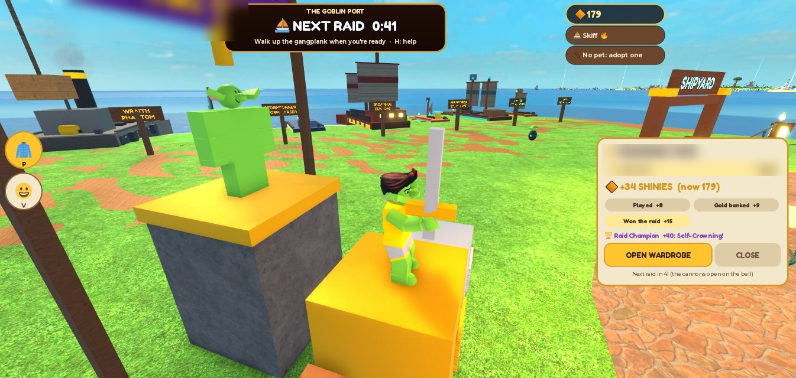

## 30. Tests actually performed

- **Luau**: 76 passed, 0 failed, run in Studio's Edit mode with fresh module instances (the suite loaded from the repository files). New: LobbySpec (7), BoatClassSpec (4), PetSpec (5), and new tests in CatalogSpec, EconomySpec (4), PersistenceSpec, CohesionSpec.
- **StyLua and Selene**: clean. **Rojo**: both the game and test places build. `git diff --check`: clean.
- **Studio playtests** (one client, real keys and clicks unless noted): Port arrival, countdown, sign, departures board, help card; the showroom and pet shop by clicks; buying and wearing a boat and pets (and the server refusing a boat change on the skyship); ready-up by walking aboard (test teleport onto the deck); the raid starting and launching; the raid HUD on foot, at home, at the wheel; all seven abilities by `R` (boats spawned by the test hook in open water, guns mounted the way `B` does); a steal and a bank (by test command: Studio's simulated keys do not drive Roblox's prompts); raid end, podium, statue, results, payout; an abandoned raid ending; spectating with the watch state forced on the only goblin; the pens; performance.
- **Not run**: a second player; spectating or joining with another goblin raiding; a phone; a controller; live DataStore; real purchases; the full escape trophy chain in play (proven by EconomySpec, the escape signal fired by code paths seen in V9 to V12).

## 31. Bugs discovered and fixed (this session)

1. **V11 bug, fixed**: `Main.server.lua` passed only the first argument of a `ShopRequest` to `Progress.handle`, so "equip, slot, item" arrived as "equip, slot": WEAR IT / BRING OUT / SAIL IT on anything already owned **took that slot off**, and outfit names were dropped. Only a purchase (which wears the item itself) ever changed a look. Found when the parrot would not come out at the Hoard; confirmed by reading the profile through the test hook.
2. After buying a pet the wardrobe's stage showed the Crab (the try-on was cleared and the stage fell back to what was worn); the chosen pet or boat now stays on the stage.
3. The airship's 20-stud neon ready ring bloomed into a blinding yellow deck; it is painted now.
4. The sea compass sat behind the Port's sign; hidden in the Port.
5. The sign's line was cut off; widened and shortened.
6. Long feed lines were cut off; they wrap.
7. 🪝, 🤾 and 🪙 render as boxes in Roblox's font; replaced by 🎣, 🏈 and COINS.
8. The Port help card's rows shrank unevenly; fixed size.
9. While spectating, turning the controls off alone let the goblin walk away; the movement keys are now caught too.
10. A Stormrunner that had slowed down was swallowed by its own new twister; its boat now ignores funnels for 5 s after summoning.
11. The results card still mentioned the old cannon bell; it says "walk aboard the Little Goblin" and lists deeds.
12. Lint: a duplicated branch in `Boats.displayModel`, an unused variable.

## 32. Remaining limitations

- One client: no second player, so spectating others, late entry beside other raiders, crowds in the Port and abilities against people are unseen (section 26).
- Studio's simulated keys cannot hold a ProximityPrompt; the Port's counters and the pier prompt were reached by `P` and test commands, not by holding E (their code is the same prompt path V11 used for the tailor's stall).
- Balance, prices, the 60 s Port and the deed values are first guesses with a model, not measurements of fun.
- The Stormrunner's own twister can catch it after the grace if it stops: by design a ride, untested by people.
- From high up, the Port's water meets the far-sea plane in a straight seam. The champion statue is a plain mannequin. A large part of the Port's island south of the buildings is empty grass.
- The showroom's stat card covers the lower part of the boat preview.
- Dash, drift, sprint, keg and Poltergoblin still have no touch buttons.
- No real controller, phone, live DataStore or purchase.

## 33. Deferred work

- A real two-to-four-player playtest (the guide below), then tune the Port's length, the prices and the deeds from it.
- Spectating polish once two players can try it (a free camera, a mini-scoreboard of the raiders).
- Showing the `bundle_fleet` pass in the shop if the team decides to sell it.
- Filling the empty south of the Port (a practice slipway to try boats in? a race track?), if the team likes the town.
- Touch buttons for the remaining moves; a phone check of the new HUD.

## 34. Human acceptance questions

- Is 60 seconds in the Port right? Does walking aboard to get ready make sense without being told?
- Do the seven boats feel genuinely different? Which become favourites, and is any obviously too weak or too strong? Are the cannons fun to fire and fair to be hit by?
- Are the new pets appealing? Too alike? Do they keep up and stay out of the camera?
- Does the raid screen feel cleaner, and is anything important now missing?
- Does V13 make you want to come back for the next boat, or does it distract from the raid?

## Human playtest guide

**Setup**: double-click **Play Loot Goblins**, then in Studio **Test tab > Server & Clients > 3 players > Play** (or one player with the blue Play button). You arrive in the Port.

**The Port (5 minutes)**
1. Walk around. Can you tell where to buy boats, pets and clothes without being told? Press `H` for the Port card.
2. Walk to the Shipyard; press `E` at a boat. Look at its stats. Try the pet pens: stand next to pets and read their names.
3. Everyone walk up the gangplank onto the little airship. Does the countdown drop to 8? Was that clear?

**Boats (one or two raids)**
4. Use the free Skiff and Cutter first: on the water press `R` (controller R1). Then buy a boat (the test server gives no free Shinies: earn some, or ask the AI to give the test goblins Shinies), choose it with SAIL IT in the Port, and press `B` in a raid to call it.
5. Try each class's ability. Which feels best? Is the Broadside's volley or the bow gun annoying to be hit by? Does the Ironbelly's ram feel mighty? Does the Wraith's ghost fool a pursuer?

**Watching and joining**
6. One player stays in the Port while the others raid: press WATCH. Do left/right change who you watch? Is it fun? Press JOIN with more than two minutes left: do you get on the skyship?

**Pets and progression**
7. Buy a cheap pet and take it on a raid. Does it keep up? Does it get in the way?
8. After a raid: is the results card clear? Is there something you want to save for?

**Tell the AI**: what felt bad, what you would change, and send a screenshot of any red error in the Output window.
