# V13.2: Sea of Chaos (2026-10-19)

Ninety's brief: make encounters more frequent, movement more expressive, boats more balanced and every raid more unpredictable, without making the game simply harder. Built by Claude Opus 5.5 on branch `feature/v13-2-sea-of-chaos`, stacked on V13.1 (`fix/v13-playtest-feedback`, PR #25), which is stacked on V13 (`feature/v13-goblin-port`, PR #24). Neither is merged into `main` yet, so V13.2 starts from the newest complete code (V13 + V13.1) and its PR, [#26](https://github.com/EnrikR2002/Loot-Goblins/pull/26), targets the V13.1 branch. **Not merged.**

**Read this first.** Everything below was built and tested by one AI on **one** Roblox Studio client, through a Studio-only test hook (a Workspace script obeying a `DebugCmd` attribute; never committed) and real key presses and clicks where it says so. Nobody has played V13.2. It has never had a second player, a phone or a real controller. Travel times come from server-driven test boats following the sea's own pathfinder, not from people. **Passing tests and smooth numbers do not prove the boats are balanced or the chaos is fun**: that needs Ninety, Ethan and Enrik playing it together.

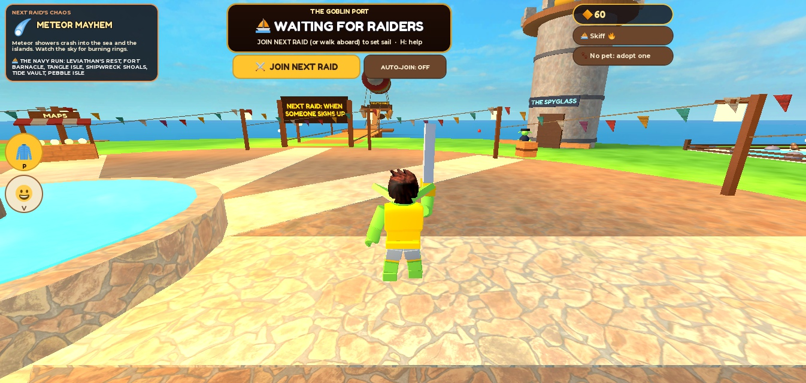

## 1. What changed

| Brief | Now |
| --- | --- |
| §3 On foot: momentum, grapple first | **No sprint key.** Running builds speed by itself: 21 on the first step, the normal 28 after 0.3 s, **38 after about 2 s**; a sharp turn or stopping spends it, jumps, falls, swings and landings keep it. **The grapple swings**: hook anything above you (rock, tree, bridge, mast, a moving boat) and you swing on a pendulum, `W A S D` pump, hold `F` to reel in, `F` or `Space` lets go keeping the speed. **Dash** stays as the dodge and quick start (`Shift` or `C`). The PvP catch is now a **thrown hook** you can see and dash out of. Poltergoblin stays switched off |
| §4 Rebalance boats | Cruise speeds compressed from **96–135 to 106–118**, acceleration from **54–100 to 61–72**, boost ×1.5 → ×1.42, Nitro ×1.75 → ×1.45. Measured: from Skull Rock the fleet now docks within **3.5 s** of each other (was 11.2 s) |
| §5 Ten classes | **Anchorjack** (the anchor, now only on this boat), **Wavebreaker** (a ring of water), **Corsair** (boarding hook) added; every class's `R` escapes, disrupts, or both. Skiff and Cutter free; the other eight for Shinies (350–700), with inert Robux keys |
| §6 Cannon on every boat | **Click while driving fires the bow gun** (gamepad `R2`, touch GUN): 2.2 s reload, 240 studs, ±70° off the bow, shoves and splashes, never sinks a boat or knocks treasure loose, never in the Port or at home |
| §7 Skyship | It **flies one of seven routes** (forwards or backwards) across the sea; cannons reach about **1,200 studs**, so what you can reach changes as it flies. **10 s prep with the cannons locked by the server**, then a 32 s pass; the six-minute clock starts after it. All 110 route-and-island landings verified dry |
| §8 Opt-in | **Nobody is sent on a raid they did not join.** JOIN NEXT RAID (or walk aboard the Little Goblin), cancel any time before it leaves, AUTO-JOIN for regulars; no empty raids; late join and spectating as before; **LEAVE THIS RAID** (two presses) goes home, forfeiting that raid's gold and Shinies |
| §9 World chaos | **One of eight events per raid**, named with its icon in the Port before anyone picks a boat: Meteor Mayhem, Kraken's Tantrum, Rogue Wave Rampage, Cannonball Crossfire, Barrel Apocalypse, Whirlpool Outbreak, Haunted Seas, Thunderstruck. Telegraphed episodes near goblins, each drawn differently, with calm between |

## 2. On foot

**Momentum** (`shared/Momentum.lua`, played by the goblin's own client over the server's speed cap; `Config.MOMENTUM`). Measured with a real `W` held on Tangle Isle:

| Time running | 0.5 s | 0.6 s | 1.0 s | 1.6 s | 2.1 s | 2.5 s on |
| --- | --- | --- | --- | --- | --- | --- |
| Speed (studs/s) | 23 | 27 | 29 | 32 | 36 | **38** |

A full reverse (`S`) dropped it to 28 and it built again; stopping returns to 21. A carrier's top is 29 to 37 (weight). The server still sets the base speed (`Movement`'s MoveCap: carrying, water, a knockout) and the goblin's own client multiplies it. As with every Roblox character the client moves its own body: there is no server check on running speed, before V13.2 or now (a known limit, not new).

**The swing** (`shared/Swing.lua`, `Config.SWING`): the aim finds a hook within 170 studs with a forgiving 7° cone. Above you by 6 studs or more it is a **swing** (gravity 150, pump 46 studs/s², top 125 studs/s on the rope, 7 s at most); level or below it is V7's straight **pull**. Speed carried off a rope (up to 92) slides back to the run 0.75 s after landing. A hook on a boat seats you (V7). Carriers can swing too, every 2.4 s (was 5).

Measured (real `F`, `W`, `Space` on Tangle Isle's canopy bridge, 42 studs up): hooked from standing, at the rope's cap (125) within about 0.3 s, about 95 studs covered in 0.8 s; released, landed at full momentum (38). One run flew straight into a tree trunk in its path, which is the kind of thing a human must judge: **it is fast, and possibly too fast**.

**The catch** is a thrown hook (170 studs/s, 7 studs wide) instead of an instant hit: a carrier who sees it coming can dash out of its line. Shell Tortoise pets still bounce one catch; Spring Frog still speeds the dash; Pocket Ghost (SPIRIT) still shortens a knockout.

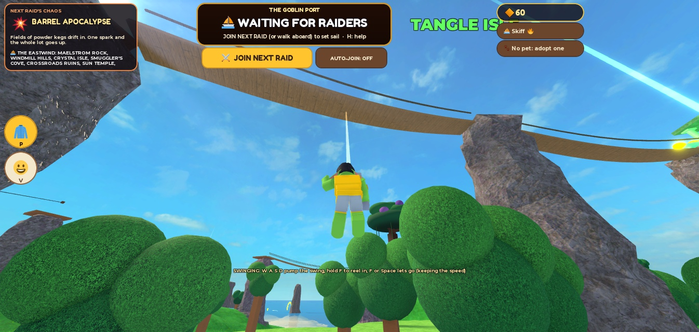

## 3. Boats: before and after

V13.1's numbers (git `8972cb4`) against V13.2's (`Config.BOAT_TYPES`):

| Class | Top speed | Acceleration | Turn | Hull |
| --- | --- | --- | --- | --- |
| Skiff | 135 → **118** | 100 → **72** | 2.5 → 2.6 | 160 → 170 |
| Cutter | 110 → **114** | 72 → **69** | 1.8 → 1.9 | 420 |
| Reefhopper | 124 → **113** | 92 → **70** | 2.4 → 2.45 | 150 → 160 |
| Broadside | 98 → **108** | 58 → **63** | 1.45 → 1.5 | 520 |
| Stormrunner | 122 → **112** (132 in a storm) | 84 → **67** | 2.1 → 2.15 | 260 → 270 |
| Wraith | 128 → **115** | 96 → **71** | 3.1 | 120 → 130 |
| Ironbelly | 96 → **106** | 54 → **61** | 1.35 → 1.4 | 640 |
| Anchorjack (new) | **110** | **65** | 2.2 | 360 |
| Wavebreaker (new) | **111** | **66** | 2.0 | 320 |
| Corsair (new) | **116** | **68** | 2.3 | 250 |
| Patrol ship (Navy) | 106 → 104 | 68 → 64 | | |

Shared: boost ×1.5 → **×1.42** (a Skiff 168, an Ironbelly 150), boost thrust 2.4 → 2.2, the standstill punch 0.9 → 0.6, super jump from 150 → **132** (still above every cruise, below every boost) to 188 for the full height. Nitro ×1.75 → **×1.45** for 1.1 s (was 1.3), kick 30 → 18, cooldown 15 s: its worth is now **breaking free** (anchors, hooks, tows, whirlpools: shoves are shrugged off while it burns), not winning races.

### Travel times (measured)

Each class driven by the server from the shore of an island to the Hoard's docks (within 260 studs of it), along the path `SeaNav` gives that hull's draft, full throttle, Shift whenever it was ready (with its own cooldown), no abilities, test boats unable to touch each other. "Before" is the same run in the same session with V13.1's numbers patched in for the seven old classes.

| Class | Crystal Isle → docks (1,700 studs) | Tangle Isle → docks (2,700) | Skull Rock → docks (4,330) |
| --- | --- | --- | --- |
| Skiff | 10.5 → **12.5** s | 16.4 → **19.4** | 25.8 → **31.3** |
| Cutter | 12.3 → **12.5** | 20.6 → **19.3** | 31.5 → **31.3** |
| Reefhopper | 11.4 → **13.2** | 18.1 → **20.5** | 28.6 → **32.5** |
| Broadside | 14.2 → **13.6** | 22.5 → **22.4** | 36.6 → **33.8** |
| Stormrunner | 11.4 → **12.8** | 17.6 → **21.1** | 28.3 → **31.9** |
| Wraith | 10.9 → **12.7** | 17.4 → **19.7** | 26.9 → **31.5** |
| Ironbelly | 14.5 → **13.8** | 23.0 → **22.9** | 37.0 → **34.5** |
| Anchorjack | **13.0** | **21.3** | **32.1** |
| Wavebreaker | **12.9** | **20.5** | **32.0** |
| Corsair | **12.4** | **19.6** | **31.0** |
| **Spread (slowest − fastest)** | 4.0 → **1.4 s** | 6.6 → **3.6 s** | 11.2 → **3.5 s** |

What it says: the Skiff no longer wins by seconds; **the free Cutter keeps pace with it** everywhere; the slow pair (Broadside, Ironbelly) lost most of their penalty; the long Tangle route still favours good turners (it winds). Top speeds seen on the way (boosts and currents) fell from 141–217 to 148–179. A long crossing takes 3 to 6 s longer in the fast boats: that time is now spent near other boats instead of ahead of them.

### The fleet

| Class | Price | Role | Size (W × H × L) | Top | Accel | Turn | Hull | Crash taken | Crew | `R` ability (cooldown) |
| --- | --- | --- | --- | --- | --- | --- | --- | --- | --- | --- |
| Skiff | free | Escape artist | 9 × 3 × 20 | 118 | 72 | 2.6 | 170 | ×1.00 | 1 | 🔥 NITRO (15 s): a burst that breaks every chain, hook and tow and shrugs off shoves |
| Cutter | free | All-rounder | 14 × 4 × 34 | 114 | 69 | 1.9 | 420 | ×0.60 | 3 | 📯 RALLY HORN (16 s): every boat within 150 surges, a hull patch, nearby pursuers and the Leviathan flinch |
| Reefhopper | 350 | Stunt boat | 10 × 3 × 18 | 113 | 70 | 2.45 | 160 | ×1.10 | 1 | 🌀 SPRING (9 s) |
| Broadside | 700 | Gunboat | 16 × 5 × 38 | 108 | 63 | 1.5 | 520 | ×0.50 | 3 | 💣 BROADSIDE (10 s) |
| Stormrunner | 550 | Storm chaser | 11 × 3.5 × 26 | 112 | 67 | 2.15 | 270 | ×0.85 | 2 | 🌪 TWISTER (24 s, was 28) |
| Wraith | 500 | Phantom | 8 × 2.6 × 22 | 115 | 71 | 3.1 | 130 | ×1.25 | 1 | 👻 PHANTOM (11 s) |
| Ironbelly | 600 | Bruiser | 18 × 6 × 36 | 106 | 61 | 1.4 | 640 | ×0.30 | 4 | 🐗 RAM PLOW (14 s) |
| **Anchorjack** | 500 | Anchor | 13 × 4 × 28 | 110 | 65 | 2.2 | 360 | ×0.70 | 2 | ⚓ ANCHOR (9 s): snag a rival boat ahead (150 studs) and chain it to you for 3.5 s, or bite a rock or the sea bed and swing round it; `R` again lets go as a slingshot |
| **Wavebreaker** | 550 | Wave maker | 14 × 4 × 26 | 111 | 66 | 2.0 | 320 | ×0.75 | 2 | 🌊 BREAKER (11 s): a ring of water 115 studs out throws boats away and washes swimmers back; you hop onto the crest and surge. Rides rogue waves 1.6× farther |
| **Corsair** | 650 | Boarder | 11 × 3.6 × 27 | 116 | 68 | 2.3 | 250 | ×0.90 | 2 | ⚔ BOARDING HOOK (14 s): harpoon the boat ahead (170 studs), reel in at 70 faster than it; reach it and you **board**: it is knocked aside and slowed, 24 hull damage, and **its crew drop what they carry**. No boat ahead: it zips you to a rock |

Every ability is played by whichever machine simulates the hull and judged by the server (`BoatAbilities`: range, arc, safe zones, cooldown, what the anti-cheat lets the hull do meanwhile). The anchor and the hook name the rival hull the client chose, which the server believes only if it passes the same tests.

### The abilities, measured (real `R` presses, one client, a server-driven rival)

| Ability | What happened |
| --- | --- |
| ⚓ Anchor, snag | Rival Skiff fleeing at 70: **dropped to 6 on the snag**, held on the chain 3.5 s (its speed about halved), the Anchorjack towed along at 50–72; then it broke free. "SNAGGED! R lets the chain go" |
| ⚓ Anchor, swing + sling | At 92, anchor bit the sea bed: **swung 160° in 1.7 s** at about 80, then `R` let go: **79 → 135** (a slingshot hairpin) |
| ⚔ Boarding hook | Hooked a Skiff fleeing at 90 from 107 studs: reeled at up to 158, **BOARDED** ("FrikiEnriki BOARDED a Skiff!"): the rival 24 hull damage, the Corsair 12, the rival knocked 48° off its line and slowed (96 → 84) |
| 🌊 Breaker | Rival 51 studs off the beam: **thrown at 71 studs/s** to 97 away; the Wavebreaker hopped 11 studs onto its crest |
| 🔥 Nitro | A Skiff held on a 40-stud tow sat at 0 with the throttle down; Nitro **broke the chain** and it shot off to 130 |
| 📯 Rally Horn | The Cutter surged **102 → 153** and patched to full hull (406 → 420) |
| Bow gun | Real click at a rival 32 studs off the bow: the shot landed **within 0.1 studs of the aim**, 9 hull damage, the rival shoved away. A 5-keg chain reaction in Barrel Apocalypse from one shot (earlier in the session) |

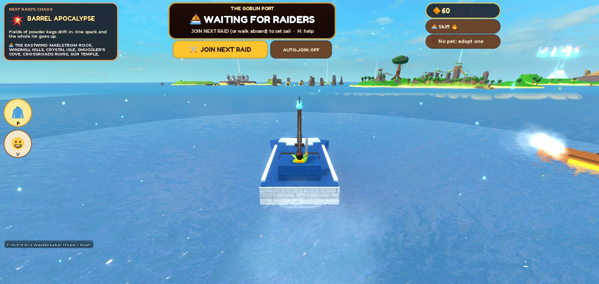

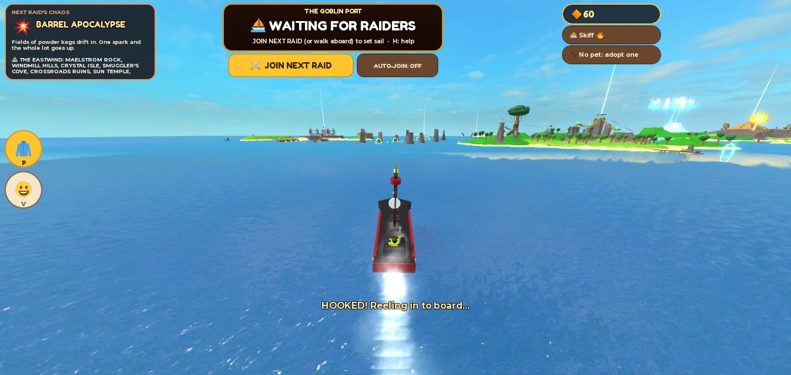

## 4. Controls (and the collision audit)

| Where | Keyboard / mouse | Controller | Touch |
| --- | --- | --- | --- |
| At the wheel | Click: **bow gun**. `Shift`: boost. `Space`: hop / super jump. `R`: the boat's ability on the water, a trick in the air. Hold `C`: drift. `E` or `X`: leave | `R2` gun, `X` boost, `A` hop, `R1` ability / trick, `B` drift, `Y` leave | GUN, BOOST, HOP, STUNT |
| On foot | Running builds speed. `Shift` or `C`: dash. `Space` twice: air jump. `F`: grapple (swing / pull / catch); hold `F` reels in; `F` or `Space` lets go. Click: sword | `B` dash, `A` jump, `L2` grapple | HOOK |

What was checked: at the wheel the click is the gun, never the sword (`Combat` refuses a driver's swing) and never the grapple (`F`); `R` was the anchor winch's key through V13 and is now only the ability/trick (the winch is gone: the anchor belongs to the Anchorjack); `Shift` on foot was sprint and is now the dash (no hold behaviour left to clash); a click over a button is the button's (`processed`); R2 at the wheel is bound above Roblox's own tool action. The controls card (`H`) says all of it. Not checked: a real controller, a real phone.

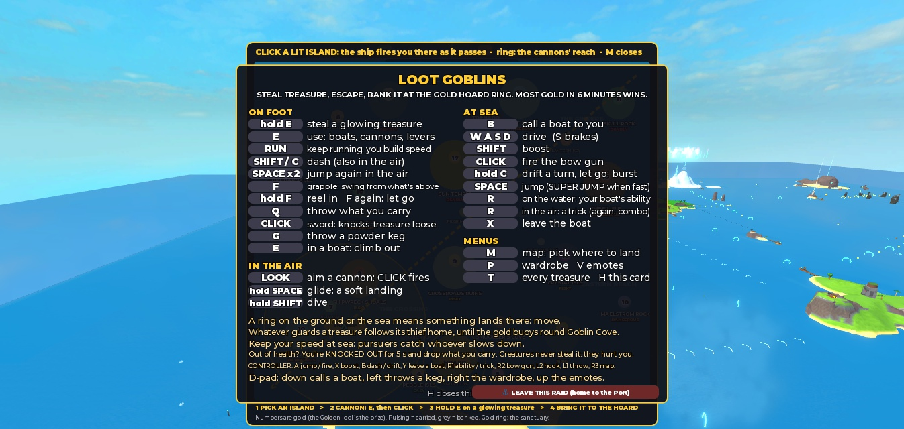

## 5. The skyship

`shared/SkyRoute.lua`, `server/Skyship.lua`, `Config.SKYSHIP`.

- **Seven routes** (the Westwind, the Eastwind, the Northern Arc, the Southern Sweep, the Spine, the Cinder Run, the Navy Run), each flown forwards or backwards, never the same as the raid before, chosen and shown when the Port opens. Each reaches 6 to 10 of the 16 major islands; every island is in reach on at least two routes (tested).
- **Finite reach**: the cannon throws at 215 (was 440): about **1,200 studs** from 540 up (was 3,560: the whole sea). Skull Rock from the middle of the sea is out of reach (tested).
- **The countdown is real**: aboard, the ship waits at its route's start for **10 s** with the cannons **locked by the server** (`Flight`/`Skyship` refuse a fire; the HUD says 🔒 SETS OFF). Aiming works. Then it flies the route in **32 s** (152 to 222 studs/s). Manual fire, the auto-fire of a map pick, the end-of-pass straggler fire and late joiners all go through the same check.
- **The six-minute clock starts when the pass ends** (42 s from boarding).
- **Picking on the map** (`M`) lights the islands in reach on this route; the ship fires you as it passes your pick's closest point. The map shows the route, the ship and the reach ring. Anyone still aboard at the end is fired at the best landing in reach.
- **Late joiners** board the ship mid-route (it flies back and forth, swinging round at the ends instead of jumping) and get 24 s on deck.
- **V12's dry landings, kept**: each route checks every island's landing spot by flying the actual throw from its closest pass (`Skyship.throwLands`), and moves it if needed. **All 110 route-and-island combinations come down dry within 22 studs of their spot.** Real flights in Studio landed 10 to 20 studs from the spot on seven islands (Crystal Isle 33, on a ledge above it).

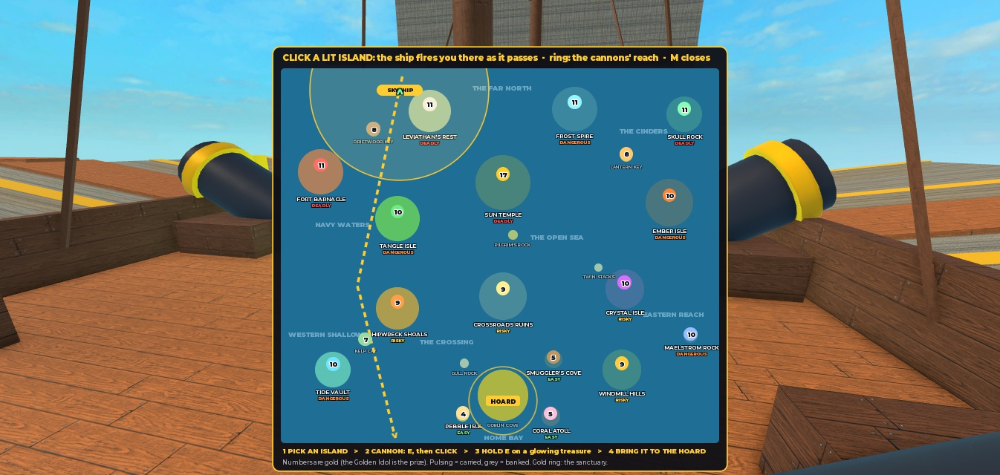

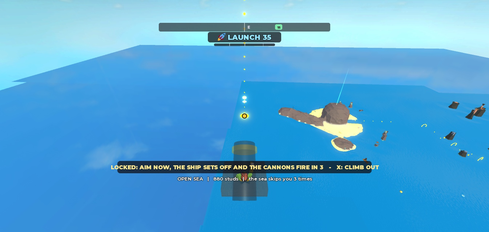

## 6. Going is a choice

`server/Raid.lua`, `shared/Lobby.lua`, client `PortHud.lua`, `Hud.lua`.

- The Port says **WAITING FOR RAIDERS** while nobody has joined: no countdown, no empty raid. **JOIN NEXT RAID** (or walking aboard the Little Goblin) signs you up; the first sign-up starts the 60 s countdown; once everyone signed up is aboard it leaves in 8 s. **SIGNED UP · STAY IN PORT** cancels. **AUTO-JOIN** signs you up for every raid until you turn it off.
- Only signed-up goblins go. Everyone else stays to shop, chat, watch (Spyglass), or JOIN a running raid late (while 2 minutes are left).
- **LEAVE THIS RAID** on the `H` card (two presses: "SURE? You lose this raid's gold. Press again") takes you home to the Port: what you carry drops for others, that raid's gold and Shinies are forfeited. If the last raider leaves, the raid ends.

Seen in Studio with real clicks: WAITING → JOIN (countdown 0:59, "1 signed up") → raid → skyship (route, prep) → fired onto Tide Vault → LEAVE, two presses → "FrikiEnriki sailed home to the Port", gold 0, raid over, the Port waiting again with the next chaos and route. Cancel and walk-aboard were checked earlier in the session.

## 7. World chaos

`server/WorldChaos.lua` (the server's events), `client/ChaosFx.lua` (all their visuals), rogue waves and whirlpools in the shared sea maths (`shared/Sea.lua`: the server and every driver's client float boats on the same water), `Config.CHAOS`.

Every raid draws **one** event (never the last raid's), shown in the Port with its icon and a line. During the six minutes it plays **episodes**: the first 22–34 s in, then one after another with 18–30 s of calm between, none in the last 18 s. Each is centred 80–260 studs off where goblins are (never on their heads, never within 650 of the Hoard, never in the Port), telegraphed, and drawn afresh (size, count, shape, place). Everything hits through the game's own rules: explosions are `Blast`s (creatures, sea mobs, the Navy, mines and kegs react), boats are shoved through `Boats.shove` with the crash grace (chaos batters, it never sinks), goblins through `Impact`'s grace (no juggling).

| Event | What happens | Seen in Studio |
| --- | --- | --- |
| ☄ Meteor Mayhem | 5–9 meteors (sometimes THE BIG ONE first, ×1.8) under burning rings; blasts throw boats up 120–170 and out, splash, set off kegs | A boat thrown high off the blast; crash grace stopped the landing from sinking it |
| 🐙 Kraken's Tantrum | 4–6 tentacles after bubbles: some sweep a 120° arc, some slam, some come up under a boat and toss it (190 up) | A Wavebreaker tossed 25 up, 320 → 298 hull |
| 🌊 Rogue Wave Rampage | 1–2 walls of water 20–30 high rolling at 58–74 across the sea; break against land | The sea rose 22.8 studs under a boat and **carried it 159 studs**, no damage |
| 💣 Cannonball Crossfire | An armada 520–650 off (always in deep water) shells a 180–250 zone for 14–18 s, sometimes rolling across the sea; 60% of shells aim at boats' paths | Rings and shells round the boat; armada ships placed in deep water after a beach spawn was fixed |
| 💥 Barrel Apocalypse | Fields of 26–40 kegs (70% powder) drift in; anything that goes bang sets off the ones near it, in chains | One bow-gun shot set off a 5-keg chain |
| 🌀 Whirlpool Outbreak | Wandering whirlpools (70–110 studs in radius) pull boats in, spin them round, fling them out of the far side | A boat spun at 70 studs/s and pulled to the eye |
| 👻 Haunted Seas | Twin portals (sail into one, out of the other) and phantom ships that ram | A boat in portal A came out at portal B |
| ⚡ Thunderstruck | The sky darkens, a crackling ring, then a giant strike on the busiest water: the shockwave throws boats and **SUPERCHARGES** them (a burst of speed), with chains of lightning between boats | 13 supercharges in one test, fastest throw 39 up |

After a raid: chaos cleared (`WorldChaos.reset`: no waves, whirlpools, barrels, portals or ships left), the next event and route chosen, opt-ins cleared (checked twice, two raids in a row).

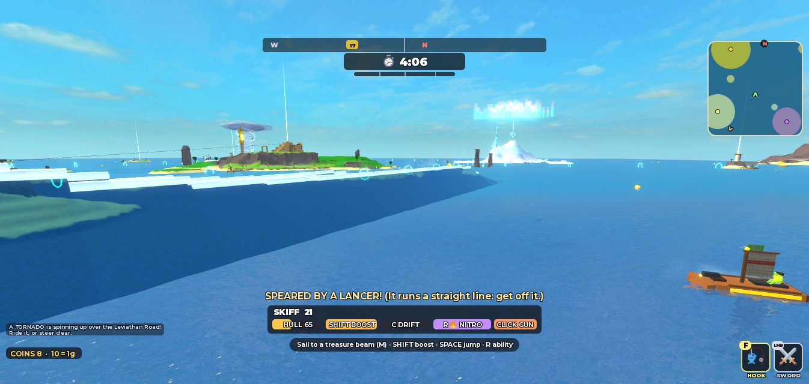

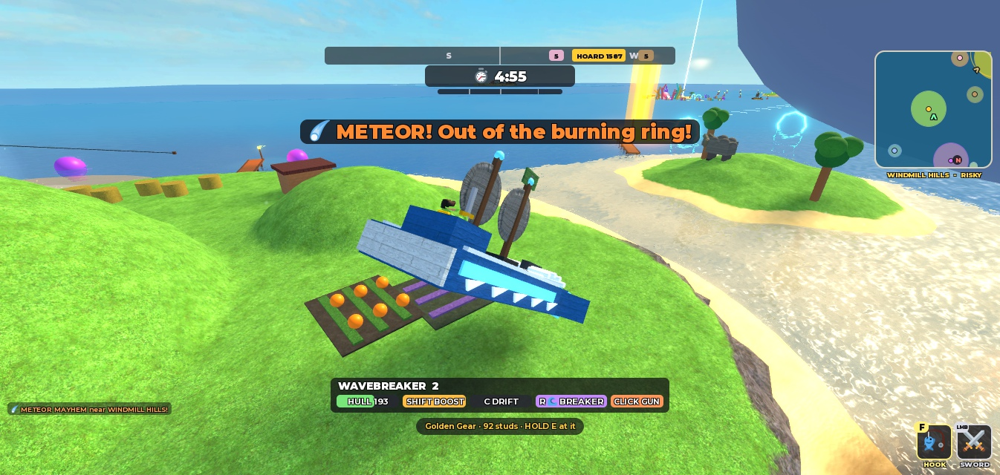

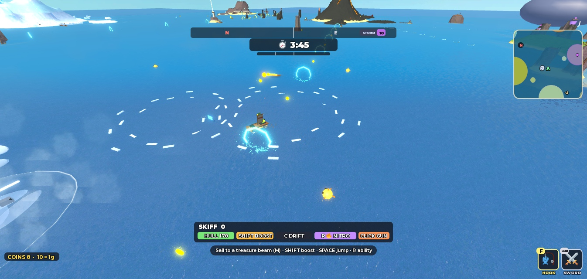

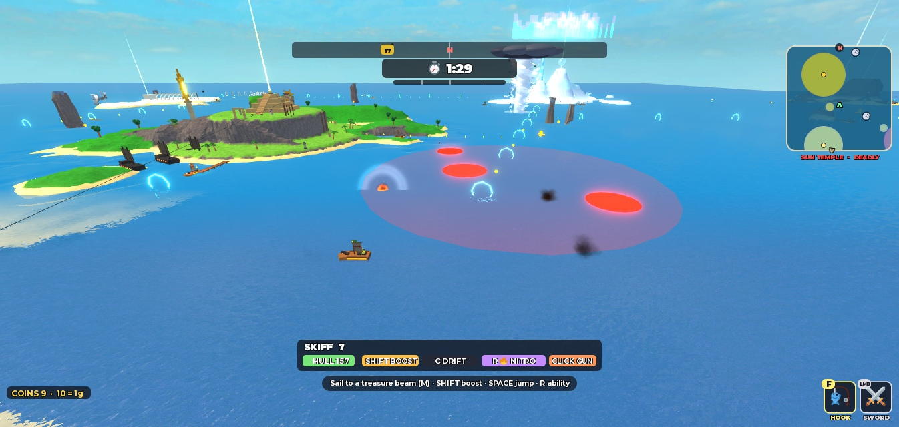

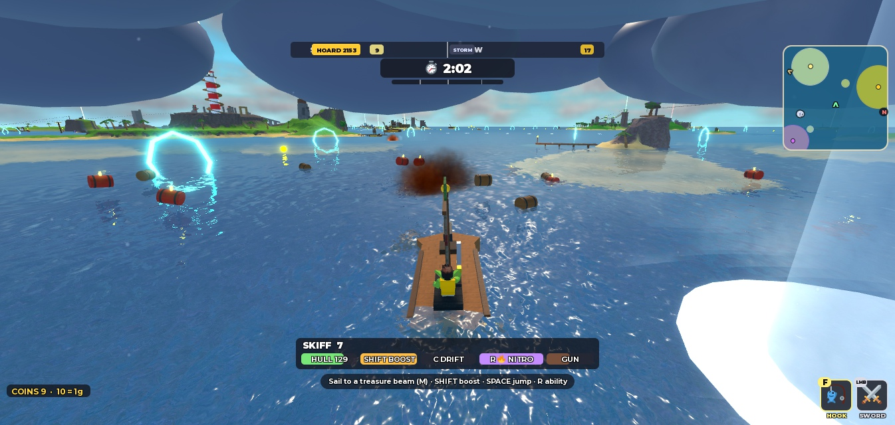

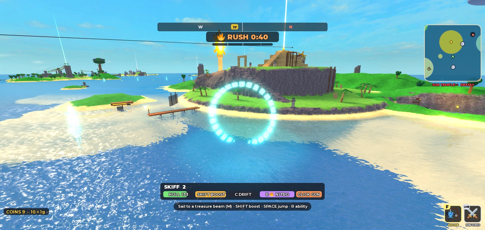

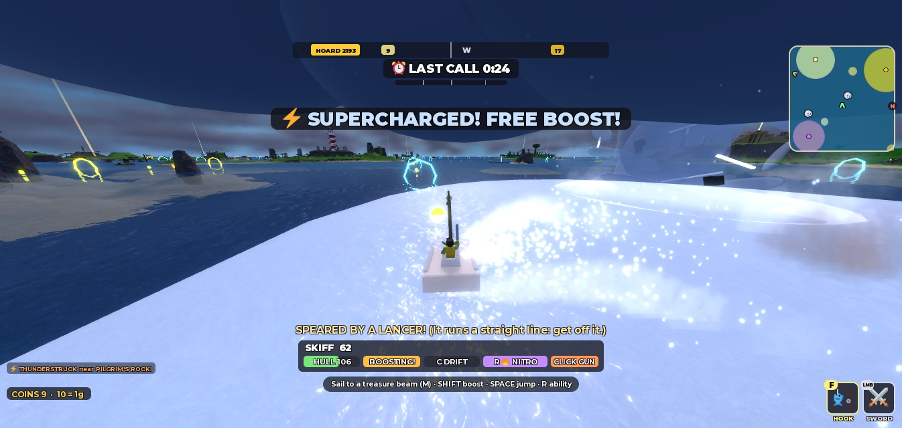

## 8. Performance

Each event forced in turn round the test goblin's Cutter with six AI boats circling it (Studio on the development PC, one client, Studio in front):

| Scene | Server frame (avg / worst) | Client fps |
| --- | --- | --- |
| Calm | 16.7 / 19.9 ms | 60–61 |
| Meteors | 16.7 / 19.1 ms | 60–61 |
| Kraken | 16.7 / 19.0 ms | 60–61 |
| Rogue waves | 16.7 / 20.2 ms | 60–61 |
| Crossfire | 16.7 / 19.9 ms | 60–61 |
| Barrels (31 kegs) | 16.7 / 19.6 ms | 60–61 |
| Whirlpools (4) | 16.7 / 19.3 ms | 60–61 |
| Haunted (3 ghost ships) | 16.7 / 19.7 ms | 60–61 |
| Thunder | 16.7 / 20.2 ms | 60–61 |
| **Barrels + meteors together** (27 kegs) | 16.7 / 19.9 ms | 60–61 |

The server never dropped below 60 steps a second; the client held 60 (it dipped to 36 for one second while the test boats spawned). Barrels are data, not physics parts (the server moves them and draws nothing; clients draw them); whirlpools and waves are maths in the shared sea; every visual is drawn on the clients (`ChaosFx`). **Not measured**: a full 3-player server, a phone.

## 9. Profile and economy

- **No profile migration needed**: boats are catalogue items (`boat_anchorjack` 500, `boat_wavebreaker` 550, `boat_corsair` 650 Shinies) owned the V11/V13 way, so every existing owner keeps everything. Free: Skiff and Cutter.
- **Robux**: inert product keys for the three new boats and the fleet bundle (now all eight), `id = nil`. A human creates any product in the Creator Dashboard (docs/MONETIZATION.md).
- `EconomySpec`: the whole fleet is still earnable in under 26 hours of ordinary raids.
- Pets: nothing depended on sprint. Spring Frog speeds the dash (kept), Shell Tortoise bounces a catch (now a thrown hook, still blocked), SPIRIT shortens a knockout.
- Leaving a raid forfeits that raid's gold and Shinies, so it can't be used to bank Shinies and skip the risk.

## 10. Tests and checks

- **107 Luau tests pass** in Studio (V13.1's 82, all kept, plus 25): `MovementSpec` (momentum: moving at once, the run, the top; a hard turn or stop spends it, a curve, jump or fall keeps it; swing speed kept in the air, sliding back after landing; the swing: swing or pull by height, a pendulum that never stretches the rope, pump, reel, release with a lift, a pull that arrives), `SkyRouteSpec` (finite reach; every route 6–10 islands, every island on 2+ routes; bounds and speed; the prep wait; the pass and the swing-round with no jump; reversed routes; in reach at the closest pass), `ChaosSpec` (eight events with names, icons, lines and tuning; several episodes with calm between; hits recoverable; the sea's chaos reaching clients intact; a rogue wave lifts, carries and breaks against land; a whirlpool swirls round and in), `BoatClassSpec` (ten classes in the showroom; no class better at everything; one speed band 105–120 and nobody much quicker to top speed; a 3,000-stud crossing from a standstill about the same for all; Nitro an escape, not a straight-line win; every ability escapes or disrupts; the bow gun shoves more than it hurts; snag, swing and hook become the right chains and a swing lets go as a sling), `LobbySpec` (a raid leaves only with somebody signed up and the countdown over; a raid nobody is left in ends).
- StyLua and Selene clean; `./scripts/check.ps1` (see the PR).
- Studio: everything in sections 2 to 8 above.

## 11. Bugs found and fixed while testing

| Found | Fix |
| --- | --- |
| The Corsair's boarding never happened: its own client says "arrived" alongside the rival, but the server sees that hull a moment late and the client saw the rival a moment late (27 studs apart at 94 and 68 studs/s) | On "arrived" the server allows both boats' speeds along the line × 0.35 s (`A.hook.lag`) |
| A boarded boat sped up (it was shoved along the line between the hulls: straight ahead when boarding from behind) | Shoved across the Corsair's heading |
| The bow gun's shots at something close went 15–20 studs long (every cannon's aim was floored at 6° down) | The bow gun may aim down to 40° (other cannons unchanged) |
| The skyship's auto-fire landed 59 studs off (the server's view of a goblin on the moving deck lags) | Throws from a fixed point on the ship; the client starts the flight there |
| The ship jumped back to the route's start after its pass | It swings round over 3 s and flies back |
| A meteor-thrown boat took big crash damage landing | Shoves give crash grace for their size |
| Kraken markers tinted the whole screen purple (a tall column) | Warning rings instead |
| Rogue waves weak near land, crests turned 90° | Softer shelter, crests along the front |
| Whirlpools orbited a boat forever | Stronger pull at the centre |
| The armada could spawn on a beach | Tries 16 headings for deep water |
| Leftover tentacle parts when not rendering | A cleanup backstop |
| The leave button covered "H closes this", and an old reset could relabel a second question early | Text moved left; the reset knows which question it belongs to |
| Frost Spire unreachable at its landing height on the Spine | Reach computed for the landing's height |

## 12. Not tested, or unverified

- **A second player**: boarding a real goblin (their treasure dropping), a snag or hook on a boat another client simulates (the tether is sent to that client: written, never seen), PvP with the bow gun, rally surging a friend, spectating and late entry with others.
- **Feel**: whether momentum's 2 s build feels good; whether the swing's 125 cap is too fast (it can fly you into trees); whether the compressed boats make the sea feel slower in a bad way; whether eight events are fun, too much or too little. **These are the playtest.**
- A real controller (R2 gun, L2 swing) and a phone (the GUN button).
- A full six-minute raid with three people under chaos; the events with every guardian (meteors were seen to throw creatures through `Blast`, not with each guardian).
- Pursuit interactions such as the Leviathan being hit by a meteor were not staged.
- The Spine route's Frost Spire landing passes in simulation; no real flight onto it was made.
- Studio's own mouse tool leaves the camera fixed; real mice do not (no game code sets it), but nobody has played a raid start with a real mouse since.

## 13. Playtest guide (for three people)

1. Everyone presses **Play**. You arrive in the Port. Look at the top left: **the next raid's chaos and the skyship's route**.
2. Press **JOIN NEXT RAID** (or walk up the gangplank). Try cancelling, and try AUTO-JOIN. Someone stays behind and watches from the Spyglass.
3. On the skyship: climb into a cannon (`E`) and aim. **It will not fire for 10 s.** Press `M`: the lit islands are in reach now; pick one, or fire yourself when your island comes into reach.
4. On foot: just run, and feel the speed build. Press `F` at a tree, a rock or a bridge above you and **swing**; `W` pumps, `F` or `Space` lets go. Try swinging onto a moving boat.
5. At sea: **click to fire the bow gun** at each other. Try every boat at least once (the Shipyard, or `P`): the Anchorjack's anchor on a friend's boat, the Corsair boarding a carrier, the Wavebreaker's ring in a crowd, the Skiff's Nitro to escape a chain.
6. Race home from a far island in different boats. Does any boat feel useless? Does anyone feel too slow?
7. Watch the chaos: is it funny? Too often? Too rare? Did it ever feel unfair?
8. Someone press `H` and **LEAVE THIS RAID** (twice) to check you go home.
9. Report what felt bad, what was funny, and send a screenshot of any red error.
