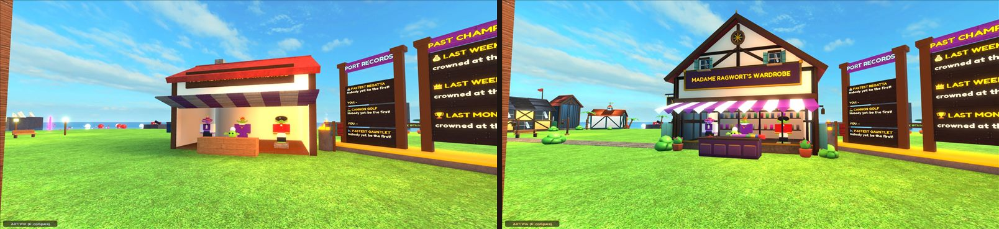
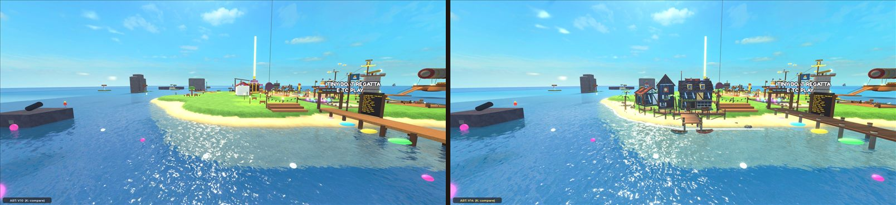
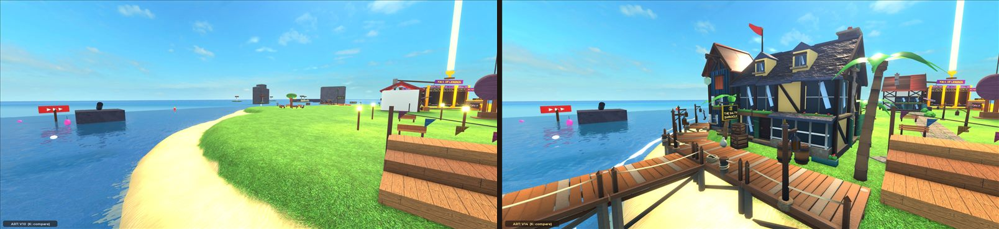
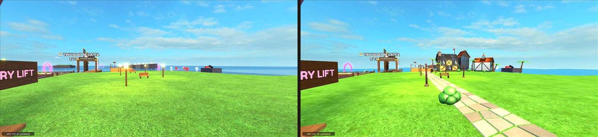
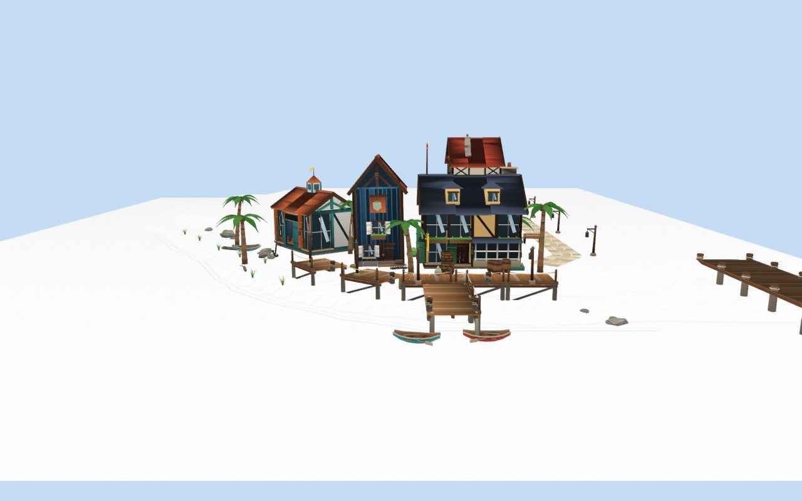
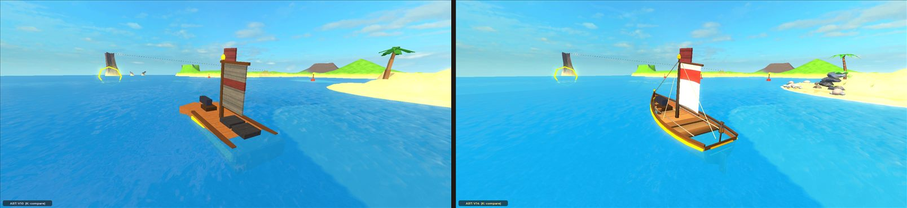
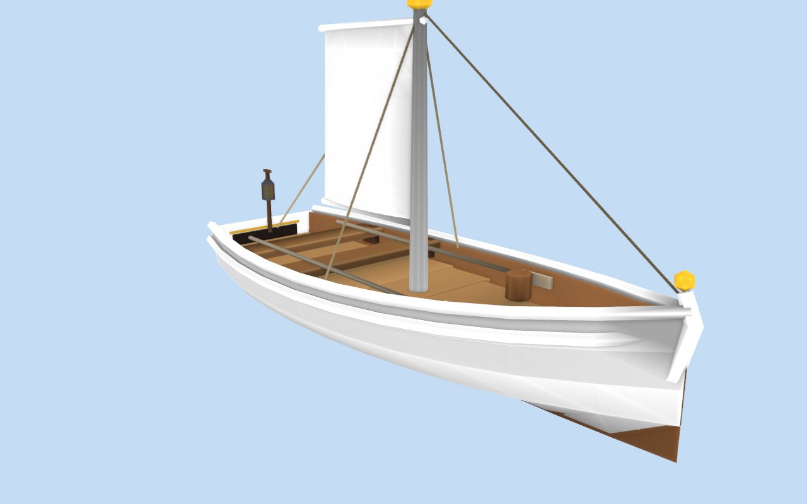
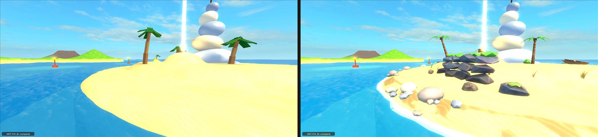
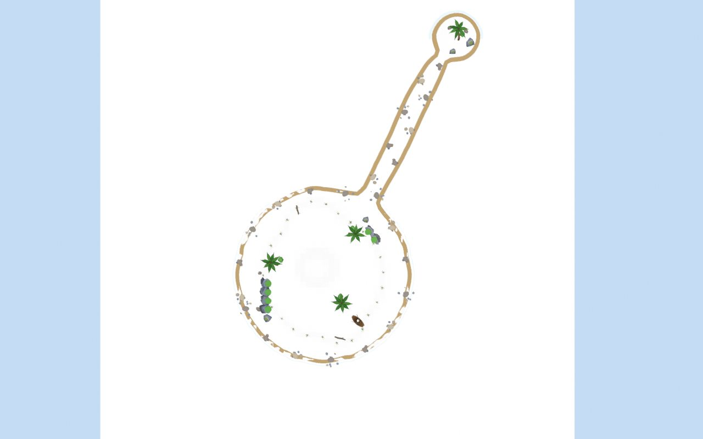

# V14: The Visual Renaissance (2026-10-26)

Ninety's brief: **establish a release-quality stylized visual standard** (a premium stylized pirate adventure: warm, readable, expressive, never noisy or realistic) through art direction, Blender asset production, environmental composition and a reproducible Roblox integration pipeline, **without repeating V10** (more Roblox primitives). The first milestone was a verified Blender-to-Roblox pipeline; then three showcases: **A, the Goblin Port's Harbour District** (highest priority), **B, a Hero Skiff** that changes only how the skiff looks, **C, one island coastline**. A prototype milestone, not the full world overhaul (that is V14.1). **No gameplay changes.** Do not merge without the team.

**Read this first.** Everything below was done and judged by **one AI**, in brief Studio sessions on **one desktop client** (no long autonomous playtests, as the brief asked). **The art gates are the team's**: this report gives the evidence and a checklist, not a verdict. Nothing was uploaded to Roblox, no asset id exists, and no account or permission was touched. Not measured: phones, low-end devices, a published experience, a second player.

## 1. The pipeline (gate 1: verified)

**What was available.** Blender 4.5.10 LTS is installed (it ran headless: `blender --background --python`). The Blender MCP server on this machine is configured for Codex (`uvx blender-mcp` on port 9876) and its add-on was not running, so this session used Blender headless instead; nothing in the pipeline needs the MCP. Roblox's official Blender plugin ([docs](https://create.roblox.com/docs/art/modeling/roblox-blender-plugin), [source](https://github.com/Roblox/roblox-blender-plugin)) is an open-source Open Cloud client that needs a person to sign in with their Roblox account: not used (account authorization is a human's), but the exports are ready for it or for Studio's 3D Importer (`art/README.md`, "Uploading meshes instead").

**The chosen path: no upload at all.** Assets are built by Python scripts in Blender, saved as `.blend` files, and exported as **mesh data in the repository**; every client builds them with `EditableMesh`. Nobody's account owns the art, any teammate's Studio shows it at once, and the manifest can switch any group to an uploaded mesh later. Measured in Studio before committing to it:

| Probe | Result |
| --- | --- |
| `AssetService:CreateEditableMesh()` + `CreateMeshPartAsync(Content.fromObject(mesh))`, Edit mode and a play client | works; Studio's local place needs no setting (a published one needs Mesh / Image APIs on) |
| Vertex colours | render, multiplied by `MeshPart.Color` (so parts stay white unless tinted) |
| Built-in materials on an editable mesh | render, tiled in studs whatever the UVs (a cube with UVs 0..1 and one with 0..4 looked the same) |
| Winding | counter-clockwise faces are front faces (Blender's convention): no flipping needed |
| A clone of the MeshPart | keeps the same EditableMesh (copies are free) |
| Built on the server, read on a client | "EditableMesh or its cloned copy can't be used on the client if it was created on the server!": each client builds its own |
| Destroy the EditableMesh under a MeshPart | the shape disappears: meshes stay alive while used |
| Client budget | 8 still-growing meshes at once, whatever their size; about 72,000 vertices of fixed-size meshes with no normals, about 36,000 of a dense mesh with a normal per vertex; a leaked mesh holds its budget until the session ends |
| The real art | 15 props: 4,454 vertices built in 0.09 s; later the whole Harbour District (29 assets) built again in 0.30 s **while the game already held it and a skiff**: the device held the set twice over |

**Reproducible.** `./scripts/art.ps1` rebuilds every set; a rebuild with nothing changed writes **byte-identical** game data and manifests (checked: two rebuilds, every generated file hashed). Generated modules stay under Roblox's 200,000-character script limit (the first export did not: a 590,000-character module; Rojo's sync would have failed too). Conventions, naming, standards, the materials library, the manual import procedure, updating and rollback: `art/README.md`.

## 2. Showcase A: the Harbour District

*(Each pair: V10 on the left, V14 on the right, same camera, toggled with `K`; the label at the bottom left says which.)*

- **The shop entrance**: Madame Ragwort's Wardrobe redrawn as a crooked half-timbered tailor's house (8,316 triangles), standing on V13's walls, floor and counter, so walking, the counter's prompt, the mannequins in the window and Ragwort herself are untouched. Its gable now faces the plaza, so V13's painted name sits whole on a carved signboard (in V10 the roof's eave hid half of it: visible in the first pair).
- **The waterfront**: three new houses on the east shore facing the sea and the Regatta: The Salty Barnacle (5,142 triangles), the Net Loft (3,784), the Chandlery (2,830); a boardwalk along the plateau's edge (rope rail, lanterns, bollards, cargo), a jetty with two moored rowboats that bob, the Regatta dock re-planked over V13's dock.
- **The promenade**: V13.5's lanterns and benches redrawn where they stand, a flagstone path from the shop to the shore.
- **Green and shore**: palms, bushes, beach grass, rocks along the turf's edge and at the water, driftwood, a beached rowboat, the surf along the measured waterline.
- **Composed in Blender in the game's coordinates** on ground captured from the game (`art/references/port_ground.txt`):

## 3. Showcase B: the Hero Skiff

A clinker-planked hull with a sweeping sheer, a wale stripe, gunwale caps, a planked deck at V10's deck height (where feet and the bow gun stand), thwarts under V10's two seats, a tapered mast with a gold cap, a bellied sail with a painted band, rigging, a rudder, a stern lantern, oars, a keg, a coil of rope (1,883 triangles, 1,297 vertices). **It changes only the look**: it is anchored and moved with V10's hull part every frame (never welded into the assembly, never solid); the hull part, seats, bow gun, flag, physics, network ownership and abilities are V10's. **Paint**: its hull, wale, trim, mast, sail and band take the colours of V10's own parts, so every livery dresses it (checked: the classic brown hull, gold wale, white sail with a red band). **Driven**: a goblin seated in a skiff with V14 on drove it about 460 studs at full health until it beached on Goblin Cove, stayed seated, and the skin stayed on the hull.

## 4. Showcase C: Pebble Isle's coast

Pebble Isle is the first treasure most goblins take, on every route from Goblin Cove. Its coast gets a stepped rock shelf on the dune's north flank and a smaller one by the sandbar, boulders on the islet at the bar's end, sea-worn grey-blue and tan pebbles round the beach, dune grass, driftwood, V14 palms over V10's (their invisible trunks stay the collision), a V14 wreck over V10's rowboat, a band of wet sand, and surf traced along the real waterline with marching squares over the captured ground (`contour.py`): it follows the round island, the sandbar and the islet in one loop. Nothing is solid; everything stays above the waterline and clear of the treasure and the landmark.

## 5. Light, water, motion

V14's fair-weather light on V14 clients: warmer key light, cooler shade, more sky fill, softer shadows, slightly more exposure, a touch more saturation, contrast and bloom; a clearer, more teal sea. Exact values: the V14 section of `docs/ART_DIRECTION.md`. The sun's angle is V10's. Storms still darken from the new values (`Weather.setBase`). Moored rowboats bob and roll; the surf breathes; lanterns carry small lights.

## 6. Comparing and rolling back

- **`K` in Studio** flips one client between V14 and V10 (art, hidden parts, light) with a label saying which; every pair above was made that way. `Config.ART.COMPARE_LIVE` allows it in live servers.
- **`Config.ART.V14 = false`** turns V14 off for everyone; V10's look was never removed.
- Per asset: remove its instances from the layout and export (`art/README.md`, "Updating and rolling back").

## 7. Function and performance (gate 4: partly verified)

| Measure (Studio, one desktop client, at the harbour) | V14 | V10 |
| --- | --- | --- |
| Frame time | 16.67 ms average (60 fps cap), worst 18.3 | 16.66, worst 17.7 |
| Render CPU / GPU per frame | 5.4 ms / 2.9 ms | 6.0 ms / 4.0 ms |
| Art MeshParts in the Port | 211 | 0 |
| District ready after Play starts | 0.3 s (one asset a frame) | |

No measurable cost on this desktop (the differences are within noise; the lighting differs). **Budgets** (`Config.ART.BUDGET`, vertices of editable mesh, checked by `ArtSpec`): Harbor 18,693 of 22,000 (29,910 triangles), Pebble 4,986 of 9,000 (7,416), Skiff 1,297 of 1,500 (1,883); the busiest moment (the Port and a skiff) is about 20,000, under the 36,000 measured. Zones release their meshes when the camera leaves (seen: the harbour released when the camera went to Pebble). **Costs**: 3.0 MB of generated Luau that every client downloads with its scripts (the built place grew to 5.3 MB); 97 MeshPart groups across 45 assets. **Mobile is not measured**: a phone's editable-mesh budget and frame time are unknown. If its budget is smaller, what does not fit simply stays V10 (the skiff first, then each zone's assets in their composition order), but that has not been seen.

**Gameplay preserved**: replacement art (the shop, the promenade's lamps and benches, the dock, Pebble's palms and wreck) brings no collision and stands on the old parts' collision (`ArtSpec`); the parts it replaces are hidden on V14 clients only, never moved or destroyed. The three new houses, the boardwalk and the jetty bring collision only for the client that shows them, on ground nothing used before, off the Regatta's lanes. The Hero Skiff is never solid and never part of the boat's assembly.

## 8. Tests and checks

- **157 Luau tests pass** in Studio's Edit mode (150 before; `ArtSpec` adds 7: Config.ART; every asset buildable, within EditableMesh's limits, indices in range, positions inside their groups; the 200,000-character limit; layouts point at real assets with clean rotations and well-formed hides and solids; the collision contract for replacement art; each set within its budget and the busiest moment within the measured budget; the Hero Skiff's paint roles and size).
- StyLua and Selene clean on `src` and `tests/luau` (generated `src/client/Art14` is excluded from StyLua by `.styluaignore`; Selene passes it), both Rojo builds, `git diff --check`.
- Byte-identical rebuilds (section 1). No machine path in the exports (Blender's FBX writer records the `.blend`'s absolute path; the exporter rewrites it to the repository path).

## 9. Bugs found and fixed before anyone looked

The 590,000-character mesh module (now one module per group, big groups cut); the shop's roof hiding its painted name (the gable now faces the plaza); windows and dormers set into solid walls drawing their glass behind the plaster; the inn's hanging-sign lettering inside its board; big plaster panels baked grey (their few corners took the shadow of the frame round them; plaster now takes little baked shadow); the first shop at 23,000 triangles (bevels and flower boxes cut to 8,300); the skiff skin white on boats whose parts streamed in after their hull, and missing on boats streamed in later (colours now bind as parts arrive; the skin waits for the hull); the skiff's top plank band covering most of its side in the stripe colour (now a narrow wale); a rebuild reordering one asset's data; the path's Roblox material printing a brick pattern inside each flagstone (now Concrete); a skiff skin built while its first mesh loaded taking a stale offset.

## 10. Quality gates

| Gate | Status |
| --- | --- |
| 1. Pipeline verified | **Met in Studio** (section 1). Not verified: a published experience with Mesh / Image APIs on; an uploaded mesh |
| 2. Asset quality | **For the team to judge.** One AI's view: the buildings, the skiff and the props read as one hand-made storybook set; weakest: Pebble's rock shelf (a heap of boulders more than a cliff), the bushes (bright, simple), the surf (a plain white band) |
| 3. Environmental quality | **For the team to judge.** One AI's view: the waterfront reads at long, medium and close range; the wet sand band shows the terrain through it in places |
| 4. Function and performance | **Partly verified**: no gameplay change found, 60 fps on one desktop. Not verified: phones, low-end devices, a second player, a full raid with V14 on |

## 11. Human review checklist (about 20 minutes, one person is enough; two to see a V14-only wall)

1. Double-click `Play Loot Goblins.bat`, press the blue Play button. The label at the bottom left says **ART: V14**.
2. Walk from the fountain south to **Madame Ragwort's Wardrobe**. Press **K** a few times to compare with V10 (K again to come back). Is the shop better? Is the sign easy to read? Stand at the counter and press E: does the wardrobe still open?
3. Follow the **flagstone path** east to the shore. Walk the **boardwalk**, onto the **jetty**, past **The Salty Barnacle**, the **Net Loft** and the **Chandlery**. Do the houses feel like a harbour town? Does anything look floating, sunk, too dark or too bright? Can you walk into a wall anywhere (you should not)?
4. Look at the harbour **from the water** (a Regatta test drive or the Spyglass): does it read from far away?
5. Go on a raid, sail a **skiff** to **Pebble Isle**: is the Hero Skiff better than the old one? Paint it with another livery in the wardrobe: does the new look take the colours? Does it still drive exactly as before?
6. Walk Pebble's beach: pebbles, rocks, grass, wet sand, surf. Do they look right where the sand meets the water? Does anything block the way up to the treasure?
7. **If you have a phone**: play there and look at the Port; say if it is slow or if the new buildings are missing (that would mean the phone's budget is smaller).
8. Report: what felt bad, and a screenshot of anything wrong (and any red error).

## 12. Known limitations

- Judged by one AI only. Phones, low-end devices, a published experience, an uploaded mesh and a second player were not tried.
- V14 covers three places: the Port's other buildings, every other island, the other nine boat classes, the shop's 3D boat previews, creatures and treasure are V10's.
- A V10 client sees no V14 walls: a V14 goblin standing behind one is in plain view to them. A modified client could remove the walls for itself (they are not gameplay).
- Decorative coast pieces are not solid: a boat that beaches can pass through pebbles at the waterline.
- The wet sand band can show the terrain through it in places; Pebble's rock shelf reads as a pile; the bushes are simple.
- 3.0 MB of mesh data rides with the client scripts (a compact encoding would cut it, see V14.1).
- `.blend` files record where they were saved (Blender always does); the exports do not.

## 13. V14.1 recommendations

1. **Measure a phone first**: its editable-mesh budget and frame time in the Port; if the budget is tight, upload the heaviest assets (the manifest's `assetId` path) or cut their detail.
2. **Decide the delivery**: keep repository-built meshes (needs Mesh / Image APIs on in the published experience) or upload through the experience's group (no budget, no 3 MB of scripts). Both are supported by the manifest.
3. **Extend the Port**: the Shipyard (a real boat shed over the slipways), the menagerie's pens, the Spyglass tower, the boarding pier and the little airship, the stalls, the fountain; then the Hall of Legends.
4. **Islands**: one signature coast per island, starting with Goblin Cove (home), Coral Atoll and Smuggler's Cove, with the same contour-traced surf and wet sand, and the V10 landmarks redrawn in Blender (stone head, sea arch, wreck, temple).
5. **The fleet**: a Blender skin for each of the other nine classes on the same rules (landmarks, paint roles), and the shop's previews.
6. **Water**: foam that follows waves, a wake for the Hero Skiff, a better far-sea seam.
7. **Pipeline**: a compact binary encoding for mesh data, textures through EditableImage for hero assets, a level of detail for far zones, a script that recaptures the ground from a Studio session.

## 14. Files

`art/` (README, `blender/` sources and scripts, `exports/`, `manifest/`, `textures/`, `references/`), `scripts/art.ps1`, `src/client/MeshKit.lua`, `src/client/Renaissance.lua`, `src/client/Art14/` (generated), `src/client/Weather.lua` (`setBase`), `src/client/Main.client.lua` (starts the layer), `src/shared/Config.lua` (`Config.ART`), `tests/luau/Specs/ArtSpec.lua`, `.styluaignore`, `.gitignore`, `docs/ART_DIRECTION.md`, `docs/GAME_DESIGN.md`, `README.md`, this report and its images.
